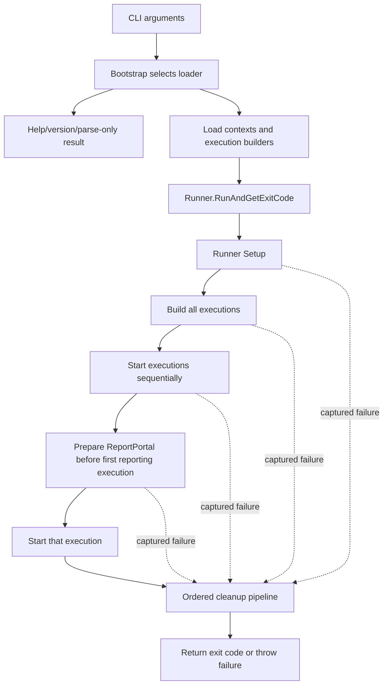
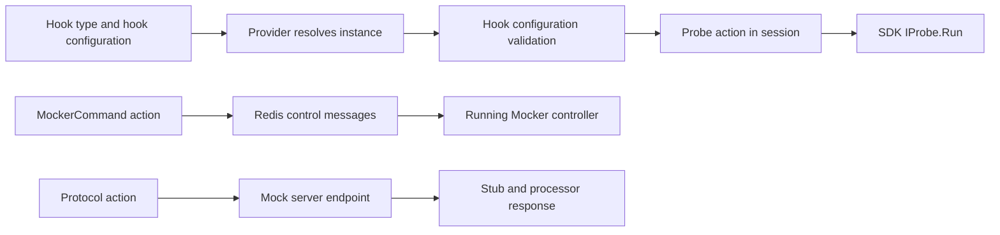
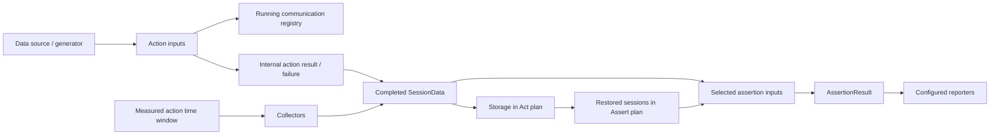

# General flow: Runner execution

This module follows a configuration from CLI bootstrap to disposed execution scopes. Allow **7 hours**, including the exercises. You should already have run a small QaaS scenario and written a small hook. The contributor's next job is to understand which component owns a behavior, when its inputs become available, and how failure changes the remaining work.

Read the published [QaaS documentation](https://docs.qaas.online/) for customer-facing configuration and the [SDK overview](https://docs.qaas.online/framework/projects/sdk/) for hook and data contracts. For a deeper explanation of the feature implementations developed throughout this lifecycle, follow the [general-flow implementation guide](../examples/general-flow/README.md).

## Study route

Follow the lifecycle in order, tracing one small configuration through each boundary before adding a new behavior.

| Work | Time | Deliverable |
|---|---:|---|
| Bootstrap, configuration, and composition | 75 minutes | Annotated configuration-to-execution trace |
| Probes, mock control, and data ownership | 60 minutes | Hook ownership and data-flow sketch |
| Session and action scheduling | 90 minutes | Predicted and observed event timeline |
| Assertions, collectors, and reports | 60 minutes | Failure/outcome matrix |
| Cleanup and failure-path investigation | 75 minutes | Resource-ownership table and regression proposal |
| Explain the entire lifecycle to another contributor | 60 minutes | Short walkthrough with source evidence |

## 1. Initialization: three different lifetimes

A **Runner invocation** owns a list of execution builders and a runner-level scope. An **Execution** owns a chosen execution plan and an execution scope. A **Session** owns a group of staged actions and optional collectors. A session is neither an operating-system process nor the whole test run. Several sessions may overlap within one execution, while the top-level Runner starts its executions sequentially.

Start at [`Bootstrap.GetRunner`](https://github.com/TheSmokeTeam/QaaS.Runner/blob/7c3af33b093b500b0dc7fdcd2cffe2bb7f60c8ba/QaaS.Runner/Bootstrap.cs). It parses arguments and chooses loaders for `run`, `act`, `assert`, `template`, or an execution sequence. Help, version, and parse-only outcomes can return a Runner with a bootstrap-handled exit code. Receiving a Runner object does not establish that any execution was built.

[`RunAndGetExitCode`](https://github.com/TheSmokeTeam/QaaS.Runner/blob/7c3af33b093b500b0dc7fdcd2cffe2bb7f60c8ba/QaaS.Runner/Runner.cs) is the useful entry point for a host that needs the result without asking Runner to apply process-exit policy. `Run()` calls it and then handles process completion. An exception can still escape `RunAndGetExitCode`; its name does not mean every failure becomes an integer.



The phase order is explicit in [`ExecuteLifecycle`](https://github.com/TheSmokeTeam/QaaS.Runner/blob/7c3af33b093b500b0dc7fdcd2cffe2bb7f60c8ba/QaaS.Runner/Runner.cs). `Setup` optionally cleans the results directory. In this revision, `StartExecutions` calls `PrepareReportPortal` before each execution. That helper validates pending reporters and starts optional terminal capture **only when the first execution containing a ReportPortal reporter is about to start**; it then clears the pending list. Earlier non-reporting executions can therefore run before validation/capture. All executions have already been built. This differs from the older implementation that had a separate validation lifecycle phase before any execution started.

`Setup` and `Teardown` are protected virtual Runner extension points. They are distinct from YAML-configured SDK probes. Changing one changes runner-level orchestration; adding a probe adds a domain action to a session.

### Hosting Runner and measuring its lifetime

These lifetime boundaries matter when embedding Runner in a CI worker that records total elapsed time while retaining QaaS's exit code and exception semantics. Use the existing public bootstrap and integer-returning entry point; avoid taking process-exit ownership through `Run()` inside a service:

```csharp
var stopwatch = System.Diagnostics.Stopwatch.StartNew();
try
{
    var runner = QaaS.Runner.Bootstrap.New(args);
    return runner.RunAndGetExitCode();
}
finally
{
    stopwatch.Stop();
    Console.Error.WriteLine($"QaaS host elapsed: {stopwatch.Elapsed}");
}
```

This is a `Program.cs` top-level host fragment, with `args` supplied by .NET and a reference to `QaaS.Runner`. The `finally` includes bootstrap failures and propagated cleanup exceptions; it does not convert either into a successful result. Source contracts: [Bootstrap.New](https://github.com/TheSmokeTeam/QaaS.Runner/blob/7c3af33b093b500b0dc7fdcd2cffe2bb7f60c8ba/QaaS.Runner/Bootstrap.cs) and [RunAndGetExitCode](https://github.com/TheSmokeTeam/QaaS.Runner/blob/7c3af33b093b500b0dc7fdcd2cffe2bb7f60c8ba/QaaS.Runner/Runner.cs). The host wrapper was source-checked, not executed against a live application here. A host integration test must cover normal return, invalid configuration, and thrown cleanup; it must verify the original exception is retained. No Mocker change is needed because this feature observes the local invocation, not remote server lifetime.

For a product-wide preflight check, `Runner.Setup` is the protected virtual extension point. Preserve `base.Setup()` when overriding it so result-directory cleanup remains intact. A preflight check should be side-effect-free or own its resources locally; it must not silently create a remote Mocker process or assume a probe is a global setup callback.

## 2. Configuration loading: build a runtime model before running it

Configuration loading turns user input into validated runtime objects and the context they share.

[`RunLoader.BuildContext`](https://github.com/TheSmokeTeam/QaaS.Runner/blob/7c3af33b093b500b0dc7fdcd2cffe2bb7f60c8ba/QaaS.Runner/Loaders/RunLoader.cs) supplies the logger, execution identity, configuration file, running-session registry, overwrite inputs, case, reference options, and environment-resolution setting to `ContextBuilder`. The resulting `InternalContext` carries runtime-owned state as well as the effective configuration.

Follow [`ContextBuilder.GetConfiguration`](https://github.com/TheSmokeTeam/QaaS.Framework/blob/11f3ec66126cf878dc34c4fab8c152ced521f3ea/QaaS.Framework.SDK/ContextObjects/ContextBuilder.cs) rather than treating YAML as a single deserialization call:

1. Add the base YAML, configured overwrite files, and files from overwrite folders.
2. In the normal branch, add the case before command-line overrides, reference resolution, and the enriched build.
3. With `ResolveCaseLast`, build and resolve the earlier configuration first, then add the case before the enriched build.
4. Construct the internal context with configuration, identity, logger, and running-session state.

The case-last option changes precedence and resolution timing. A change to a merge helper can therefore alter runtime behavior even when every individual YAML document remains valid. Do not describe environment resolution as an unconditional last overwrite layer: it participates in the configured resolution operations.

Next read [`ExecutionBuilder.Build`](https://github.com/TheSmokeTeam/QaaS.Runner/blob/7c3af33b093b500b0dc7fdcd2cffe2bb7f60c8ba/QaaS.Runner/ExecutionBuilder.cs). It initializes context, establishes scope dependencies, filters and validates configured sections, and materializes runtime components. Its construction order is data sources, sessions, storages, assertions, then reporters. It resolves the logic objects and transfers the scope into the returned `Execution`.

Construction order and execution order are separate contracts. Building a storage object does not mean every CLI verb uses storage. Constructing a data source does not necessarily enumerate its generator. `DataSourceLogic` registers sources in execution data; [`DataSource.Retrieve`](https://github.com/TheSmokeTeam/QaaS.Framework/blob/11f3ec66126cf878dc34c4fab8c152ced521f3ea/QaaS.Framework.SDK/DataSourceObjects/DataSource.cs) determines generation, lazy enumeration, and cached materialization behavior when data is requested.

The builder disposes its scope when construction inside its protected `try` fails. Context initialization and scope creation precede that `try`; do not expand this into a guarantee covering every possible allocation failure.

**Exercise — configuration trace.** Pick one existing working scenario. Find where one overridden value enters `RootConfiguration`, where its builder property is populated, and where the runtime object consumes it. Repeat with a case override and `ResolveCasesLast`. Produce a four-column table: input, resolved value, owning builder, runtime reader. Explain which validation belongs to generic configuration processing, the execution builder, and the hook itself. Do not change shared configuration-resolution code merely to make one scenario pass.

### Generating deterministic order batches

Suppose a team wants predictable order IDs and bounded batches for regression replay. This is an external generator hook; it does not require a new Runner action or a Framework factory entry. The implementation below makes those constraints explicit in the configuration and generation logic. Put the declarations in a normal class library referencing the compatible `QaaS.Framework.SDK` package, and use the `ContributorExamples` namespace. The imports shown here also support the probe, assertion, and evidence helper later in this guide.

```csharp
using System.Collections.Immutable;
using System.ComponentModel.DataAnnotations;
using Microsoft.Extensions.Logging;
using QaaS.Framework.SDK.DataSourceObjects;
using QaaS.Framework.SDK.Hooks.Generator;
using QaaS.Framework.SDK.Hooks.Probe;
using QaaS.Framework.SDK.Hooks.Assertion;
using QaaS.Framework.SDK.Session.DataObjects;
using QaaS.Framework.SDK.Session.SessionDataObjects;

namespace ContributorExamples;

public sealed record OrderBatchConfig
{
    [Range(1, 1000)] public int Count { get; set; } = 3;
    [Required] public string Prefix { get; set; } = "order";
}

public sealed record OrderRequest(string Id, int Quantity);

public sealed class OrderBatchGenerator : BaseGenerator<OrderBatchConfig>
{
    public override IEnumerable<Data<object>> Generate(
        IImmutableList<SessionData> sessions, IImmutableList<DataSource> sources)
    {
        var count = Configuration.Count;
        var prefix = Configuration.Prefix;
        for (var i = 0; i < count; i++)
            yield return new Data<object> { Body = new OrderRequest($"{prefix}-{i:D4}", i + 1) };
    }
}
```

The exact override comes from [BaseGenerator<TConfiguration>](https://github.com/TheSmokeTeam/QaaS.Framework/blob/11f3ec66126cf878dc34c4fab8c152ced521f3ea/QaaS.Framework.SDK/Hooks/Generator/BaseGenerator.cs); the returned envelope is [Data<T>](https://github.com/TheSmokeTeam/QaaS.Framework/blob/11f3ec66126cf878dc34c4fab8c152ced521f3ea/QaaS.Framework.SDK/Session/DataObjects/Data.cs). The loop counter belongs to each enumeration. There is no shared static sequence or mutable object reused for every message. `Configuration` is read into locals at enumeration start; callers must still finish configuration before concurrent use. This produces repeatable IDs, not globally unique business IDs. Give each scenario an appropriate prefix when it must avoid collisions in a persistent system.

Merge this fragment into a working scenario:

```yaml
DataSources:
  - Name: orders
    Generator: ContributorExamples.OrderBatchGenerator
    Lazy: false
    GeneratorConfiguration:
      Count: 3
      Prefix: checkout
```

`Name` identifies the source instance; `Generator` selects the CLR hook; `GeneratorConfiguration` binds to `OrderBatchConfig`. These names are checked against [DataSourceBuilder](https://github.com/TheSmokeTeam/QaaS.Framework/blob/11f3ec66126cf878dc34c4fab8c152ced521f3ea/QaaS.Framework.SDK/DataSourceObjects/DataSourceBuilder.cs). Package/reference the hook library so its DLL and dependencies reach the Runner application's output directory. Leave action protocol serialization in the consuming action unless you intentionally want the data source itself to yield serialized bytes. Adding a `Serialize` configuration here changes `Body` from an `OrderRequest` object to bytes; that is not interchangeable with arbitrary action serializer settings.

Important observed detail: the current [custom binder](https://github.com/TheSmokeTeam/QaaS.Framework/blob/11f3ec66126cf878dc34c4fab8c152ced521f3ea/QaaS.Framework.Configurations/ConfigurationUtils.cs) **logs and skips unknown properties**, even when the base generator sets `ErrorOnUnknownConfiguration=true`. A misspelled `Counnt` can leave `Count=3`; it is not automatically rejected. `[Range]` rejects an actually bound zero count; `[Required]` rejects a blank prefix. The base generator returns an empty validation-results list on success at this revision. Do not infer different behavior from a generic Microsoft binder description or an older repository manual.

Checks run against the real SDK/Providers: valid binding, zero count, blank prefix, unknown-field behavior, exact IDs, repeat enumeration, eight concurrent enumerations, and provider discovery with injected context. The YAML fragment's keys were source-checked; the complete application's YAML-to-network path was not executed by that hook harness.

## 3. Probe and Mocker integration: discovery, composition, then actions

Hooks enter through framework providers. [`HookProvider`](https://github.com/TheSmokeTeam/QaaS.Framework/blob/11f3ec66126cf878dc34c4fab8c152ced521f3ea/QaaS.Framework.Providers/Providers/HookProvider.cs) discovers supported hook types from assemblies, resolves names, and creates instances. [`HooksFromProvidersLoader.LoadAndValidate`](https://github.com/TheSmokeTeam/QaaS.Framework/blob/11f3ec66126cf878dc34c4fab8c152ced521f3ea/QaaS.Framework.Providers/HooksFromProvidersLoader.cs) then calls each selected hook's configuration loader/validator and collects validation results. A configuration instance name and a CLR hook type selector have different jobs; follow both through `HookData` when diagnosing an unresolved hook.

The execution builder composes these instances into runtime objects. For a probe, the runtime action invokes the SDK hook's `Run` method with snapshots of completed session data and selected data sources. [`Probe.Act`](https://github.com/TheSmokeTeam/QaaS.Runner/blob/7c3af33b093b500b0dc7fdcd2cffe2bb7f60c8ba/QaaS.Runner.Sessions/Actions/Probes/Probe.cs) enters a probe execution scope and returns empty communication data. This is why a probe can perform domain setup or inspection without behaving like a transaction that records a request/response pair.

A probe runs at its configured action stage. It is not an automatic global “before test” callback, and placing it in an earlier action stage does not by itself prove it finishes before later-stage actions start. The scheduling details in the next section matter for setup probes.

Mocker control is a different boundary. [`MockerCommand.Command`](https://github.com/TheSmokeTeam/QaaS.Runner/blob/7c3af33b093b500b0dc7fdcd2cffe2bb7f60c8ba/QaaS.Runner.Sessions/Actions/MockerCommands/MockerCommand.cs) discovers running Mocker instances through Redis and sends control requests. No matching instance and unsuccessful command responses have explicit failure paths. This code is not an implicit Mocker-process launcher. Arrange the required Mocker service and its control infrastructure before using the action; inspect its configured target selection and response handling when a command appears ineffective.



The Mocker side owns its own server task and optional controller task; see [`Mocker.Execution.Run`](https://github.com/TheSmokeTeam/QaaS.Mocker/blob/0407e6b038b3ada1f48ed837bc6fd7b3022e0299/QaaS.Mocker/Execution.cs). Its execution `Dispose` is empty at this revision, another reason to avoid inferring remote shutdown from a disposal call.

The lower paths describe control traffic and application traffic separately. A healthy mock endpoint does not prove Redis control works. A successful control request does not prove the application sends requests to the intended mock endpoint.

**Exercise — hook ownership.** Trace one small custom probe from its YAML type selector to `ProbeHook.Run`. Record which object owns its configuration, which context API it receives, and what data is available at invocation. Then trace a Mocker command without assuming the Runner owns the remote server lifetime. Explain where you would add a new domain hook versus where a transport change belongs.

### Observing evidence at a diagnostic checkpoint

A useful probe can report what completed evidence is visible at an orchestration checkpoint without forcing lazy sources to generate data. Compile it in the same hook library as the generator:

```csharp
public sealed record SnapshotProbeConfig
{
    [Required] public string Label { get; set; } = "checkpoint";
}

public sealed class SnapshotProbe : BaseProbe<SnapshotProbeConfig>
{
    public override void Run(IImmutableList<SessionData> sessions,
        IImmutableList<DataSource> sources)
    {
        Context.Logger.LogInformation(
            "{Label}: {CompletedSessions} completed sessions; {Sources} selected sources",
            Configuration.Label, sessions.Count, sources.Count);
    }
}
```

The method signature and binding behavior come from [BaseProbe](https://github.com/TheSmokeTeam/QaaS.Framework/blob/11f3ec66126cf878dc34c4fab8c152ced521f3ea/QaaS.Framework.SDK/Hooks/Probe/BaseProbe.cs). The configuration below uses the fields on [ProbeBuilder](https://github.com/TheSmokeTeam/QaaS.Runner/blob/7c3af33b093b500b0dc7fdcd2cffe2bb7f60c8ba/QaaS.Runner.Sessions/Actions/Probes/ProbeBuilder.cs):

```yaml
Sessions:
  - Name: inspect-checkpoint
    Stage: 1
    Probes:
      - Name: log-visible-evidence
        Probe: ContributorExamples.SnapshotProbe
        ProbeConfiguration:
          Label: before-checkout
        DataSourceNames: [orders]
```

`SnapshotProbe.Run` receives source descriptors and completed session snapshots. Logging `sources.Count` does not call `Retrieve`, so it cannot accidentally exhaust or regenerate a lazy source. This probe is observational: it neither proves a remote service is healthy nor creates a synchronization barrier. Its configuration and invocation were compiled and exercised in the harness. Deploy it using the same discovery mechanism as a generator; no Runner or Mocker core edit is needed.

If the desired feature is instead “switch a running Mocker to a fault response,” keep that as a `MockerCommands` action targeting an already running controller and an already defined replacement stub. Adding a probe that sends ad-hoc Redis keys would duplicate the existing control contract. Check command DTOs and server support before implementing a new command; switching an HTTP response processor and adding a new wire command have different ownership and release implications.

## 4. Execution loop: distinguish three scheduling levels

An execution plan chooses the phases to run; session and action scheduling decide how work overlaps within those phases.

[`Execution.ExecutionPlans`](https://github.com/TheSmokeTeam/QaaS.Runner/blob/7c3af33b093b500b0dc7fdcd2cffe2bb7f60c8ba/QaaS.Runner/Execution.cs) is the authoritative pipeline table:

| Execution type | Logic order | Normal result calculation |
|---|---|---|
| Run | Data sources → sessions → assertions → reports | All assertion results must be Passed |
| Act | Data sources → sessions → storage | Zero after successful pipeline completion |
| Assert | Data sources → storage → assertions → reports | All assertion results must be Passed |
| Template | Template logic | Zero after successful pipeline completion |

In `Act`, storage persists session data; in `Assert`, storage retrieves it. `Run` does not include `StorageLogic`. Keep that distinction when investigating a missing persisted file. A zero `Act` code does not mean assertions passed: assertions were not executed by that plan.

At the outer level, [`Runner.StartExecutions`](https://github.com/TheSmokeTeam/QaaS.Runner/blob/7c3af33b093b500b0dc7fdcd2cffe2bb7f60c8ba/QaaS.Runner/Runner.cs) loops through executions sequentially, prepares ReportPortal when applicable, and adds each `execution.Start()` result. A normal failure result allows enumeration to continue; a thrown exception interrupts it. Builders share one per-run mutable global dictionary, explicitly assigned in `BuildExecutions`; it is not an independent dictionary per execution.

At the session level, [`SessionLogic.Run`](https://github.com/TheSmokeTeam/QaaS.Runner/blob/7c3af33b093b500b0dc7fdcd2cffe2bb7f60c8ba/QaaS.Runner/Logics/SessionLogic.cs) orders numeric session-stage buckets. Before launching a bucket, it materializes deferred sessions whose target stage has arrived. It then launches that bucket's sessions and materializes its immediate results. Remaining deferred sessions are drained at the end. `RunUntilStage` postpones waiting and publication of a result; it does not postpone the initial launch until that stage. Completed-session visibility therefore differs from live running-session visibility.

Inside a session, [`Session.RunAsync`](https://github.com/TheSmokeTeam/QaaS.Runner/blob/7c3af33b093b500b0dc7fdcd2cffe2bb7f60c8ba/QaaS.Runner.Sessions/Session/Session.cs) initializes running-session state and prepares actions, launches action stages in numeric order, then awaits the combined action-task set. The easily missed detail is [`Stage.RunAsync`](https://github.com/TheSmokeTeam/QaaS.Runner/blob/7c3af33b093b500b0dc7fdcd2cffe2bb7f60c8ba/QaaS.Runner.Sessions/Session/Stage.cs): it returns launched tasks after its configured delays. Its `WhenAll` is used for a completion-log continuation; it is not awaited as a barrier before returning.

```text
One session, with two action stages:

stage 0 launch:  action A [-------------------------]
                action B [--------]
stage 1 launch:       action C [-----------]
session wait:        await all A, B, C --------------|
collectors:                                           [------]
SessionData:                                                  publish

Horizontal lengths are illustrative, not timing guarantees.
Stage numbers order launch; this implementation permits overlap.
```

[`CreateTaskFromAction`](https://github.com/TheSmokeTeam/QaaS.Runner/blob/7c3af33b093b500b0dc7fdcd2cffe2bb7f60c8ba/QaaS.Runner.Sessions/Extensions/SessionExtensions.cs) wraps `action.Act()` in `Task.Run`. Its catch records action failure and cancels corresponding live communication state rather than simply propagating every action exception as a faulted task. Consequently, “the aggregate await completed” is not equivalent to “every action succeeded.” Consult both recorded failures and assertion results.

**Exercise — scheduling experiment.** Instrument two harmless actions with start/end timestamps and use different action stages. Predict whether they overlap before running them. Then compare two sessions with immediate versus deferred result publication. Draw separate timelines for task lifetime, running registry visibility, and completed `SessionData` visibility. Propose a meaningful regression test for an ordering requirement; avoid using arbitrary sleeps as proof of a synchronization contract.

### Waiting for setup through session boundaries

Suppose fixture preparation must complete before the checkout workload starts. Use separate **session** stages with normal immediate completion, rather than assuming action stages serialize work:

```yaml
Sessions:
  - Name: prepare-fixtures
    Stage: 0
    Probes:
      - Name: inspect-setup
        Probe: ContributorExamples.SnapshotProbe
        ProbeConfiguration:
          Label: fixture-stage
  - Name: checkout-workload
    Stage: 1
    Probes:
      - Name: inspect-workload
        Probe: ContributorExamples.SnapshotProbe
        ProbeConfiguration:
          Label: workload-stage
```

This is a minimal scheduling example using the diagnostic hook above; replace the first probe with your actual fixture-preparation hook and add real actions to the second session. Omit `RunUntilStage` on the setup session. [SessionLogic.Run](https://github.com/TheSmokeTeam/QaaS.Runner/blob/7c3af33b093b500b0dc7fdcd2cffe2bb7f60c8ba/QaaS.Runner/Logics/SessionLogic.cs) materializes immediate session tasks before moving to the next session stage. This guarantees completion waiting, **not setup success**: action failures are recorded, so a dependency that requires successful setup also needs a checked outcome or an explicit core fail-fast feature. `SaveData=false` would remove the completed evidence a later check needs.

By comparison, the current [Stage.RunAsync](https://github.com/TheSmokeTeam/QaaS.Runner/blob/7c3af33b093b500b0dc7fdcd2cffe2bb7f60c8ba/QaaS.Runner.Sessions/Session/Stage.cs) creates a completion continuation without awaiting it before returning its action tasks:

```csharp
var stageCompletionTask = Task.WhenAll(stageTasks);
_ = stageCompletionTask.ContinueWith(_ =>
    {
        _context.Logger.LogDebug("Finished action stage {StageNumber} for session {SessionName}",
            _stage, _sessionName);
        _context.AppendSessionLog(_sessionName, $"Finished action stage {_stage} for session {_sessionName}");
    },
    CancellationToken.None,
    TaskContinuationOptions.ExecuteSynchronously,
    TaskScheduler.Default);
```

That excerpt is existing source, not an added barrier. An optional “await action stage completion” feature would require an explicit configuration flag, cloning/binding support, a conditional `await stageCompletionTask`, and a compatibility test proving default overlapping behavior remains. Also test cancellation and recorded action failures: `WhenAll` completing does not establish business success. The two-session recipe above was checked against scheduler source; the harness tests concurrent generator safety, not a live Runner scheduling execution.

## 5. Assertion evaluation: outcomes are computed from selected evidence

Assertions turn retained evidence into an outcome, so data selection and missing-data behavior are part of the rule.

[`AssertionLogic.Run`](https://github.com/TheSmokeTeam/QaaS.Runner/blob/7c3af33b093b500b0dc7fdcd2cffe2bb7f60c8ba/QaaS.Runner/Logics/AssertionLogic.cs) snapshots the session/source collections and evaluates assertions through `Parallel.ForEach`. Results are collected concurrently. Do not rely on configuration order as completion order. Immutable collection membership also does not make every payload and referenced object deeply immutable.

[`Assertion.Execute`](https://github.com/TheSmokeTeam/QaaS.Runner/blob/7c3af33b093b500b0dc7fdcd2cffe2bb7f60c8ba/QaaS.Runner.Assertions/AssertionObjects/Assertion.cs) removes absent session results and applies configured selection. The hook evaluates the selected sessions and data sources. An explicit hook `AssertionStatus` takes precedence over the returned Boolean; otherwise true maps to Passed and false to Failed. An exception inside the hook invocation becomes Broken. Selection and preparation occur before that protected invocation, so this is not a catch-all guarantee for every error in assertion processing.

The result also records flakiness from selected sessions' action failures. That metadata is independent of the hook's Boolean result. A selected action failure can coexist with a Passed assertion if the hook's rule still passes. Similarly, `TestDurationMs` adds assertion elapsed time to selected session durations; overlapping sessions mean it is not necessarily the suite's wall-clock duration.

[`ResolveAssertionExitCode`](https://github.com/TheSmokeTeam/QaaS.Runner/blob/7c3af33b093b500b0dc7fdcd2cffe2bb7f60c8ba/QaaS.Runner/Execution.cs) asks whether every recorded result is Passed. An empty result collection satisfies `All`, so configuration that unintentionally selects no assertions deserves explicit coverage. Do not infer useful test coverage from exit zero alone.

**Exercise — outcome matrix.** Explain these separately: Boolean false; hook exception; explicit status with Boolean true; action failure with an assertion that still passes; no assertions. For each, identify the recorded status, metadata, and execution result from source. Extend a focused test around one meaningful boundary if making a contribution.

### Rejecting missing or failed completed evidence

A useful guard assertion should reject an empty selected-session collection and recorded setup/action failures rather than returning a vacuous pass. Add the following hook beside the generator:

```csharp
public sealed record CompletedSessionConfig
{
    [Range(1, 1000)] public int ExpectedCount { get; set; } = 1;
}

public sealed class CompletedSessionAssertion : BaseAssertion<CompletedSessionConfig>
{
    public override bool Assert(IImmutableList<SessionData> sessions,
        IImmutableList<DataSource> sources)
    {
        var failureCount = sessions.Sum(session => session.SessionFailures.Count);
        var passed = sessions.Count == Configuration.ExpectedCount && failureCount == 0;
        AssertionMessage = $"Expected {Configuration.ExpectedCount} completed sessions; " +
            $"received {sessions.Count}, with {failureCount} action failures.";
        return passed;
    }
}
```

This uses [BaseAssertion](https://github.com/TheSmokeTeam/QaaS.Framework/blob/11f3ec66126cf878dc34c4fab8c152ced521f3ea/QaaS.Framework.SDK/Hooks/Assertion/BaseAssertion.cs) and [SessionData/BaseSessionData](https://github.com/TheSmokeTeam/QaaS.Framework/blob/11f3ec66126cf878dc34c4fab8c152ced521f3ea/QaaS.Framework.SDK/Session/SessionDataObjects/BaseSessionData.cs). It deliberately leaves explicit `AssertionStatus` unset, so the Boolean controls the normal result; [Assertion.Execute](https://github.com/TheSmokeTeam/QaaS.Runner/blob/7c3af33b093b500b0dc7fdcd2cffe2bb7f60c8ba/QaaS.Runner.Assertions/AssertionObjects/Assertion.cs) owns the final result mapping and exception-to-Broken behavior.

```yaml
Assertions:
  - Name: checkout-completed-cleanly
    Assertion: ContributorExamples.CompletedSessionAssertion
    SessionNames: [checkout-workload]
    AssertionConfiguration:
      ExpectedCount: 1
```

The exact assertion configuration fields are defined in [AssertionBuilder](https://github.com/TheSmokeTeam/QaaS.Runner/blob/7c3af33b093b500b0dc7fdcd2cffe2bb7f60c8ba/QaaS.Runner.Assertions/ConfigurationObjects/AssertionBuilder.cs). This guard checks presence and recorded failures, not the business response contents; pair it with an order-response assertion. With no assertion configured at all, this hook cannot help: include it in the selected plan. The harness checks missing evidence fails, one clean session passes, and a recorded action failure produces a failed Boolean with a descriptive message; selection filters and report publication still require Runner-level coverage.

## 6. Metric and log harvesting: several mechanisms at different times

There is no universal post-assertion “collect all metrics” phase in `ExecutionPlans`. Collection and reporting have different owners:

| Evidence | Owner and timing |
|---|---|
| Action input/output and failures | Produced during session work; materialized into session data |
| Live communication | Running-session registry, available while actions run |
| Collector output | Collected after ordinary session actions complete |
| Assertion result and links | Constructed during assertion evaluation |
| Reporter entries | Written by ReportLogic after assertions |
| Terminal capture / queued ReportPortal publication | Runner-level capture and cleanup publication |

[`RunPostSessionTasksAsync`](https://github.com/TheSmokeTeam/QaaS.Runner/blob/7c3af33b093b500b0dc7fdcd2cffe2bb7f60c8ba/QaaS.Runner.Sessions/Session/Session.cs) passes the session's measured start/end timestamps to collectors, launches their tasks, and awaits completion. The measured end is captured after normal action completion and before collector work. This gives collectors the action window to query rather than automatically including their own collection latency. The actual metrics/log backend and filtering depend on the configured collector protocol.

`CreateSessionData` combines action results into public session evidence. Public communication objects represent input/output directions; internal communication results support runtime materialization. `SaveData=false` returns no session result even though the session work ran. That directly affects what later assertions can select.

[`ReportLogic.Run`](https://github.com/TheSmokeTeam/QaaS.Runner/blob/7c3af33b093b500b0dc7fdcd2cffe2bb7f60c8ba/QaaS.Runner/Logics/ReportLogic.cs) filters by configured reporter type and assertion status before writing results. A missing report entry can therefore be a reporting-selection issue rather than a missing assertion execution. ReportPortal's queued results are published later, before execution scope disposal. Dashboard links are references to evidence; they are not proof that a collector fetched that evidence into `SessionData`.



### Summarizing evidence without logging payloads

For debugging an unexpectedly empty report, count saved input/output messages per completed session without logging their potentially large bodies. This helper works over SDK evidence and can be called from an assertion or observational hook:

```csharp
public static class EvidenceSummary
{
    public static string[] Summarize(IImmutableList<SessionData> sessions) =>
        sessions.Select(session =>
            $"{session.Name}: inputs={session.Inputs?.Sum(x => x.Data.Count) ?? 0}, " +
            $"outputs={session.Outputs?.Sum(x => x.Data.Count) ?? 0}, " +
            $"failures={session.SessionFailures.Count}").ToArray();
}
```

The shape is verified against [GenericSessionData](https://github.com/TheSmokeTeam/QaaS.Framework/blob/11f3ec66126cf878dc34c4fab8c152ced521f3ea/QaaS.Framework.SDK/Session/SessionDataObjects/GenericSessionData.cs) and [CommunicationData](https://github.com/TheSmokeTeam/QaaS.Framework/blob/11f3ec66126cf878dc34c4fab8c152ced521f3ea/QaaS.Framework.SDK/Session/CommunicationDataObjects/CommunicationData.cs). The count is the number of saved `DetailedData` envelopes, not necessarily the number of bytes sent or attempted network operations. Null input/output collections produce zero. A zero output count can be legitimate for an input-only action or a non-saving configuration; it is not itself proof of a failed transport.

The helper compiled and its empty-collection behavior was executed. To turn it into a new report format, implement the Runner reporting contract and wire its configured selection into reporter construction/routing; do not write report files inside a protocol implementation. If the feature instead needs external metrics, use a collector so its query receives the measured action window. Those are separate features with different timing and dependencies, and neither requires changing this SDK summary helper.

## 7. Cleanup and teardown: inspect the precise failure boundary

Session cleanup and Runner cleanup are separate. `Session.RunAsync` uses `finally` to dispose its task collection and configured actions/collectors and remove its running-session entry. Its optional after-session delay and returned result follow the `finally`; they are not executed after an exception that propagates out of the protected session work. The disposal helper attempts individual items and logs failures, so its behavior differs from the Runner's execution-disposal loop.

[`RunCleanupSteps`](https://github.com/TheSmokeTeam/QaaS.Runner/blob/7c3af33b093b500b0dc7fdcd2cffe2bb7f60c8ba/QaaS.Runner/Runner.cs) establishes this order:

1. Stop terminal capture and publish queued ReportPortal results; dispose capture in the publication helper's `finally`.
2. Dispose the built executions, releasing their owned scopes.
3. Call Runner `Teardown`, which can dispose the Serilog logger and serve results when configured.
4. Dispose Runner-level resources.

Each cleanup **step** is caught separately and remaining steps are attempted. However, [`DisposeExecutions`](https://github.com/TheSmokeTeam/QaaS.Runner/blob/7c3af33b093b500b0dc7fdcd2cffe2bb7f60c8ba/QaaS.Runner/Runner.cs) loops without a separate catch around each execution. One throwing disposal can skip later executions in that loop while teardown and runner disposal still proceed. “Cleanup continues” must name the level at which continuation is guaranteed.

[`CompleteRun`](https://github.com/TheSmokeTeam/QaaS.Runner/blob/7c3af33b093b500b0dc7fdcd2cffe2bb7f60c8ba/QaaS.Runner/Runner.cs) combines lifecycle outcomes with cleanup failures. `InvalidConfigurationsException` has a dedicated failure-code path. Other captured lifecycle exceptions are rethrown when cleanup succeeds; combined failures can become `AggregateException`. Cleanup failures can therefore replace a normal integer-return path with an exception.

Two ownership caveats deserve attention when reviewing changes:

- The terminal capture begins inside `PrepareReportPortal`, after bootstrap/loading/building and possibly after earlier non-reporting executions. The explicit cleanup pipeline is not a universal `finally` around everything that occurred since process launch.
- `BuildExecutions` materializes a LINQ projection into a list before assigning that list into lifecycle state. If a later builder fails, earlier successful executions are not automatically preserved in that outcome list. The failing builder's local cleanup does not establish that every earlier built scope was released. Verify ownership explicitly before claiming complete partial-build cleanup.

These are code-reading boundaries, not claims that a failure has been reproduced in a deployment. They identify where a contributor should add evidence before changing resource handling.

**Exercise — failure-path review.** Create an ownership table for Runner scope, execution scope, action, terminal capture, and remote Mocker service. For each, record creation, normal release, failure release, and whether the owner can outlive the current method. Select one failure injection—second builder fails, one execution disposal throws, or a publication step throws—and specify the expected remaining operations. Write the regression-test design before the fix. Do not assume disposing a local Mocker command stops the remote service.

### Continuing cleanup after an execution disposal fails

A concrete core improvement is to release later executions even if one execution throws during disposal. The current `DisposeExecutions` loop stops at the first exception. This is the proposed replacement **method body**, not shipped behavior:

```csharp
var failures = new List<Exception>();
foreach (var execution in executions ?? Enumerable.Empty<Execution>())
{
    try { execution.Dispose(); }
    catch (Exception error) { failures.Add(error); }
}
if (failures.Count != 0)
    throw new AggregateException("Execution disposal failed", failures);
```

Apply it inside [Runner.DisposeExecutions](https://github.com/TheSmokeTeam/QaaS.Runner/blob/7c3af33b093b500b0dc7fdcd2cffe2bb7f60c8ba/QaaS.Runner/Runner.cs), retaining the current diagnostic logging if desired. The caller already runs disposal as one guarded cleanup step and collects its exception. This proposal preserves an observable failure while allowing subsequent executions to release resources; it does not swallow errors, and it does not fix earlier successful scopes lost when a later builder fails before the execution list is assigned.

The disposal-loop algorithm was compiled as a standalone `IEnumerable<IDisposable>` helper and exercised with three resources: first and third throw, second succeeds. All three were visited in order and both errors were retained. That validates the algorithm, **not an integrated Runner patch**. Before merging, add a Runner regression using controlled execution scopes and verify later teardown/disposal steps still run, normal exit remains unchanged, and combined lifecycle/cleanup exceptions preserve their causes. Mocker is unaffected because remote service lifetime is not owned by this local disposal loop.

## Contributor completion check

Complete the lifecycle study by explaining which behaviors have direct execution evidence and which still need integration coverage.

The generator, probe, assertion, summary, and disposal algorithm shown in this guide were compiled against the pinned Framework SDK and Providers projects with .NET 10. The focused executable harness passed **18 checks**, including actual provider discovery, configuration binding and validation, repeated/concurrent generator enumeration, evidence handling, and continued cleanup after exceptions. These checks do not claim a full Runner/Mocker integration run: the host wrapper and YAML/scheduling recipes were source-checked, and the disposal change remains a proposed core patch. Use those boundaries when deciding which tests a real contribution still needs.

Explain one scenario from configuration to report in ten minutes with the source open. Your explanation should distinguish build order from execution order, session stages from action stages, live data from completed evidence, assertion status from action failure, and session cleanup from Runner cleanup. Then propose one small contribution with an explicit owner, input/output contract, failure behavior, and regression case. If any claim relies only on a class name or an architecture diagram, follow its actual call site before including it in a PR.
