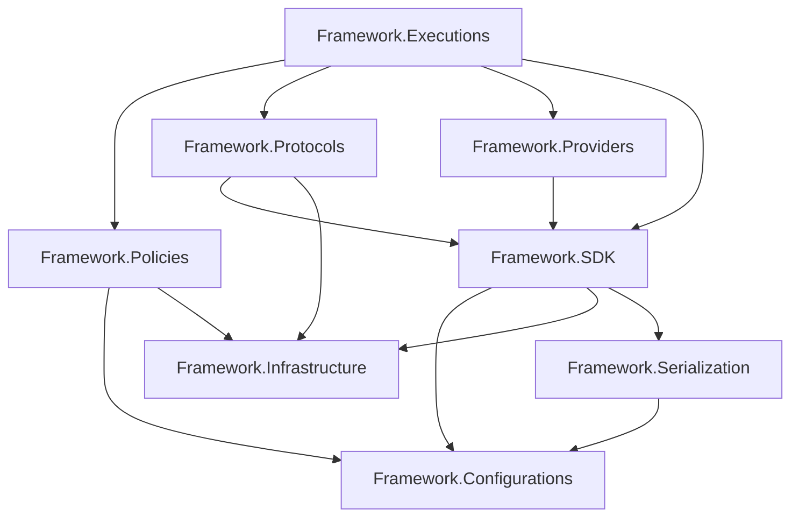
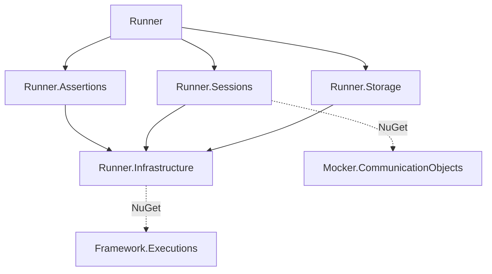
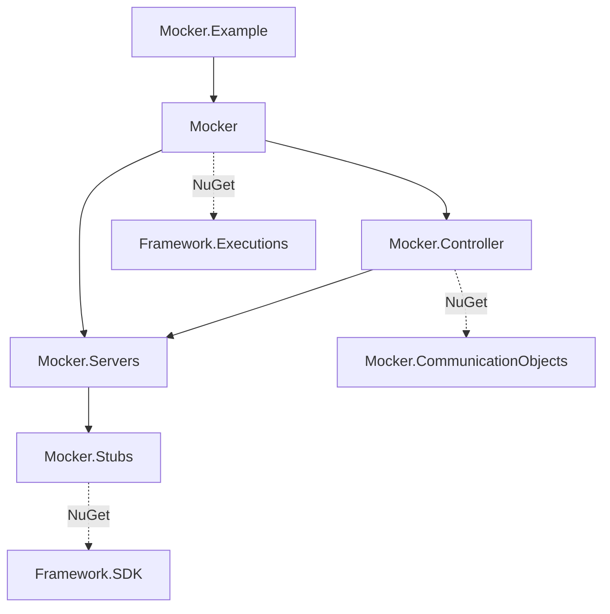

# Solution and project structure

This chapter explains where QaaS behavior belongs and how a change crosses project boundaries. Follow the sender and maintenance-response examples as concrete applications of those boundaries.

Budget **4 hours**, including the exercises. Start after [conventions and guidelines](../02-standards/conventions-and-guidelines.md), then continue to the [Runner lifecycle](../01-general-flow/runner-execution-flow.md); return to the [study plan](../README.md) whenever you need the wider sequence. Your deliverable is an annotated dependency map and a short placement decision for a proposed contribution.

## Read names at the right level

A Git repository is a version-control and release boundary. A solution (`.sln`) groups projects for development and build operations. A project (`.csproj`) defines compilation, target framework, direct project references and package dependencies. A namespace groups C# names; it does not prove which assembly owns a type. A NuGet package is a versioned consumption boundary. These are related, but they are not interchangeable.

For example, the **QaaS.Framework repository** contains **QaaS.Framework.sln** and several assemblies; **QaaS.Framework.SDK** is one project and package inside it. There is no single SDK project that contains the entire framework. The inspected projects target `net10.0`. “Modern .NET” is the useful runtime description here; `.Core` is not a target-framework suffix.

The [live documentation](https://docs.qaas.online/) supplies the customer view: Runner tests, Mocker services, hooks and Framework capabilities. For contributor ownership and dependencies, start from the project files linked below. A descriptive document can outlive a renamed or deleted project.

| Name or suffix | Meaning in this checkout | Put here | Do not assume |
| --- | --- | --- | --- |
| `.Core` | A conceptual name sometimes used for foundational code; **no production project with this suffix exists in the four solutions mapped here** | Discuss the actual owner: SDK, Configurations, Infrastructure, or Executions | Do not create or cite `QaaS.Core` or `QaaS.Framework.Core` as an existing project |
| `.Framework` | Repository/product family containing reusable configuration, contracts, transport support and execution scaffolding | Behavior that multiple hosts genuinely need | The entire family is dependency-free, or all its projects are contracts |
| `.Runner` | Host/orchestrator and a family of execution-specific projects | Runner lifecycle, sessions/actions, assertion orchestration and stored results | Every assertion implementation belongs in the Runner repository |
| `.Mocker` | Host and server/stub/controller project family | Mock service lifecycle, request handling and control | Runner must reference the whole Mocker host to control it |
| `.Probes` | `QaaS.Common.Probes`, a concrete hook package; also a folder/concept inside Runner and SDK | Reusable probe implementations in Common.Probes; scheduling in Runner; contract in SDK | All three occurrences are one assembly or responsibility |
| `.SDK` | `QaaS.Framework.SDK`, shared developer contracts and supporting objects | Hook interfaces/base classes, contexts, data-source and session-facing types | SDK means “interfaces only” or “no dependencies” |
| `.Tests` | Companion verification projects, commonly NUnit with Moq where needed | Behavioral regression tests at the owning boundary | Every project containing “Tests” is a unit-test assembly; Runner.E2ETests is an executable harness |

## The Framework is several layers, not one core assembly

Framework divides reusable capabilities into separately compiled projects. This limits which parts of the ecosystem a change must depend on.

Arrows below mean **the project at the tail directly references the project at the head**. They do not mean runtime call order. This graph includes all direct production `ProjectReference` edges in the Framework solution; package dependencies are discussed separately.



| Project | Responsibility to inspect first | Direct in-solution dependencies |
| --- | --- | --- |
| Configurations | Binding, validation and configuration-related helpers | None |
| Infrastructure | Shared supporting utilities | None |
| Serialization | Serialization-related abstractions and implementations | Configurations |
| SDK | Hooks, contexts and shared developer-facing data/building objects | Configurations, Infrastructure, Serialization |
| Policies | Rate/stop/load behavior used by execution | Configurations, Infrastructure |
| Protocols | Protocol interfaces and implementations | Infrastructure, SDK |
| Providers | Hook discovery/resolution infrastructure | SDK |
| Executions | Shared execution building/loading scaffolding | Policies, Protocols, Providers, SDK |

“None” means no **ProjectReference**, not no third-party libraries, no side effects, or a promise of purity. Executions also consumes the separate `QaaS.Configuration` package. SDK has logging/configuration packages as well as its three project references. A change to SDK can therefore affect both consumer API compatibility and transitive package resolution.

Read the [SDK project][sdk-project], [Executions project][executions-project], and [Framework solution][framework-solution] together. The actual `BaseExecutionBuilder` belongs to [Framework.Executions][base-builder]. Runner and Mocker have their own `ExecutionBuilder` types; a shared simple name does not imply the same class or namespace. Follow the declaration and assembly when navigating an IDE.

## Runner ownership and dependency direction

Runner composes actions, assertions and storage while keeping their implementation in separate projects. A transport change reaches its session builders; a new domain hook usually does not.



Runner composes the feature projects. Sessions owns the session/action machinery; Assertions owns assertion configuration/execution support; Storage owns storage behavior. Infrastructure supplies shared Runner facilities and directly consumes Framework.Executions as a package. It is therefore **not** a dependency-free leaf in the ecosystem, even though it has no in-solution ProjectReference.

The Sessions package reference to `QaaS.Mocker.CommunicationObjects` is significant: a communication contract can connect Runner and Mocker without making Runner depend on all server implementations. Do not turn a need for one message type into a dependency on the whole Mocker host. Conversely, do not assume a package called “Infrastructure” is suitable for every convenient helper. Putting a feature there expands the dependency surface for Assertions, Sessions and Storage.

Evidence: [Runner composition][runner-project], [Runner.Infrastructure][runner-infrastructure], [Runner.Sessions][runner-sessions]. For behavior inside those boundaries, use the [runtime chapter](../01-general-flow/runner-execution-flow.md).

## Mocker ownership and dependency direction

Mocker separates hosting, response processing and runtime control. Choose the layer that owns the new behavior before adding dependencies.



Stubs owns the response behavior layer; Servers owns the hosting/request-handling layer over stubs. Controller coordinates runtime control over servers, and the Mocker host composes them. `Mocker.Example` demonstrates consumption and references the host; it is not the foundational dependency of production code. The host itself directly consumes Framework.Executions, while Stubs directly consumes SDK.

A contributor adding a protocol-specific server should first determine whether the change belongs to Servers and its configuration/builder paths. A reusable custom response processor belongs at the hook boundary when the existing contract can express it. The goal is to place a change where its behavior is owned, rather than in whichever project makes compilation easiest.

Evidence: [Mocker project][mocker-project], [Controller project][controller-project], [Servers project][servers-project], [Stubs project][stubs-project], and [Mocker solution][mocker-solution].

## Probe contracts, scheduling and implementation

A probe spans three responsibilities: an SDK contract, Runner scheduling and the hook’s actual operation. Keeping those responsibilities separate lets a new operation reuse the existing execution machinery.

Trace this separation before adding a new probe:

1. **SDK contract:** [IProbe][iprobe] inherits `IHook` and declares `Run(IImmutableList<SessionData>, IImmutableList<DataSource>)`. Its signature establishes the data available to an implementation; it does not schedule a Runner session.
2. **SDK convenience base:** [BaseProbe<TConfiguration>][base-probe] supplies context/configuration properties, binding and recursive validation. Its base class requests strict binder options; verify the effective binding path rather than inferring behavior from that flag alone. The updated general-flow examples demonstrate the current custom binder logging and skipping unknown fields. The derived implementation supplies `Run`.
3. **Runner scheduling:** [ProbeBuilder][probe-builder] and [Probe][probe-action] live in Runner.Sessions. Read these when the problem concerns constructing/running a probe as an action, rather than the external system operation itself.
4. **Concrete reusable behavior:** [Common.Probes][probes-project] packages implementations. It directly consumes Framework.Configurations, Protocols, SDK and Serialization. It does not reference the Runner project.

This is why a new reusable probe normally need not modify Runner. A missing protocol implementation or an incompatible SDK contract is different: it changes a shared dependency and may require coordinated downstream package updates. Use the [publishing chapter](../04-devops/cicd-and-package-publishing.md) before treating a local build as proof that separately versioned consumers work.

## Extending a protocol through Framework and Runner

A new sender must connect transport behavior to configuration, construction and validation. A JSON-lines file sink makes those responsibilities visible without needing a broker.

Suppose a team needs to inspect generated messages in a local `.ndjson` file during a bounded test. The implementation below adds that capability through the real sender contract and Runner selection paths. It is a proposed extension, not an already shipped protocol. The [detailed sender walkthrough](../examples/protocol-extension/README.md) explains the design decisions, failure paths and test boundaries behind each step.

### 1. Choose the contract before choosing the class name

The actual [ISender declaration](https://github.com/TheSmokeTeam/QaaS.Framework/blob/11f3ec66126cf878dc34c4fab8c152ced521f3ea/QaaS.Framework.Protocols/Protocols/ISender.cs) is:

```csharp
public interface ISender : IConnectable
{
    public SerializationType? GetSerializationType();
    public DetailedData<object> Send(Data<object> dataToSend);
}
```

It has connection lifecycle methods through `IConnectable` and returns the recorded outgoing item, rather than `void`. Do not generalize that inheritance to every protocol: the current [ITransactor](https://github.com/TheSmokeTeam/QaaS.Framework/blob/11f3ec66126cf878dc34c4fab8c152ced521f3ea/QaaS.Framework.Protocols/Protocols/ITransactor.cs) has its own request/response contract and does **not** inherit `IConnectable`. Match the actual interface for the operation you need.

For a file sink, implement `ISender`, not `ITransactionProcessor`: no response is expected and there is no Mocker request to process. The [current factory](https://github.com/TheSmokeTeam/QaaS.Framework/blob/11f3ec66126cf878dc34c4fab8c152ced521f3ea/QaaS.Framework.Protocols/Protocols/Factories/SenderFactory.cs) selects on concrete `ISenderConfig` types and then checks singular/chunk capability. It does not scan hook DLLs for new YAML protocol names.

### 2. Add the configuration and implementation in Framework.Protocols

The configuration selects the destination; the sender owns lifecycle, JSON framing and writes. Reading the complete class together shows which state belongs to one publisher instance.

The implementation uses the normal .NET implicit framework imports alongside these QaaS imports:

```csharp
using System.ComponentModel;
using System.ComponentModel.DataAnnotations;
using System.Text;
using System.Text.Json;
using QaaS.Framework.Protocols.ConfigurationObjects;
using QaaS.Framework.Protocols.Protocols;
using QaaS.Framework.SDK.Session.DataObjects;
using QaaS.Framework.Serialization;

namespace QaaS.Framework.Protocols.Examples;

public sealed record JsonLinesSenderConfig : ISenderConfig
{
    [Required, Description("Local file to append one compact JSON document per line.")]
    public string FilePath { get; set; } = "";
}

// Teaching extension, not a protocol shipped by QaaS.
// Use a different file per publisher instance/execution.
public sealed class JsonLinesSender : ISender
{
    private readonly string _path;
    private readonly object _gate = new();
    private bool _connected;

    public JsonLinesSender(JsonLinesSenderConfig config)
    {
        ArgumentNullException.ThrowIfNull(config);
        ArgumentException.ThrowIfNullOrWhiteSpace(config.FilePath);
        _path = Path.GetFullPath(config.FilePath);
    }

    public SerializationType? GetSerializationType() => SerializationType.Json;

    public void Connect()
    {
        lock (_gate)
        {
            Directory.CreateDirectory(Path.GetDirectoryName(_path)!);
            _connected = true;
        }
    }

    public DetailedData<object> Send(Data<object> data)
    {
        ArgumentNullException.ThrowIfNull(data);
        lock (_gate)
        {
            if (!_connected)
                throw new InvalidOperationException("Connect before sending.");
            if (data.Body is not byte[] bytes)
                throw new ArgumentException("Configure Serialize.Serializer: Json to produce bytes.", nameof(data));

            using var document = JsonDocument.Parse(bytes);
            var line = JsonSerializer.Serialize(document.RootElement);
            // Open/close on each send: no stream survives a failed action.
            File.AppendAllText(_path, line + "\n", new UTF8Encoding(false));
            return new DetailedData<object>
            {
                Body = bytes,
                MetaData = data.MetaData,
                Timestamp = DateTime.UtcNow
            };
        }
    }

    public void Disconnect()
    {
        lock (_gate)
            _connected = false;
    }
}
```

The sender constructor rejects a blank path even when a C# caller bypasses configuration validation. `Connect` prepares the directory, and `Disconnect` prevents subsequent sends; neither retains a stream between operations.

The per-instance lock prevents two parallel calls from interleaving a record. Parsing and re-serializing guarantees a compact single-line JSON document even if the input was pretty-printed. The timestamp is assigned only after the write succeeds. Input metadata is preserved. A file error propagates; it is not converted into a false “sent” result. Each write closes its handle so a later failed Runner action cannot strand a stream owned by this example. Distinct publisher instances must use distinct files: the lock is not cross-process coordination. Rotation, disk quotas, fsync guarantees and crash-atomic writes would be separate features with separate failure tests.

`GetSerializationType()` returns `SerializationType.Json`; that describes the communication representation. It does **not** replace configuring the serializer for the outgoing data. [Publisher.Publish](https://github.com/TheSmokeTeam/QaaS.Runner/blob/7c3af33b093b500b0dc7fdcd2cffe2bb7f60c8ba/QaaS.Runner.Sessions/Actions/Publishers/Publisher.cs) sends `dataPair.Serialized` but logs the original item with the returned timestamp. That distinction matters when writing assertions over stored messages.

### 3. Register the Framework factory and all Runner builder paths

Add this arm to `SenderFactory.CreateSender`'s existing type switch; keep the existing chunk/single checks after it:

```csharp
JsonLinesSenderConfig config => new JsonLinesSender(config),
```

Use the namespace `QaaS.Framework.Protocols.Examples` from the complete implementation above. In a production contribution choose the owning namespace/folder convention and provide XML documentation. The following insertion excerpts assume that namespace is imported in each edited file.

Runner must be able to bind, select, update, clone and validate the new option. These are insertion excerpts, not complete replacements for the original methods:

```csharp
// PublisherBuilderProperties.cs
[Description("Appends compact JSON documents to a local file")]
public JsonLinesSenderConfig? JsonLines { get; internal set; }

// PublisherBuilderLogic.cs: inside Reset()
JsonLines = null;

// Inside Configure(ISenderConfig config)'s switch
case JsonLinesSenderConfig jsonLines:
    JsonLines = jsonLines;
    break;

// Inside GetConfiguration(), before the existing alternatives
if (JsonLines != null)
    return JsonLines;

// Inside BuildWithTimeZone()'s allTypes collection initializer
JsonLines,

// ProtocolChunkSupport.cs: inside SenderModes
[typeof(JsonLinesSenderConfig)] = (ProtocolChunkMode.SingleOnly, "JsonLines"),
```

Read the [properties](https://github.com/TheSmokeTeam/QaaS.Runner/blob/7c3af33b093b500b0dc7fdcd2cffe2bb7f60c8ba/QaaS.Runner.Sessions/Actions/Publishers/Builders/PublisherBuilderProperties.cs), [builder logic](https://github.com/TheSmokeTeam/QaaS.Runner/blob/7c3af33b093b500b0dc7fdcd2cffe2bb7f60c8ba/QaaS.Runner.Sessions/Actions/Publishers/Builders/PublisherBuilderLogic.cs), [validation](https://github.com/TheSmokeTeam/QaaS.Runner/blob/7c3af33b093b500b0dc7fdcd2cffe2bb7f60c8ba/QaaS.Runner.Sessions/Actions/Publishers/Builders/PublisherBuilderValidation.cs), and [chunk registry](https://github.com/TheSmokeTeam/QaaS.Runner/blob/7c3af33b093b500b0dc7fdcd2cffe2bb7f60c8ba/QaaS.Runner.Sessions/Actions/ProtocolChunkSupport.cs) together. Omitting `GetConfiguration` breaks update/validation; omitting `Reset` leaves conflicting configurations; omitting the registry causes an unsupported-protocol error before the sender factory is reached. The existing generic deep-clone path handles this scalar configuration; a clone-isolation check confirms that modifying the copy does not mutate its original.

After those additions, a publisher fragment becomes:

```yaml
Publishers:
  - Name: audit-orders
    DataSourceNames: [orders]
    JsonLines:
      FilePath: artifacts/orders.ndjson
    Serialize:
      Serializer: Json
```

This goes inside an existing session with a real `orders` data source. `JsonLines` is a **new key introduced by the exercise** and will fail on an unmodified release. Do not add `Chunk`: this sender is singular-only. For repeated or parallel executions use distinct paths. C# construction uses the same config:

```csharp
var publisher = new PublisherBuilder()
    .Named("audit-orders")
    .AddDataSource("orders")
    .Configure(new JsonLinesSenderConfig { FilePath = "artifacts/orders.ndjson" })
    .WithSerializer(new SerializeConfig { Serializer = SerializationType.Json });
```

The current Runner also exposes [session action overrides](https://github.com/TheSmokeTeam/QaaS.Runner/blob/7c3af33b093b500b0dc7fdcd2cffe2bb7f60c8ba/QaaS.Runner.Sessions/RuntimeOverrides/SessionActionOverrides.cs) for embedding/testing. An override can substitute the runtime object for an already accepted action configuration; it does not by itself teach YAML binding, configuration selection, or chunk validation a new `JsonLines` option. Do not mistake that seam for reflection-based protocol registration.

### 4. Decide whether Mocker actually needs a change

This feature sends to a file; it needs **no Mocker server change**. Adding an unused Mocker branch would couple unrelated responsibilities. A new wire transport that Mocker must receive is a different feature: implement an `IServer`, add its configuration and `ServerType`, update `ServerConfig.ResolveType`/validation and the host builder selection, and add a branch to [ServerFactory](https://github.com/TheSmokeTeam/QaaS.Mocker/blob/0407e6b038b3ada1f48ed837bc6fd7b3022e0299/QaaS.Mocker.Servers/ServerFactory.cs). The existing source makes that separate selection boundary explicit:

```csharp
return server.ResolveType() switch
{
    ServerType.Http => new HttpServer(server.Http!, _context.Logger, transactionStubList),
    ServerType.Grpc => new GrpcServer(server.Grpc!, _context.Logger, transactionStubList),
    ServerType.Socket => new SocketServer(server.Socket!, _context.Logger, transactionStubList,
        dataSourceList),
    _ => throw new ArgumentException("Server type not supported!", nameof(server))
};
```

That is an existing source excerpt, not a claim that adding one switch arm implements a server. A genuine new receiver also needs cancellation/shutdown, endpoint routing, request-to-stub conversion, response serialization, failure behavior and a client/server round-trip test. Use an existing transport plus a processor when only response behavior changes; the worked processor below demonstrates that route.

### 5. What was actually verified?

Verification of this implementation compiled the modified Framework and Runner.Sessions source and passed **19 executable checks**. These cover factory selection/rejection, sender lifecycle and malformed inputs, complete records under parallel sends, timestamp/body preservation, real Runner construction, conflict detection, chunk validation, configuration binding, cloning, update and reset. The test assembly uses the already-declared `QaaS.Runner.Sessions.Tests` friend-assembly name to exercise internal construction without making internals public.

This is stronger than compiling an isolated interface implementation, but it is not an entire test-plan execution or a released NuGet consumer test. The proposed YAML fragment is checked against the same property names; the executable exercises its configuration tree via the real binder, not the YAML file loader. Upstream dependency/compiler warnings remain visible in the build. Before shipping: add the cases to the owning test suites, exercise a complete Runner session, verify generated schema/docs, pack the Framework change, and test Runner with that local package. Follow [the release guide](../04-devops/cicd-and-package-publishing.md). Mocker and hook consumers need compatible Framework versions when affected shared contracts change; this example introduces no wire DTO or hook-contract break.


## Changing Mocker responses through a processor

Suppose a client must handle planned maintenance: HTTP `503`, a deterministic JSON error, and a configurable `Retry-After` delay. That is response behavior behind an existing HTTP server, so implement a processor hook, not another protocol. The complete example below implements the actual [BaseTransactionProcessor contract](https://github.com/TheSmokeTeam/QaaS.Framework/blob/11f3ec66126cf878dc34c4fab8c152ced521f3ea/QaaS.Framework.SDK/Hooks/Processor/BaseTransactionProcessor.cs) and uses the SDK's [HTTP metadata fields](https://github.com/TheSmokeTeam/QaaS.Framework/blob/11f3ec66126cf878dc34c4fab8c152ced521f3ea/QaaS.Framework.SDK/Session/MetaDataObjects/Http.cs). It is a proposed hook to put in your own compatible `net10.0` hook library, not an already shipped QaaS class.

```csharp
using System.Collections.Immutable;
using System.ComponentModel.DataAnnotations;
using System.Globalization;
using QaaS.Framework.SDK.DataSourceObjects;
using QaaS.Framework.SDK.Hooks.Processor;
using QaaS.Framework.SDK.Session.DataObjects;
using QaaS.Framework.SDK.Session.MetaDataObjects;

namespace Common.Shampoo;

public sealed class MaintenanceConfiguration
{
    [Range(1, 86400)] public int RetryAfterSeconds { get; set; } = 30;
    [Required] public string Message { get; set; } = "Planned maintenance";
}

public sealed record MaintenancePayload(string Code, string Message);

public sealed class MaintenanceResponse : BaseTransactionProcessor<MaintenanceConfiguration>
{
    public override Data<object> Process(IImmutableList<DataSource> dataSources,
        Data<object> requestData) => new()
    {
        Body = new MaintenancePayload("maintenance", Configuration.Message),
        MetaData = new MetaData
        {
            Http = new Http
            {
                StatusCode = 503,
                ResponseHeaders = new Dictionary<string, string>
                {
                    ["Retry-After"] = Configuration.RetryAfterSeconds.ToString(CultureInfo.InvariantCulture),
                    ["Content-Type"] = "application/json; charset=utf-8"
                }
            }
        }
    };
}
```

The method does not sleep. The header tells the client when to retry; delaying the mock response would test a different behavior. Each call creates its own metadata dictionary, preventing one request's headers from leaking into the next. Request data is left untouched. The base class binds and validates configuration before execution; the sample intentionally keeps a public parameterless constructor for the existing reflection path.

Reference the hook package/library from the Mocker host, keep its SDK version compatible with that host, and add this **Mocker configuration fragment**. The names and nesting come from [TransactionStubBuilder](https://github.com/TheSmokeTeam/QaaS.Mocker/blob/0407e6b038b3ada1f48ed837bc6fd7b3022e0299/QaaS.Mocker.Stubs/ConfigurationObjects/TransactionStubBuilder.cs), [HttpServerConfig](https://github.com/TheSmokeTeam/QaaS.Mocker/blob/0407e6b038b3ada1f48ed837bc6fd7b3022e0299/QaaS.Mocker.Servers/ConfigurationObjects/HttpServerConfigs/HttpServerConfig.cs), and the checked-in [Mocker example](https://github.com/TheSmokeTeam/QaaS.Mocker/blob/0407e6b038b3ada1f48ed837bc6fd7b3022e0299/QaaS.Mocker.Example/mocker.qaas.yaml).

```yaml
Stubs:
  - Name: maintenance
    Processor: Common.Shampoo.MaintenanceResponse
    ProcessorConfiguration:
      RetryAfterSeconds: 30
      Message: Planned maintenance
    ResponseBodySerialization:
      Serializer: Json
Servers:
  - Http:
      Port: 8087
      IsLocalhost: true
      IsSecuredSchema: false
      Endpoints:
        - Path: /maintenance
          Actions:
            - Name: maintenance-get
              Method: Get
              TransactionStubName: maintenance
```

`ResponseBodySerialization` is essential here. [TransactionStub.Exercise](https://github.com/TheSmokeTeam/QaaS.Mocker/blob/0407e6b038b3ada1f48ed837bc6fd7b3022e0299/QaaS.Mocker.Stubs/Stubs/TransactionStub.cs) turns the record into bytes and preserves metadata; without a serializer this non-byte body is rejected. [The HTTP response writer](https://github.com/TheSmokeTeam/QaaS.Mocker/blob/0407e6b038b3ada1f48ed837bc6fd7b3022e0299/QaaS.Mocker.Servers/Extensions/HttpExtensions.cs) sets `StatusCode`, copies `ResponseHeaders`, and writes the bytes. Do not put the HTTP status inside the JSON body and expect it to set the transport status.

A corresponding **Runner session fragment** probes this already running mock endpoint:

```yaml
Sessions:
  - Name: maintenance-client
    Transactions:
      - Name: maintenance-call
        TimeoutMs: 1000
        SendEmptyRequest: true
        Iterations: 1
        OutputDeserialize:
          Deserializer: Json
        OutputDataFilter:
          Body: true
          MetaData: true
          Timestamp: true
        Http:
          Method: Get
          BaseAddress: http://localhost
          Port: 8087
          Route: /maintenance
```

These are fragments to merge into each host's existing valid configuration, not a deployment recipe. The consumer needs the version exposing [TransactionBuilder.SendEmptyRequest](https://github.com/TheSmokeTeam/QaaS.Runner/blob/7c3af33b093b500b0dc7fdcd2cffe2bb7f60c8ba/QaaS.Runner.Sessions/Actions/Transactions/Builders/TransactionBuilder.cs); it sends one bodyless HTTP GET per iteration, with no generator or input serializer. Add an assertion over the retained `maintenance-call` output that expects status `503`, header `Retry-After: 30`, and the JSON fields. The `HttpSuccess` assertion from the standards guide is intentionally the wrong assertion for this scenario: `503` is the expected behavior here.

No Framework transport, Runner factory, or Mocker server change is required for this feature. It uses the existing HTTP path end to end. Also, do not mistake Runner's `Http.Retries` for application retry-on-503 logic: [HttpTransactorConfig](https://github.com/TheSmokeTeam/QaaS.Framework/blob/11f3ec66126cf878dc34c4fab8c152ced521f3ea/QaaS.Framework.Protocols/ConfigurationObjects/Http/HttpTransactorConfig.cs) and [HttpProtocol](https://github.com/TheSmokeTeam/QaaS.Framework/blob/11f3ec66126cf878dc34c4fab8c152ced521f3ea/QaaS.Framework.Protocols/Protocols/HttpProtocol.cs) retry transport failures/timeouts, not arbitrary HTTP statuses. To test your application's retry behavior, send requests through that application and let it call this mock dependency; the direct Runner request above only checks the mock's contract.

## Compose policies before introducing a new policy type

A bounded load experiment often needs both a message-count cap and an elapsed-time cap. Use two separate [PolicyBuilder](https://github.com/TheSmokeTeam/QaaS.Framework/blob/11f3ec66126cf878dc34c4fab8c152ced521f3ea/QaaS.Framework.Policies/PolicyBuilder.cs) instances:

```csharp
using QaaS.Framework.Policies;
using QaaS.Framework.Policies.ConfigurationObjects;

PolicyBuilder[] limits =
[
    new PolicyBuilder().Configure(new CountPolicyConfig { Count = 100 }),
    new PolicyBuilder().Configure(new TimeoutPolicyConfig { TimeoutMs = 5000 })
];
var chain = PolicyBuilder.BuildPolicies(limits)
    ?? throw new InvalidOperationException("No policies configured.");
chain.SetupChain();
// The owning action invokes chain.RunChain() at its policy checkpoint.
```

In YAML, the equivalent action-level fragment is:

```yaml
Policies:
  - Count:
      Count: 100
  - Timeout:
      TimeoutMs: 5000
```

`Configure` calls `Reset`, so configuring Count then Timeout on **one** builder leaves only Timeout. `BuildPolicies` builds and chains separate policies; `SetupChain` initializes their runtime state. [CountPolicy](https://github.com/TheSmokeTeam/QaaS.Framework/blob/11f3ec66126cf878dc34c4fab8c152ced521f3ea/QaaS.Framework.Policies/CountPolicy.cs) increments and stops on the Nth checkpoint. [Runner's transaction checkpoint](https://github.com/TheSmokeTeam/QaaS.Runner/blob/7c3af33b093b500b0dc7fdcd2cffe2bb7f60c8ba/QaaS.Runner.Sessions/Actions/Transactions/Transaction.cs) occurs after the operation and result logging. Therefore copying `while (chain.RunChain()) Send();` into your own loop changes the count boundary. Concurrent operations may already be in flight when one checkpoint stops the action; neither this composition nor an elapsed-time policy proves a hard global deadline on already started I/O. Set the transport's own timeout separately.

Only introduce a new compiled policy when composition cannot express the requirement. Such a change needs a configuration implementing `IPolicyConfig`, a `Policy` implementation with tested setup/stop behavior and ordering, and updates to the builder's selection/reset/configuration/build paths. It is not discovered by dropping a hook DLL into the output directory.

## Serialization: use an existing format explicitly

For a new JSON response shape such as `MaintenancePayload`, add a DTO and select JSON; do not extend the serialization enum just because the JSON schema is new. This complete sequence uses the real [serializer factory](https://github.com/TheSmokeTeam/QaaS.Framework/blob/11f3ec66126cf878dc34c4fab8c152ced521f3ea/QaaS.Framework.Serialization/SerializerFactory.cs) and [deserializer factory](https://github.com/TheSmokeTeam/QaaS.Framework/blob/11f3ec66126cf878dc34c4fab8c152ced521f3ea/QaaS.Framework.Serialization/DeserializerFactory.cs):

```csharp
using Common.Shampoo;
using QaaS.Framework.Serialization;

var serializer = SerializerFactory.BuildSerializer(SerializationType.Json)
    ?? throw new InvalidOperationException("JSON serializer unavailable.");
var deserializer = DeserializerFactory.BuildDeserializer(SerializationType.Json)
    ?? throw new InvalidOperationException("JSON deserializer unavailable.");
var original = new MaintenancePayload("maintenance", "Try later");
var bytes = serializer.Serialize(original)
    ?? throw new InvalidOperationException("Expected a JSON payload.");
var restored = (MaintenancePayload?)deserializer.Deserialize(bytes, typeof(MaintenancePayload));
```

Passing the target type requests a typed record; passing `null` requests the JSON implementation's `JsonNode` representation. Neither means a `Newtonsoft.Json.Linq.JToken`. The factories return `null` for a null format, and the JSON serializer/deserializer preserve null payloads; callers must choose whether absent data is valid. A genuinely new wire encoding needs enum/factory implementations and compatibility tests for both encode and decode, then updated consuming packages. It does not require another protocol when the existing transport already carries its byte representation.

**Verification of these examples:** the scratch tests compiled the complete processor against the current SDK, exercised binding/validation and reflection creation, checked separate response dictionaries, and compiled the exact current `TransactionStub` and HTTP writer source into the test harness. They checked serialization to bytes, metadata preservation, rejection without serialization, and writing status `503`, `Retry-After`, content type, and body to an ASP.NET `DefaultHttpContext`. Policy tests covered separate-builder composition, reset-on-second-Configure, and zero-timeout behavior without sleeps. JSON tests covered typed/untyped decoding and null handling. These are focused code/contract checks, not a claim that both YAML fragments have run in a live Runner/Mocker deployment. Before shipping, add that host-level scenario and package-version/discovery verification.

## Which rules are enforced, and which rules must reviewers enforce?

The **observed structure** is supported by project references and declarations. The **contributor rules** below are deliberately strict guidance for changes to that structure; they are not claims that an architecture analyzer rejects every violation.

| Boundary rule | Status and consequence |
| --- | --- |
| Respect `internal` visibility unless the owning assembly grants friendship | Compiler-enforced accessibility. Do not make implementation types public merely to make a test or downstream shortcut compile. |
| Keep production projects independent of test projects | Contributor rule consistent with the inspected production references. Reject a production-to-Tests edge in review. Tests may reference production. |
| Keep Framework independent of Runner/Mocker implementation assemblies | Contributor rule preserving the observed dependency direction. A new upward edge couples the shared foundation to a particular host. |
| Keep reusable hook packages dependent on contracts and required capabilities, not host orchestration | Contributor rule illustrated by Common.Probes. A hook that needs a Runner builder is a signal to reconsider the boundary. |
| Do not add cycles or move feature code into shared Infrastructure just to bypass ownership | Contributor rule. Build failures can reveal some cycles, but a successful compilation does not prove a good dependency design. |
| For a proposed future `.Core`, forbid host, transport-client, reporting and test dependencies unless its documented purpose explicitly requires them | Proposed design constraint only. No existing `.Core` project is being described. Choose an existing owner before proposing a new layer. |

Friendship is an important exception to simplistic layering diagrams. Framework.Serialization grants `InternalsVisibleTo` to SDK, SDK.Tests, Mocker.Stubs and Runner.Sessions. Framework.Executions grants friendship to selected host/test assemblies. SDK's DataSourceBuilder also declares friends. These declarations allow named assemblies to use internals; they **do not add a ProjectReference**, make the member public to everyone, or grant the same access transitively to every consumer. Inspect [Serialization's project][serialization-project] and [DataSourceBuilder][data-source-builder]; read Microsoft's [friend assembly explanation](https://learn.microsoft.com/en-us/dotnet/standard/assembly/friend).

The inspected project and source searches did not identify NetArchTest or ArchUnit enforcement for these architectural rules. The inspected `Directory.Build.props` files configure source/debug metadata and selected warning settings, rather than a forbidden-dependency policy. Treat an absent architecture gate as a reason to explain a new dependency in review, not permission to ignore the boundary. See [Framework props][framework-props] and [Runner props][runner-props].

## Tests belong on the map

Framework has companion tests for Configurations, Executions, Policies, Protocols, Providers, SDK and Serialization. Do not infer an Infrastructure.Tests project from the naming convention: it is absent from the inspected solution inventory. Runner has Runner.Tests and companion tests for Assertions, Infrastructure, Sessions and Storage. Mocker has host, Controller, Servers and Stubs tests. Common.Probes has its companion tests.

The boundary is not always one test assembly to one production assembly. Runner.Sessions.Tests references both Runner and Sessions; Runner.Tests references all five Runner production projects. This enables integration across construction boundaries but makes dependency scope worth checking before copying a test pattern. [Sessions.Tests project][sessions-tests] documents that exception.

`QaaS.Runner.E2ETests` is listed in the [Runner solution][runner-solution]. Its [project file][e2e-project] declares `OutputType=Exe`, references all five production projects, and copies YAML/case/config/variable assets to output. It is not configured there as a standard NUnit test project. Therefore, a successful `dotnet test` does not by itself prove that its executable scenarios ran. Consult the harness entry point and its documented invocation before claiming end-to-end coverage.

## Practice: build an evidence-backed contribution plan

Use the ownership rules to turn a feature idea into a change another contributor can review. The result should identify both the implementation boundary and the evidence needed to trust it.

Allow **240 minutes total**. These are study and review exercises; no service deployment or package publishing is required.

| Time | Work | Evidence to produce |
| --- | --- | --- |
| 35 min | Read this chapter and open all four solutions. Distinguish solution, project, namespace and package in one example each. | A glossary with concrete file paths. |
| 45 min | Reconstruct Framework's direct ProjectReference graph from `.csproj` files without looking at the diagram. Add the separate Configuration package edge afterward. | A diagram whose arrows have a written meaning; identify direct versus transitive SDK access. |
| 40 min | Trace the four probe responsibilities above. Pick one existing concrete probe and identify its configuration and external dependency. | An ownership table showing where a new operation, a new scheduler behavior and a changed hook signature would each go. |
| 45 min | Review four proposals: SDK references Runner for a helper; production references a test helper; a custom probe references SDK; Controller uses CommunicationObjects. | Accept/reject each with evidence, explain what is observed versus recommended, and propose a safe alternative for each rejection. |
| 45 min | Pick one small hypothetical contribution and list affected production/tests/packages. Inspect project and package references, access modifiers and friendship. | A PR-sized change plan with compatibility risks and targeted validation, including whether the E2E executable is relevant. |
| 30 min | Compare your map with the source ledger and explain it to a reviewer. | A corrected map plus three questions you could not answer without opening source. |

Suggested review criteria: reject the SDK-to-Runner and production-to-test shortcuts; accept a contract-based probe in principle but inspect its actual dependencies and behavior; recognize Controller's CommunicationObjects reference as an existing dependency. Do not claim an architectural violation solely because a test references multiple production projects. Do not confuse a runtime invocation of a hook with a reverse compile-time project reference.

Useful local inspection commands, run from the checkout root:

```powershell
rg --files QaaS.Framework QaaS.Runner QaaS.Mocker QaaS.Common.Probes -g '*.csproj' -g '*.sln'
rg -n 'ProjectReference|PackageReference|InternalsVisibleTo' QaaS.Framework QaaS.Runner QaaS.Mocker QaaS.Common.Probes -g '*.csproj'
rg -n 'InternalsVisibleTo' QaaS.Framework QaaS.Runner QaaS.Mocker -g '*.cs'
```

Read the command output before adding anything. Microsoft's [project-reference documentation](https://learn.microsoft.com/en-us/dotnet/core/tools/dotnet-reference-add) explains the relation between the CLI and `<ProjectReference>`; it does not decide whether a dependency belongs in QaaS's architecture.

## Source ledger

The links below pin the inspected source revisions, so the map remains reviewable when default branches move. Re-check the live branch and [current docs](https://docs.qaas.online/) before making a contribution.

- **QaaS.Framework**: `4d4b192391418c7882990323f2690d0649a20465`.
- **QaaS.Runner**: `8ccd6f53f9d23645ee117eef48ea3d56f24acfd0`.
- **QaaS.Mocker**: `c3aa787b2db6d4c796b0ec6625af16799150e5ec`.
- **QaaS.Common.Probes**: `8b1f65c2bab281904ee61415ebad33d6574a29b1`.

The project-reference diagrams are inventories, not inferred call graphs. To audit every edge, inspect the corresponding production `.csproj` files at these revisions.

[sdk-project]: https://github.com/TheSmokeTeam/QaaS.Framework/blob/4d4b192391418c7882990323f2690d0649a20465/QaaS.Framework.SDK/QaaS.Framework.SDK.csproj
[executions-project]: https://github.com/TheSmokeTeam/QaaS.Framework/blob/4d4b192391418c7882990323f2690d0649a20465/QaaS.Framework.Executions/QaaS.Framework.Executions.csproj
[framework-solution]: https://github.com/TheSmokeTeam/QaaS.Framework/blob/4d4b192391418c7882990323f2690d0649a20465/QaaS.Framework.sln
[base-builder]: https://github.com/TheSmokeTeam/QaaS.Framework/blob/4d4b192391418c7882990323f2690d0649a20465/QaaS.Framework.Executions/BaseExecutionBuilder.cs
[iprobe]: https://github.com/TheSmokeTeam/QaaS.Framework/blob/4d4b192391418c7882990323f2690d0649a20465/QaaS.Framework.SDK/Hooks/Probe/IProbe.cs
[base-probe]: https://github.com/TheSmokeTeam/QaaS.Framework/blob/4d4b192391418c7882990323f2690d0649a20465/QaaS.Framework.SDK/Hooks/Probe/BaseProbe.cs
[serialization-project]: https://github.com/TheSmokeTeam/QaaS.Framework/blob/4d4b192391418c7882990323f2690d0649a20465/QaaS.Framework.Serialization/QaaS.Framework.Serialization.csproj
[data-source-builder]: https://github.com/TheSmokeTeam/QaaS.Framework/blob/4d4b192391418c7882990323f2690d0649a20465/QaaS.Framework.SDK/DataSourceObjects/DataSourceBuilder.cs
[framework-props]: https://github.com/TheSmokeTeam/QaaS.Framework/blob/4d4b192391418c7882990323f2690d0649a20465/Directory.Build.props
[runner-project]: https://github.com/TheSmokeTeam/QaaS.Runner/blob/8ccd6f53f9d23645ee117eef48ea3d56f24acfd0/QaaS.Runner/QaaS.Runner.csproj
[runner-infrastructure]: https://github.com/TheSmokeTeam/QaaS.Runner/blob/8ccd6f53f9d23645ee117eef48ea3d56f24acfd0/QaaS.Runner.Infrastructure/QaaS.Runner.Infrastructure.csproj
[runner-sessions]: https://github.com/TheSmokeTeam/QaaS.Runner/blob/8ccd6f53f9d23645ee117eef48ea3d56f24acfd0/QaaS.Runner.Sessions/QaaS.Runner.Sessions.csproj
[probe-builder]: https://github.com/TheSmokeTeam/QaaS.Runner/blob/8ccd6f53f9d23645ee117eef48ea3d56f24acfd0/QaaS.Runner.Sessions/Actions/Probes/ProbeBuilder.cs
[probe-action]: https://github.com/TheSmokeTeam/QaaS.Runner/blob/8ccd6f53f9d23645ee117eef48ea3d56f24acfd0/QaaS.Runner.Sessions/Actions/Probes/Probe.cs
[runner-props]: https://github.com/TheSmokeTeam/QaaS.Runner/blob/8ccd6f53f9d23645ee117eef48ea3d56f24acfd0/Directory.Build.props
[sessions-tests]: https://github.com/TheSmokeTeam/QaaS.Runner/blob/8ccd6f53f9d23645ee117eef48ea3d56f24acfd0/QaaS.Runner.Sessions.Tests/QaaS.Runner.Sessions.Tests.csproj
[runner-solution]: https://github.com/TheSmokeTeam/QaaS.Runner/blob/8ccd6f53f9d23645ee117eef48ea3d56f24acfd0/QaaS.Runner.sln
[e2e-project]: https://github.com/TheSmokeTeam/QaaS.Runner/blob/8ccd6f53f9d23645ee117eef48ea3d56f24acfd0/QaaS.Runner.E2ETests/QaaS.Runner.E2ETests.csproj
[mocker-project]: https://github.com/TheSmokeTeam/QaaS.Mocker/blob/c3aa787b2db6d4c796b0ec6625af16799150e5ec/QaaS.Mocker/QaaS.Mocker.csproj
[controller-project]: https://github.com/TheSmokeTeam/QaaS.Mocker/blob/c3aa787b2db6d4c796b0ec6625af16799150e5ec/QaaS.Mocker.Controller/QaaS.Mocker.Controller.csproj
[servers-project]: https://github.com/TheSmokeTeam/QaaS.Mocker/blob/c3aa787b2db6d4c796b0ec6625af16799150e5ec/QaaS.Mocker.Servers/QaaS.Mocker.Servers.csproj
[stubs-project]: https://github.com/TheSmokeTeam/QaaS.Mocker/blob/c3aa787b2db6d4c796b0ec6625af16799150e5ec/QaaS.Mocker.Stubs/QaaS.Mocker.Stubs.csproj
[mocker-solution]: https://github.com/TheSmokeTeam/QaaS.Mocker/blob/c3aa787b2db6d4c796b0ec6625af16799150e5ec/QaaS.Mocker.sln
[probes-project]: https://github.com/TheSmokeTeam/QaaS.Common.Probes/blob/8b1f65c2bab281904ee61415ebad33d6574a29b1/QaaS.Common.Probes/QaaS.Common.Probes.csproj
