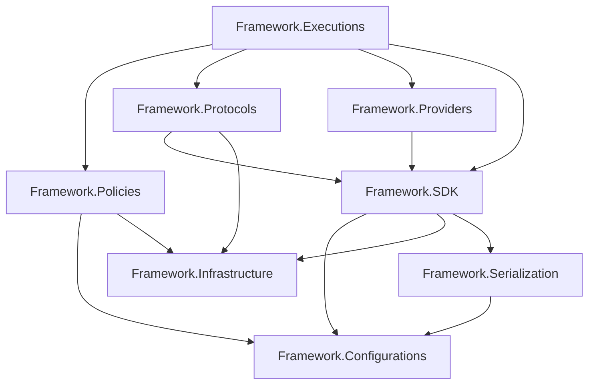
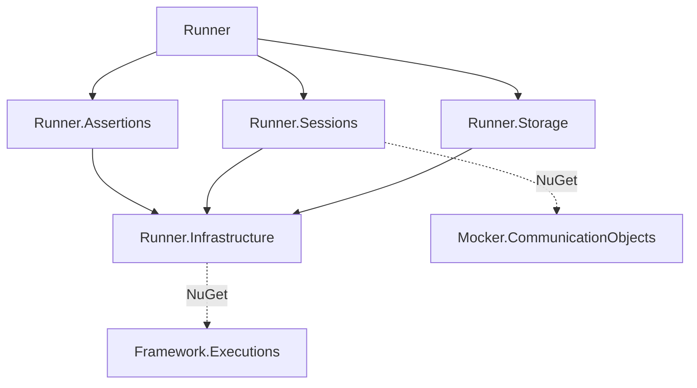
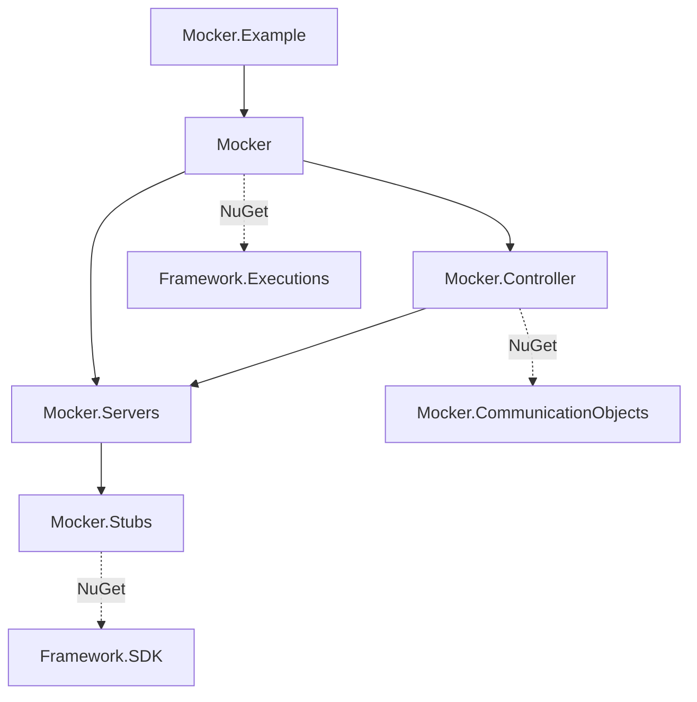

# Solution and project structure

Budget **4 hours**, including the exercises. Start after [conventions and guidelines](../02-standards/conventions-and-guidelines.md), then continue to the [Runner lifecycle](../01-architecture/runner-execution-flow.md); return to the [study plan](../README.md) whenever you need the wider sequence. Your deliverable is an annotated dependency map and a short placement decision for a proposed contribution.

## Read names at the right level

A Git repository is a version-control and release boundary. A solution (`.sln`) groups projects for development and build operations. A project (`.csproj`) defines compilation, target framework, direct project references and package dependencies. A namespace groups C# names; it does not prove which assembly owns a type. A NuGet package is a versioned consumption boundary. These are related, but they are not interchangeable.

For example, the **QaaS.Framework repository** contains **QaaS.Framework.sln** and several assemblies; **QaaS.Framework.SDK** is one project and package inside it. There is no single SDK project that contains the entire framework. The inspected projects target `net10.0`. “Modern .NET” is the useful runtime description here; `.Core` is not a target-framework suffix.

The [live documentation](https://docs.qaas.online/) supplies the customer view: Runner tests, Mocker services, hooks and Framework capabilities. For contributor ownership and dependencies, start from the project files linked below. A descriptive document can outlive a renamed or deleted project.

| Name or suffix | Meaning in this checkout | Put here | Do not assume |
| --- | --- | --- | --- |
| `.Core` | A conceptual name sometimes used for foundational code; **no production project with this suffix exists in the four solutions mapped here** | Discuss the actual owner: SDK, Configurations, Infrastructure, or Executions | Do not create or cite `QaaS.Core` or `QaaS.Framework.Core` as an existing project |
| `.Framework` | Repository/product family containing reusable configuration, contracts, transport support and execution scaffolding | Behavior that multiple hosts genuinely need | The entire family is dependency-free, or all its projects are contracts |
| `.Runner` | Host/orchestrator and a family of execution-specific projects | Runner lifecycle, sessions/actions, assertion orchestration and stored results | Every assertion implementation belongs in the Runner repository |
| `.Mocker` | Host and server/stub/controller project family | Mock service lifecycle, request handling and control | Runner must reference the whole Mocker host to control it |
| `.Probes` | `QaaS.Common.Probes`, a concrete hook package; also a folder/concept inside Runner and SDK | Reusable probe implementations in Common.Probes; scheduling in Runner; contract in SDK | All three occurrences are one assembly or responsibility |
| `.SDK` | `QaaS.Framework.SDK`, shared developer contracts and supporting objects | Hook interfaces/base classes, contexts, data-source and session-facing types | SDK means “interfaces only” or “no dependencies” |
| `.Tests` | Companion verification projects, commonly NUnit with Moq where needed | Behavioral regression tests at the owning boundary | Every project containing “Tests” is a unit-test assembly; Runner.E2ETests is an executable harness |

## The Framework is several layers, not one core assembly

Arrows below mean **the project at the tail directly references the project at the head**. They do not mean runtime call order. This graph includes all direct production `ProjectReference` edges in the Framework solution; package dependencies are discussed separately.



| Project | Responsibility to inspect first | Direct in-solution dependencies |
| --- | --- | --- |
| Configurations | Binding, validation and configuration-related helpers | None |
| Infrastructure | Shared supporting utilities | None |
| Serialization | Serialization-related abstractions and implementations | Configurations |
| SDK | Hooks, contexts and shared developer-facing data/building objects | Configurations, Infrastructure, Serialization |
| Policies | Rate/stop/load behavior used by execution | Configurations, Infrastructure |
| Protocols | Protocol interfaces and implementations | Infrastructure, SDK |
| Providers | Hook discovery/resolution infrastructure | SDK |
| Executions | Shared execution building/loading scaffolding | Policies, Protocols, Providers, SDK |

“None” means no **ProjectReference**, not no third-party libraries, no side effects, or a promise of purity. Executions also consumes the separate `QaaS.Configuration` package. SDK has logging/configuration packages as well as its three project references. A change to SDK can therefore affect both consumer API compatibility and transitive package resolution.

Read the [SDK project][sdk-project], [Executions project][executions-project], and [Framework solution][framework-solution] together. The actual `BaseExecutionBuilder` belongs to [Framework.Executions][base-builder]. Runner and Mocker have their own `ExecutionBuilder` types; a shared simple name does not imply the same class or namespace. Follow the declaration and assembly when navigating an IDE.

## Runner ownership and dependency direction



Runner composes the feature projects. Sessions owns the session/action machinery; Assertions owns assertion configuration/execution support; Storage owns storage behavior. Infrastructure supplies shared Runner facilities and directly consumes Framework.Executions as a package. It is therefore **not** a dependency-free leaf in the ecosystem, even though it has no in-solution ProjectReference.

The Sessions package reference to `QaaS.Mocker.CommunicationObjects` is significant: a communication contract can connect Runner and Mocker without making Runner depend on all server implementations. Do not turn a need for one message type into a dependency on the whole Mocker host. Conversely, do not assume a package called “Infrastructure” is suitable for every convenient helper. Putting a feature there expands the dependency surface for Assertions, Sessions and Storage.

Evidence: [Runner composition][runner-project], [Runner.Infrastructure][runner-infrastructure], [Runner.Sessions][runner-sessions]. For behavior inside those boundaries, use the [runtime chapter](../01-architecture/runner-execution-flow.md).

## Mocker ownership and dependency direction



Stubs owns the response behavior layer; Servers owns the hosting/request-handling layer over stubs. Controller coordinates runtime control over servers, and the Mocker host composes them. `Mocker.Example` demonstrates consumption and references the host; it is not the foundational dependency of production code. The host itself directly consumes Framework.Executions, while Stubs directly consumes SDK.

A contributor adding a protocol-specific server should first determine whether the change belongs to Servers and its configuration/builder paths. A reusable custom response processor belongs at the hook boundary when the existing contract can express it. The goal is to place a change where its behavior is owned, rather than in whichever project makes compilation easiest.

Evidence: [Mocker project][mocker-project], [Controller project][controller-project], [Servers project][servers-project], [Stubs project][stubs-project], and [Mocker solution][mocker-solution].

## The probe example: contract, scheduling and implementation

Trace this separation before adding a new probe:

1. **SDK contract:** [IProbe][iprobe] inherits `IHook` and declares `Run(IImmutableList<SessionData>, IImmutableList<DataSource>)`. Its signature establishes the data available to an implementation; it does not schedule a Runner session.
2. **SDK convenience base:** [BaseProbe<TConfiguration>][base-probe] supplies context/configuration properties, binding and recursive validation. Its binder rejects unknown configuration by default. The derived implementation supplies `Run`.
3. **Runner scheduling:** [ProbeBuilder][probe-builder] and [Probe][probe-action] live in Runner.Sessions. Read these when the problem concerns constructing/running a probe as an action, rather than the external system operation itself.
4. **Concrete reusable behavior:** [Common.Probes][probes-project] packages implementations. It directly consumes Framework.Configurations, Protocols, SDK and Serialization. It does not reference the Runner project.

This is why a new reusable probe normally need not modify Runner. A missing protocol implementation or an incompatible SDK contract is different: it changes a shared dependency and may require coordinated downstream package updates. Use the [publishing chapter](../04-devops/cicd-and-package-publishing.md) before treating a local build as proof that separately versioned consumers work.

## Which rules are enforced, and which rules must reviewers enforce?

The **observed structure** is supported by project references and declarations. The **contributor rules** below are deliberately strict guidance for changes to that structure; they are not claims that an architecture analyzer rejects every violation.

| Boundary rule | Status and consequence |
| --- | --- |
| Respect `internal` visibility unless the owning assembly grants friendship | Compiler-enforced accessibility. Do not make implementation types public merely to make a test or downstream shortcut compile. |
| Keep production projects independent of test projects | Contributor rule consistent with the inspected production references. Reject a production-to-Tests edge in review. Tests may reference production. |
| Keep Framework independent of Runner/Mocker implementation assemblies | Contributor rule preserving the observed dependency direction. A new upward edge couples the shared foundation to a particular host. |
| Keep reusable hook packages dependent on contracts and required capabilities, not host orchestration | Contributor rule illustrated by Common.Probes. A hook that needs a Runner builder is a signal to reconsider the boundary. |
| Do not add cycles or move feature code into shared Infrastructure just to bypass ownership | Contributor rule. Build failures can reveal some cycles, but a successful compilation does not prove a good dependency design. |
| For a proposed future `.Core`, forbid host, transport-client, reporting and test dependencies unless its documented purpose explicitly requires them | Proposed design constraint only. No existing `.Core` project is being described. Choose an existing owner before proposing a new layer. |

Friendship is an important exception to simplistic layering diagrams. Framework.Serialization grants `InternalsVisibleTo` to SDK, SDK.Tests, Mocker.Stubs and Runner.Sessions. Framework.Executions grants friendship to selected host/test assemblies. SDK's DataSourceBuilder also declares friends. These declarations allow named assemblies to use internals; they **do not add a ProjectReference**, make the member public to everyone, or grant the same access transitively to every consumer. Inspect [Serialization's project][serialization-project] and [DataSourceBuilder][data-source-builder]; read Microsoft's [friend assembly explanation](https://learn.microsoft.com/en-us/dotnet/standard/assembly/friend).

The inspected project and source searches did not identify NetArchTest or ArchUnit enforcement for these architectural rules. The inspected `Directory.Build.props` files configure source/debug metadata and selected warning settings, rather than a forbidden-dependency policy. Treat an absent architecture gate as a reason to explain a new dependency in review, not permission to ignore the boundary. See [Framework props][framework-props] and [Runner props][runner-props].

## Tests belong on the map

Framework has companion tests for Configurations, Executions, Policies, Protocols, Providers, SDK and Serialization. Do not infer an Infrastructure.Tests project from the naming convention: it is absent from the inspected solution inventory. Runner has Runner.Tests and companion tests for Assertions, Infrastructure, Sessions and Storage. Mocker has host, Controller, Servers and Stubs tests. Common.Probes has its companion tests.

The boundary is not always one test assembly to one production assembly. Runner.Sessions.Tests references both Runner and Sessions; Runner.Tests references all five Runner production projects. This enables integration across construction boundaries but makes dependency scope worth checking before copying a test pattern. [Sessions.Tests project][sessions-tests] documents that exception.

`QaaS.Runner.E2ETests` is listed in the [Runner solution][runner-solution]. Its [project file][e2e-project] declares `OutputType=Exe`, references all five production projects, and copies YAML/case/config/variable assets to output. It is not configured there as a standard NUnit test project. Therefore, a successful `dotnet test` does not by itself prove that its executable scenarios ran. Consult the harness entry point and its documented invocation before claiming end-to-end coverage.

## Practice: build an evidence-backed contribution plan

Allow **240 minutes total**. These are study and review exercises; no service deployment or package publishing is required.

| Time | Work | Evidence to produce |
| --- | --- | --- |
| 35 min | Read this chapter and open all four solutions. Distinguish solution, project, namespace and package in one example each. | A glossary with concrete file paths. |
| 45 min | Reconstruct Framework's direct ProjectReference graph from `.csproj` files without looking at the diagram. Add the separate Configuration package edge afterward. | A diagram whose arrows have a written meaning; identify direct versus transitive SDK access. |
| 40 min | Trace the four probe responsibilities above. Pick one existing concrete probe and identify its configuration and external dependency. | An ownership table showing where a new operation, a new scheduler behavior and a changed hook signature would each go. |
| 45 min | Review four proposals: SDK references Runner for a helper; production references a test helper; a custom probe references SDK; Controller uses CommunicationObjects. | Accept/reject each with evidence, explain what is observed versus recommended, and propose a safe alternative for each rejection. |
| 45 min | Pick one small hypothetical contribution and list affected production/tests/packages. Inspect project and package references, access modifiers and friendship. | A PR-sized change plan with compatibility risks and targeted validation, including whether the E2E executable is relevant. |
| 30 min | Compare your map with the source ledger and explain it to a reviewer. | A corrected map plus three questions you could not answer without opening source. |

Suggested review criteria: reject the SDK-to-Runner and production-to-test shortcuts; accept a contract-based probe in principle but inspect its actual dependencies and behavior; recognize Controller's CommunicationObjects reference as an existing dependency. Do not claim an architectural violation solely because a test references multiple production projects. Do not confuse a runtime invocation of a hook with a reverse compile-time project reference.

Useful local inspection commands, run from the checkout root:

```powershell
rg --files QaaS.Framework QaaS.Runner QaaS.Mocker QaaS.Common.Probes -g '*.csproj' -g '*.sln'
rg -n 'ProjectReference|PackageReference|InternalsVisibleTo' QaaS.Framework QaaS.Runner QaaS.Mocker QaaS.Common.Probes -g '*.csproj'
rg -n 'InternalsVisibleTo' QaaS.Framework QaaS.Runner QaaS.Mocker -g '*.cs'
```

Read the command output before adding anything. Microsoft's [project-reference documentation](https://learn.microsoft.com/en-us/dotnet/core/tools/dotnet-reference-add) explains the relation between the CLI and `<ProjectReference>`; it does not decide whether a dependency belongs in QaaS's architecture.

## Source ledger

The links below pin the inspected source revisions, so the map remains reviewable when default branches move. Re-check the live branch and [current docs](https://docs.qaas.online/) before making a contribution.

- **QaaS.Framework**: `4d4b192391418c7882990323f2690d0649a20465`.
- **QaaS.Runner**: `8ccd6f53f9d23645ee117eef48ea3d56f24acfd0`.
- **QaaS.Mocker**: `c3aa787b2db6d4c796b0ec6625af16799150e5ec`.
- **QaaS.Common.Probes**: `8b1f65c2bab281904ee61415ebad33d6574a29b1`.

The project-reference diagrams are inventories, not inferred call graphs. To audit every edge, inspect the corresponding production `.csproj` files at these revisions.

[sdk-project]: https://github.com/TheSmokeTeam/QaaS.Framework/blob/4d4b192391418c7882990323f2690d0649a20465/QaaS.Framework.SDK/QaaS.Framework.SDK.csproj
[executions-project]: https://github.com/TheSmokeTeam/QaaS.Framework/blob/4d4b192391418c7882990323f2690d0649a20465/QaaS.Framework.Executions/QaaS.Framework.Executions.csproj
[framework-solution]: https://github.com/TheSmokeTeam/QaaS.Framework/blob/4d4b192391418c7882990323f2690d0649a20465/QaaS.Framework.sln
[base-builder]: https://github.com/TheSmokeTeam/QaaS.Framework/blob/4d4b192391418c7882990323f2690d0649a20465/QaaS.Framework.Executions/BaseExecutionBuilder.cs
[iprobe]: https://github.com/TheSmokeTeam/QaaS.Framework/blob/4d4b192391418c7882990323f2690d0649a20465/QaaS.Framework.SDK/Hooks/Probe/IProbe.cs
[base-probe]: https://github.com/TheSmokeTeam/QaaS.Framework/blob/4d4b192391418c7882990323f2690d0649a20465/QaaS.Framework.SDK/Hooks/Probe/BaseProbe.cs
[serialization-project]: https://github.com/TheSmokeTeam/QaaS.Framework/blob/4d4b192391418c7882990323f2690d0649a20465/QaaS.Framework.Serialization/QaaS.Framework.Serialization.csproj
[data-source-builder]: https://github.com/TheSmokeTeam/QaaS.Framework/blob/4d4b192391418c7882990323f2690d0649a20465/QaaS.Framework.SDK/DataSourceObjects/DataSourceBuilder.cs
[framework-props]: https://github.com/TheSmokeTeam/QaaS.Framework/blob/4d4b192391418c7882990323f2690d0649a20465/Directory.Build.props
[runner-project]: https://github.com/TheSmokeTeam/QaaS.Runner/blob/8ccd6f53f9d23645ee117eef48ea3d56f24acfd0/QaaS.Runner/QaaS.Runner.csproj
[runner-infrastructure]: https://github.com/TheSmokeTeam/QaaS.Runner/blob/8ccd6f53f9d23645ee117eef48ea3d56f24acfd0/QaaS.Runner.Infrastructure/QaaS.Runner.Infrastructure.csproj
[runner-sessions]: https://github.com/TheSmokeTeam/QaaS.Runner/blob/8ccd6f53f9d23645ee117eef48ea3d56f24acfd0/QaaS.Runner.Sessions/QaaS.Runner.Sessions.csproj
[probe-builder]: https://github.com/TheSmokeTeam/QaaS.Runner/blob/8ccd6f53f9d23645ee117eef48ea3d56f24acfd0/QaaS.Runner.Sessions/Actions/Probes/ProbeBuilder.cs
[probe-action]: https://github.com/TheSmokeTeam/QaaS.Runner/blob/8ccd6f53f9d23645ee117eef48ea3d56f24acfd0/QaaS.Runner.Sessions/Actions/Probes/Probe.cs
[runner-props]: https://github.com/TheSmokeTeam/QaaS.Runner/blob/8ccd6f53f9d23645ee117eef48ea3d56f24acfd0/Directory.Build.props
[sessions-tests]: https://github.com/TheSmokeTeam/QaaS.Runner/blob/8ccd6f53f9d23645ee117eef48ea3d56f24acfd0/QaaS.Runner.Sessions.Tests/QaaS.Runner.Sessions.Tests.csproj
[runner-solution]: https://github.com/TheSmokeTeam/QaaS.Runner/blob/8ccd6f53f9d23645ee117eef48ea3d56f24acfd0/QaaS.Runner.sln
[e2e-project]: https://github.com/TheSmokeTeam/QaaS.Runner/blob/8ccd6f53f9d23645ee117eef48ea3d56f24acfd0/QaaS.Runner.E2ETests/QaaS.Runner.E2ETests.csproj
[mocker-project]: https://github.com/TheSmokeTeam/QaaS.Mocker/blob/c3aa787b2db6d4c796b0ec6625af16799150e5ec/QaaS.Mocker/QaaS.Mocker.csproj
[controller-project]: https://github.com/TheSmokeTeam/QaaS.Mocker/blob/c3aa787b2db6d4c796b0ec6625af16799150e5ec/QaaS.Mocker.Controller/QaaS.Mocker.Controller.csproj
[servers-project]: https://github.com/TheSmokeTeam/QaaS.Mocker/blob/c3aa787b2db6d4c796b0ec6625af16799150e5ec/QaaS.Mocker.Servers/QaaS.Mocker.Servers.csproj
[stubs-project]: https://github.com/TheSmokeTeam/QaaS.Mocker/blob/c3aa787b2db6d4c796b0ec6625af16799150e5ec/QaaS.Mocker.Stubs/QaaS.Mocker.Stubs.csproj
[mocker-solution]: https://github.com/TheSmokeTeam/QaaS.Mocker/blob/c3aa787b2db6d4c796b0ec6625af16799150e5ec/QaaS.Mocker.sln
[probes-project]: https://github.com/TheSmokeTeam/QaaS.Common.Probes/blob/8b1f65c2bab281904ee61415ebad33d6574a29b1/QaaS.Common.Probes/QaaS.Common.Probes.csproj
