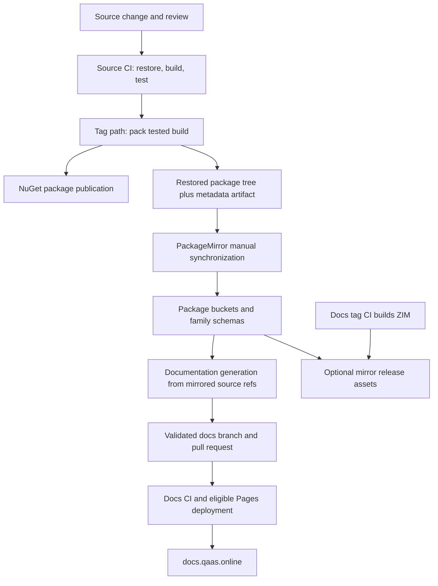

# CI/CD and package publishing

**Study time: 4 hours, including exercises.** Return to the [study schedule](../README.md). Read the [solution boundaries](../03-architecture/solution-and-project-structure.md) first: a Framework dependency change and a standalone hook change have different release consequences.

Your goal is to trace a contribution from source to a tested package, a usable downstream dependency, and accurate published documentation. Completing this module does not require publishing a package, creating a tag, or dispatching a production workflow. The exercises use a disposable local checkout and feed.

## 1. Understand what CI actually guarantees

Start with the executable workflows: [Runner CI][runner-ci] and [Framework CI][framework-ci]. Both define the `build-test-deploy` job, install .NET SDK `10.0.x`, and use Release configuration. They trigger for branch pushes, tag pushes, pull requests, and manual dispatch. Their concurrency groups cancel superseded runs for the same PR or ref.

The main path restores the solution into `RestoredPackages`, builds with `--no-restore`, and runs tests under `dotnet-coverage collect` with `--no-restore --no-build`. This makes the test stage consume the build just produced. The workflows resolve non-test assemblies from the solution to scope the reported coverage, generate reports, print totals, and upload a `coverage-report` artifact. Coverage measurement and correctness testing answer different questions: covered code may still have weak assertions or missing failure cases.

| Concern | Evidence in the inspected workflows | Contributor responsibility |
| --- | --- | --- |
| Restore and compilation | Explicit restore/build stages; failed commands prevent normal subsequent stages | Reproduce dependency resolution and Release compilation locally |
| Test execution | Solution tests are invoked through coverage collection | Inspect failures and relevant tests, including required external service setup; a solution run does not prove every possible integration scenario was exercised |
| Coverage | Collection, filtering, summary, artifact, and badge handling | Review meaningful behavior coverage; there is no numerical coverage threshold comparison in these two workflows |
| Formatting | No dedicated CSharpier check appears in these two workflows | Follow repository formatting instructions before opening a PR |
| Static analysis | No dedicated CodeQL or separate analyzer gate appears in these two workflow files | Inspect project settings and compiler diagnostics; do not claim an organization-wide static-analysis gate from these files |
| Merge protection | Not established by workflow YAML alone | Inspect repository rules and the actual PR required-check status |

Static analysis can still occur during a normal build. For example, the [Framework SDK project][sdk-project] enables nullable analysis and targets `net10.0`; that is different from a separately configured CI scan. Its inspected project settings and the [shared build properties][framework-props] do not establish a universal warnings-as-errors rule. Likewise, a repository handbook's desired coverage or formatting policy is guidance unless an executable check or repository rule enforces it. Report both facts accurately.

For a contribution, use the selected repository's solution and configuration consistently:

```powershell
# Run from a disposable QaaS.Framework checkout with the repository's SDK installed.
dotnet restore .\QaaS.Framework.sln
dotnet build .\QaaS.Framework.sln -c Release --no-restore
dotnet test .\QaaS.Framework.sln -c Release --no-build --no-restore
```

Stop at a failed command and investigate it; do not continue to packaging and call the package verified. These commands are a local validation baseline, not a reproduction of the reporting, secrets, runner image, and artifact handling in Actions. Read CI logs to identify the first failing stage rather than treating every red run as a test failure.

## 2. Follow the package and documentation chain



Each arrow is a separate boundary. Publishing a new NuGet package does not automatically prove that the mirror contains it, that a generated docs PR has merged, or that the website describes it. Diagnose the first missing artifact or mismatched version at the relevant boundary.

### Source release path

The source workflows pack using the tag string as `PackageVersion`, then push `.nupkg` files to NuGet.org with `NUGET_AUTH_TOKEN` and `--skip-duplicate`. Packed packages are also staged into the restored package tree under package ID/version directories. The workflow writes `restore-artifact-metadata.json` with repository, tag, run ID, and creation time, then uploads the `restored-packages` artifact with seven-day retention. This records where the mirror input came from. See the release stages in [Framework CI][framework-ci] and [Runner CI][runner-ci].

The variable named `is_stable_tag` is potentially misleading: these inspected workflows set it for **any** `refs/tags/*` ref. They do not first enforce an `X.Y.Z` stable-version regular expression. Invalid versions may fail later; prerelease tags are not excluded by this condition. Therefore, a contributor must not assume that pushing an experimental tag is harmless or prevented from publishing.

The pack commands use `--no-build --no-restore` and request embedded debug/source information and deterministic CI-related properties. Because pack does not rebuild, pack-time build properties alone cannot retroactively change already compiled DLLs. Verify actual binary and package contents when changing symbol or reproducibility behavior; the shared [Framework build properties][framework-props] also matter. The workflow explicitly disables separate symbol packages for this pack invocation.

### Version selection

Use SemVer reasoning for the public contract: an incompatible API change calls for a major increment, an additive backward-compatible feature for a minor increment, and a backward-compatible bug fix for a patch increment. Prerelease labels identify work before its intended normal release. This is versioning guidance; the workflow's tag detector is not a compatibility analyzer. [Semantic Versioning specification](https://semver.org/spec/v2.0.0.html).

In QaaS, review more than C# method signatures. Removing a hook name, changing a YAML default, changing validation acceptance, or changing the shape of serialized communication can affect consumers even when their projects compile. List the affected contract explicitly. A Framework contract change requires checking downstream Runner, Mocker, and relevant hook packages; a new hook within existing SDK contracts may remain within its own package family. Use actual `PackageReference` and `ProjectReference` edges rather than incrementing every repository mechanically.

Before a maintainer releases, prepare a concrete handoff: intended version and rationale; exact source revision; successful validation; changed packages and dependent consumers; migration notes if needed; expected mirror and docs changes. Do not reuse the same local prerelease version after changing bytes: a cached package can hide the new implementation. Use distinct local versions such as `0.0.0-local.1`, then `0.0.0-local.2`.

## 3. Test packages locally before asking for a release

A project-reference build is not sufficient packaging validation. A `.nupkg` can omit expected assets or declare incorrect dependency versions while the source solution builds correctly. Packing project references creates dependencies on their packages; it does not simply copy their entire source projects into the consuming package. [Microsoft: dotnet pack](https://learn.microsoft.com/en-us/dotnet/core/tools/dotnet-pack).

Use a disposable checkout plus a separate scratch directory. The following is a recipe to run deliberately, not a command already executed for this study pack. Change the paths to your own checkouts. The example packs the Framework solution so sibling Framework dependencies can be available together.

```powershell
$frameworkCheckout = 'C:\qaas-scratch\QaaS.Framework'
$packageLab = 'C:\qaas-scratch\package-lab'
$localFeed = Join-Path $packageLab 'feed'
$localCache = Join-Path $packageLab 'cache'
$packageVersion = '0.0.0-local.1'
New-Item -ItemType Directory -Force -Path $localFeed, $localCache | Out-Null

# Use the same version during restore/build/test/pack.
dotnet restore "$frameworkCheckout\QaaS.Framework.sln" -p:Version=$packageVersion -p:PackageVersion=$packageVersion
dotnet build "$frameworkCheckout\QaaS.Framework.sln" -c Release --no-restore -p:Version=$packageVersion -p:PackageVersion=$packageVersion
dotnet test "$frameworkCheckout\QaaS.Framework.sln" -c Release --no-build --no-restore -p:Version=$packageVersion -p:PackageVersion=$packageVersion
dotnet pack "$frameworkCheckout\QaaS.Framework.sln" -c Release --no-build --no-restore -p:Version=$packageVersion -p:PackageVersion=$packageVersion -o $localFeed
```

Inspect the resulting `.nupkg` files as ZIP archives, especially their `.nuspec` dependency groups, `lib/` assemblies, and expected README/content assets. Verify sibling package dependencies resolve to the versions you actually produced. Do not assume a single global version override always supersedes every explicit project property.

In a disposable **consumer** project, change the relevant `PackageReference` to the exact local version. If it uses `ProjectReference` for the component being tested, replace that reference in this disposable copy; otherwise the build can bypass the package. Restore explicitly from the local feed and the normal public source into the isolated cache:

```powershell
$consumerProject = 'C:\qaas-scratch\Consumer\Consumer.csproj'
dotnet restore $consumerProject --source $localFeed --source https://api.nuget.org/v3/index.json --packages $localCache
dotnet build $consumerProject -c Release --no-restore
```

Run the consumer's relevant behavior test using its documented command. Check `obj/project.assets.json` to confirm the resolved package ID, version, dependency graph, and package folder. Inspect the isolated cache's package provenance metadata when available. A successful compile against an unintended public version is not a successful local-package test. When a repository uses central package versions or source mapping, update the disposable consumer's existing configuration rather than adding contradictory references.

`--source` supplies restore sources for this invocation, and `--packages` selects the package directory. If the lab needs a persistent feed entry, use `dotnet nuget add source` with an explicit lab-only `--configfile` rather than changing the contributor's global configuration. See [restore options](https://learn.microsoft.com/en-us/dotnet/core/tools/dotnet-restore), [adding a source](https://learn.microsoft.com/en-us/dotnet/core/tools/dotnet-nuget-add-source), and [local feed layouts](https://learn.microsoft.com/en-us/nuget/hosting-packages/local-feeds).

## 4. Understand PackageMirror's responsibilities

[PackageMirror's implementation workflow][mirror-ci] has two materially different paths. A qualifying push to `master` validates its implementation with a Release build and tests. Manual `workflow_dispatch` runs the synchronization path, with inputs controlling release publication, docs PR creation, or drift checking. Defaults enable release publication and docs PR creation; dispatch is therefore a maintainer operation, not the local-package exercise above.

The mirror consumes restored package artifacts from tracked source repositories, rebuilds its package buckets, generates schemas, records state, and validates required outputs. Its [README][mirror-readme] explains retention: `packages/qaas` keeps the latest allowed QaaS versions, while `packages/not-qaas` retains the external versions needed by the combined inputs. Excluded packages and artifact-expiration fallbacks have explicit implementation logic. A missing recent artifact does not justify silently claiming that a new source version is mirrored: inspect the corresponding `state/` file and selected package version.

One important discrepancy must be resolved from code: the README describes preferring stable tags except for Runner, but the inspected [tracked repository definitions][mirror-sync] set `AllowPrerelease=true` for all eight entries. The tag acceptance helper distinguishes stable/prerelease patterns using that flag. Consequently this module does not promise stable-only mirror selection. When behavior and a guide disagree, verify the executable selection logic and report the documentation mismatch.

Family schemas are assembled from mirrored packages, not merely handwritten YAML examples:

- Runner family: Runner, Generators, Assertions, and Probes.
- Mocker family: Mocker, Generators, and Processors.
- Each family produces `schema.json`, `docs-manifest.json`, and `hook-catalog.json` under `schemas/<family>/latest/`.

The schema is the configuration validation/editor artifact; the two accompanying contracts support configuration-section and hook documentation generation. A hook or configuration change can therefore require package, schema, and documentation validation even when its implementation is small. Read the [mirror schema contract][mirror-readme] before editing generated output.

## 5. Follow generated documentation through publication

[QaaS.Docs.Generator][generator-readme] separates deterministic Markdown rendering from the `QaaS.Docs.Tools` orchestration CLI. Inputs include mirror-owned schema contracts, captured CLI snapshots, and source XML documentation/placement tags. Generated pages should be repaired at their owning input when appropriate; a manual edit to rendered output may disappear during the next generation pass.

The [mirror workflow][mirror-ci] resolves source tags from mirror state, checks out the source repositories, and invokes `generate-reference-docs` with explicit roots for docs, mirror, Runner, Mocker, Framework, and four hook families. This aligns documentation with the package selection rather than accidentally documenting an unrelated branch tip. It also selects a generator revision separately: record both source refs and generator revision when diagnosing a reproducibility issue.

Before pushing a generated docs branch, the workflow builds MkDocs with `--strict` and checks the generated documentation contract. The inspected checks include frontmatter, Markdown lint, verification markers, reference skeletons, headings/anchors, example density, navigation, YAML indentation, and schema-backed YAML snippets. It also checks docs PR size. `docs_drift_check_only` enables comparison behavior and suppresses the normal publication/commit paths; generation receives `--check`. Do not conflate a drift check with opening or merging a PR.

For a local docs exercise, use a disposable docs checkout with the generator submodule initialized and required sibling inputs available. From the docs root, the generator documents these commands:

```powershell
dotnet run --project .\tools\QaaS.Docs.Generator\QaaS.Docs.Tools\QaaS.Docs.Tools.csproj -- generate-reference-docs
dotnet run --project .\tools\QaaS.Docs.Generator\QaaS.Docs.Tools\QaaS.Docs.Tools.csproj -- generate-reference-docs --check --build-site
```

If your folder layout differs, use the explicit root arguments shown in the mirror workflow. Install the docs checkout's declared dependencies first. Inspect the generated diff; do not accept a large unrelated rewrite just because the build passed.

Publication belongs to [qaas-docs CI][docs-ci]. It initializes the generator submodule, installs documentation dependencies, validates configuration, builds MkDocs strictly, and uploads the site. The inspected Pages deployment condition permits pushes to `master`, `fix/improve_docs`, and `fix/docs_errors`; it is not an unconditional PR deployment or a master-only condition. Treat these exact branches as implementation evidence that can change, not a suggested branch-naming policy. Readers consume the published site at [docs.qaas.online](https://docs.qaas.online/).

Offline documentation has a separate ownership boundary: docs tag CI builds and validates the ZIM artifact; PackageMirror obtains the existing ZIM and republishes its bytes in a mirror release. The mirror does not build the ZIM itself. Missing or ambiguous ZIM inputs can block a mirror release despite passing package tests. Docker image publication in docs CI is another conditional path, with tag/manual-dispatch and credential checks; a green docs build alone does not establish that an image was pushed.

## 6. Four-hour contributor lab

| Time | Exercise | Evidence to hand to a reviewer |
| --- | --- | --- |
| 45 minutes | Read Runner and Framework CI. Trace a PR run versus a tag run. Find the exact tag condition, coverage command, and upload artifact names. | A short stage table separating enforced checks, reported metrics, and guidance; explain why a prerelease tag is not a safe dry run |
| 75 minutes | Pack a small Framework change or an unchanged baseline locally, then consume the unique local version in a disposable project. Use the same build configuration throughout. | Package ID/version, relevant `.nuspec` dependencies, resolved assets entry, and consumer behavior result; explain what project references would have concealed |
| 60 minutes | Trace one selected hook package through mirror state and its family schema/hook catalog. Read the matching source selection code. Do not dispatch synchronization. | A source-to-package-to-schema map, the selected version/ref, and a diagnosis of what an expired artifact or prerelease selection changes |
| 60 minutes | Trace one generated docs section back to schema/XML/snapshot input. Run local generation/check when dependencies are available, or trace the exact CI commands and identify missing prerequisites. | Input owner, expected generated files, validation commands/results, and the remaining deployment boundary |

Timebox dependency setup during the lab. If a feed or integration service is unavailable, record the exact blocked stage and prerequisite rather than presenting a command you could not run as verified. An acceptable contributor handoff states what was tested, what remains untested, and which maintainer operation would complete the release chain.

### Self-check

Can you explain why a green build is not proof of a correct NuGet dependency graph? Can you identify the source version behind a mirrored package and a generated docs page? Can you distinguish the name `stable_tag` from its actual predicate? Can you name the owner of ZIM generation? Can you propose a compatible version increment and identify downstream consumers without publishing anything? If any answer is unclear, revisit the corresponding source boundary above.

## Source map

The following links pin the inspected workspace revisions so readers can reproduce the claims. When contributing against a newer revision, compare these files with that revision before acting. User-facing documentation links use the published site; repository links below are implementation evidence.

- [Runner workflow][runner-ci]: build, tests, coverage, package publication, and restore artifact.
- [Framework workflow][framework-ci], [SDK project][sdk-project], and [shared build properties][framework-props]: build settings and package behavior.
- [PackageMirror workflow][mirror-ci], [selection implementation][mirror-sync], and [README][mirror-readme]: synchronization, schemas, release assets, and generated docs PRs.
- [Generator README][generator-readme] and [docs workflow][docs-ci]: rendering inputs, verification, Pages, ZIM, and image publication.

[runner-ci]: https://github.com/TheSmokeTeam/QaaS.Runner/blob/8ccd6f53f9d23645ee117eef48ea3d56f24acfd0/.github/workflows/ci.yml
[framework-ci]: https://github.com/TheSmokeTeam/QaaS.Framework/blob/4d4b192391418c7882990323f2690d0649a20465/.github/workflows/ci.yml
[sdk-project]: https://github.com/TheSmokeTeam/QaaS.Framework/blob/4d4b192391418c7882990323f2690d0649a20465/QaaS.Framework.SDK/QaaS.Framework.SDK.csproj
[framework-props]: https://github.com/TheSmokeTeam/QaaS.Framework/blob/4d4b192391418c7882990323f2690d0649a20465/Directory.Build.props
[mirror-ci]: https://github.com/TheSmokeTeam/QaaS.PackageMirror/blob/903007e48765875931609236ccb3599daf93cf96/.github/workflows/sync-packages.yml
[mirror-sync]: https://github.com/TheSmokeTeam/QaaS.PackageMirror/blob/903007e48765875931609236ccb3599daf93cf96/QaaS.PackageMirror.Tools/Commands/SyncRestoredPackagesCommand.cs
[mirror-readme]: https://github.com/TheSmokeTeam/QaaS.PackageMirror/blob/903007e48765875931609236ccb3599daf93cf96/README.md
[generator-readme]: https://github.com/TheSmokeTeam/QaaS.Docs.Generator/blob/8fe81cf340e63302252bce1e487cc121d5be1e92/README.md
[docs-ci]: https://github.com/TheSmokeTeam/qaas-docs/blob/8a9f9c5b7ac661aec99f7653871eea8143299c2b/.github/workflows/ci.yml
