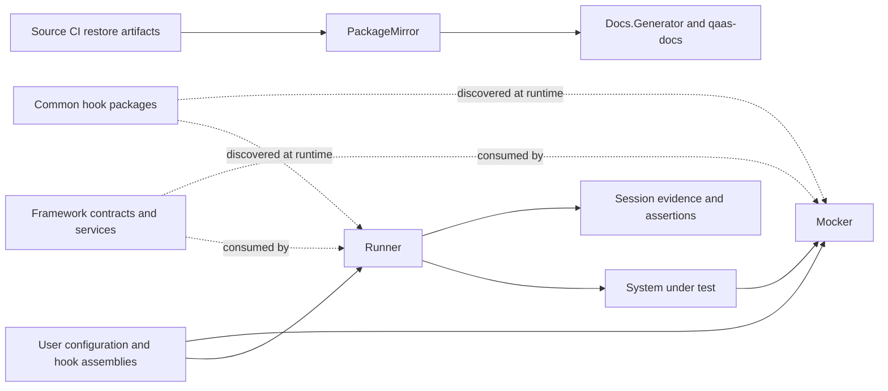
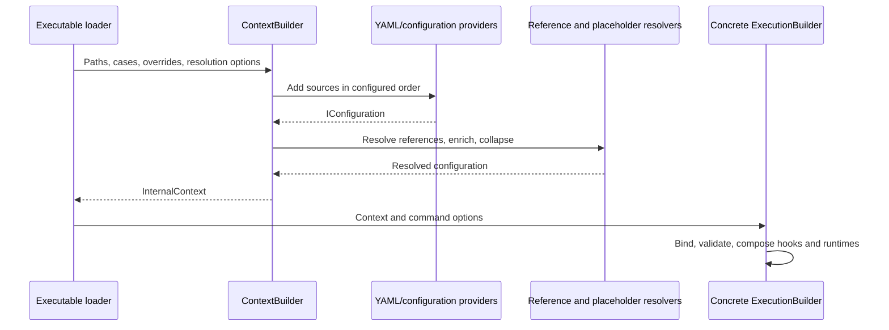
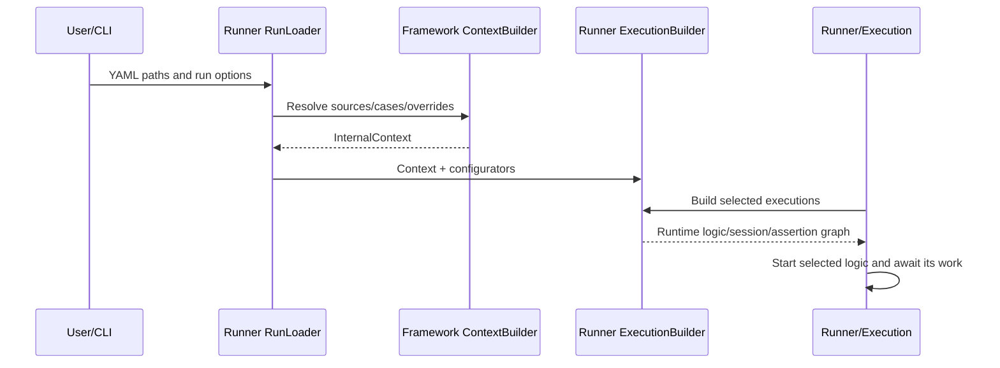
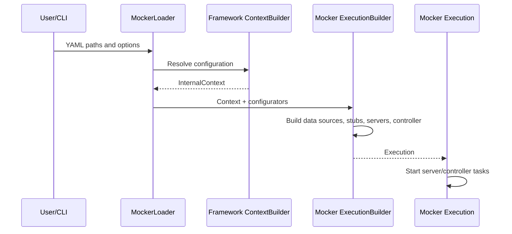

## Q1. The core ecosystem

QaaS has a shared contract layer and two different runtime products. Runner orchestrates test activity and evaluates evidence. Mocker supplies configurable behavior at protocol boundaries. A system under test can sit between them: Runner sends an input to the real service; that service makes a downstream request to Mocker; Runner captures the service's observable output and evaluates assertions. Runner can also address Mocker directly, but that is a particular test topology rather than the definition of the platform.

The current Framework solution contains eight production projects. `Infrastructure` provides general utilities. `Configurations` loads and transforms configuration and supplies binding and validation support. `Serialization` converts payload representations. `SDK` defines hook contracts, contexts, data envelopes, data sources, and session evidence. `Protocols` implements transport-facing capabilities and factories. `Policies` controls iterative work through ordered policy chains. `Providers` discovers and creates hook implementations. `Executions` provides execution-builder scaffolding, bootstrap helpers, and logging support. An inventory must describe actual build inputs rather than copying an outdated table.

Runner has five production projects: `QaaS.Runner` is the composition and invocation root; `.Sessions` contains session, stage, action, and iterator behavior; `.Assertions` evaluates assertions and integrates reporters; `.Storage` persists and restores evidence; `.Infrastructure` supplies Runner utilities. Mocker has four production runtime projects: its root project composes executions, `.Servers` hosts protocol-specific servers, `.Stubs` runs the request/processor/response pipeline, and `.Controller` exposes remote commands. The [project dependency view](qaas-ecosystem/qaas-ecosystem.html#view=projects) shows the project-reference relationships.

The four `Common.*` repositories supply reusable assertions, generators, probes, and processors. Their implementation contracts belong in the SDK, while the behavior belongs in a separately shipped assembly. This distinction permits a user to create domain-specific behavior without editing Framework. Providers is responsible for discovering eligible hook types, while Runner or Mocker configures and invokes the appropriate instance. In contrast, a new protocol needs integration with compiled factories, configuration types, and relevant action/server behavior. Implementing an interface in a random DLL does not automatically register a protocol as a YAML-selectable transport.

Supporting libraries and tooling sit outside this core runtime path. `QaaS.Configuration` provides fallback deployment defaults; Framework.Configurations implements the configuration machinery itself. Schema, package, and documentation tooling help distribute and describe the platform. They should be distinguished from the libraries that execute a configured scenario.



The arrows deliberately represent different relationships. A project reference is build-time coupling; a NuGet reference fixes or constrains a package version; a protocol exchange is runtime communication; a schema transfer is a release-time artifact dependency. The graph offers separate views to avoid interpreting all arrows as calls. Architecturally, the adapters hide transport-specific implementation behind capabilities, the hook mechanism is a plugin architecture, and bootstrap is a facade over composition. Those are analytical descriptions of the observed structure, not evidence that every class was consciously written to satisfy a named pattern. The practical benefit is change localization: an assertion rule can evolve independently, while an SDK signature change demands coordinated consumers.

Consider an order-service scenario to make these responsibilities concrete. A generator creates order requests. A Runner publisher or transaction action supplies those requests to the order service. If the order service calls a payment provider, Mocker can represent that provider and return a configured approval or refusal. Runner then observes the order service response or a resulting message, and an assertion evaluates whether the observed business behavior satisfies the scenario. A probe might prepare a queue or database before the action starts. These roles describe different moments in the same scenario: producing inputs, exercising a system, simulating a dependency, arranging state, and judging observations. No single hook contract is an appropriate replacement for all five responsibilities.

The location of a change follows from this scenario. A new rule saying that refused payments must never produce shipment events belongs naturally in assertion behavior. A new way to construct varied order requests belongs in a generator. A new payment-response algorithm belongs in a processor. A reusable operation that clears the scenario's external state may belong in a probe. Those choices normally extend the SDK's existing hook contracts. Conversely, introducing a transport that existing factories cannot construct changes the platform integration surface. That work may need Framework protocol/configuration changes and corresponding Runner or Mocker factory consumers. This is why learning the repository boundaries is useful before memorizing individual classes: it helps an engineer choose the smallest appropriate change and identify which downstream products must remain compatible.

Framework is a set of shared libraries rather than a third server that every test contacts. Its SDK types are compiled into the consuming application's dependency graph. At runtime the application's loader, hook provider, protocol implementations, and execution scaffolding run inside the consuming process. Similarly, referencing a Common package makes its implementation assembly available; discovery and configuration still have to select an eligible hook. Dependency presence is necessary for many scenarios but is not evidence that a specific hook was instantiated or executed. Following the concrete type chosen by configuration is more informative than counting installed packages.

Runner and Mocker can also be studied independently. A Runner scenario may exercise a real service without involving Mocker at all. A Mocker instance may serve requests from a developer's application without Runner controlling that application. When Runner sends control commands to Mocker, that is an additional coordination path with its own contracts and communication mechanism. It should be drawn separately from the business request path. A diagram that merges these arrows risks suggesting that every business response is delivered through the control channel, which is not what the server/stub design implements.

Finally, separate platform responsibility from what the experiment proves. A healthy mock endpoint establishes that a configured server and processor can answer a request. It does not establish that the real service called that endpoint, nor that an assertion evaluated the result. A green Runner report is meaningful only when the selected scenario, actions, captured evidence, and assertion identity match the intended experiment. A useful first explanation therefore names the real system, the simulated boundary, the source of inputs, the location of observations, and the rule that judges them. This five-part account gives a newcomer a reliable foundation for the later questions about configuration, binding, discovery, and scheduling.

**Source trail:** [Framework solution](https://github.com/TheSmokeTeam/QaaS.Framework/blob/daa83a2b7ddcba5142760fc42833486219efd1ba/QaaS.Framework.sln); [QaaS.Runner/QaaS.Runner/Bootstrap.cs:1](https://github.com/TheSmokeTeam/QaaS.Runner/blob/0b184ee3c9f6111bc6aca070f0c6f9c9bfd8283f/QaaS.Runner/Bootstrap.cs#L1); [QaaS.Mocker/QaaS.Mocker/Bootstrap.cs:1](https://github.com/TheSmokeTeam/QaaS.Mocker/blob/c3aa787b2db6d4c796b0ec6625af16799150e5ec/QaaS.Mocker/Bootstrap.cs#L1); [QaaS.PackageMirror/README.md:1](https://github.com/TheSmokeTeam/QaaS.PackageMirror/blob/903007e48765875931609236ccb3599daf93cf96/README.md#L1). **Reasoning check:** distinguish responsibility from deployment and never infer package consumption from neighboring folders alone.

**Published documentation:** [QaaS documentation](https://docs.qaas.online/). Introduces the product families and shared ecosystem vocabulary.

## Q2. The units of a test

QaaS separates the scenario being configured, the work performed against a system, and the claims checked about the resulting evidence. A case is one effective configuration variant loaded by the Runner. A session is a named collection of actions and timing rules that produces session evidence. An action is one named unit of runtime activity, such as sending data, transacting, or probing. An assertion is a named configured invocation of an assertion hook over selected evidence. Consequently, “the test” is often ambiguous: it may mean a whole case, one session workflow, or one reportable assertion. A good explanation states which level it means before discussing filtering or results.

Give the preparation session the name `prepare` and category `setup`, the purchase session `purchase` and category `business`, and the observation session `observe` and category `telemetry`. These are illustrative values, not reserved words. Give assertion `purchase-valid` the category `smoke` and a dependency on session `purchase`; give `telemetry-valid` the category `observability` and a dependency on `observe`. The configured assertion name identifies an invocation; its `Assertion` configuration identifies the hook implementation. Two differently named assertions can invoke the same implementation with different configuration. Similarly, a session name identifies its saved evidence while an action name identifies an input/output communication group within that session.

The selection implementation is worth reading literally. Assertion filtering first checks whether both assertion-name and assertion-category filter lists are absent. If they are absent, it retains all assertions. Otherwise it forms the union of matching category results and matching name results. This is an OR operation, not an intersection. A filter asking for assertion name `purchase-valid` and category `observability` therefore includes both example assertions. Unknown requested names or categories produce an `InvalidOperationException`; selection is not silently permissive. Exact names and category membership use string membership checks, whereas assertion session-name patterns use regular expressions.

Session selection has an additional dependency rule. With no filters at all it retains all sessions. With only session filters, it unions sessions matching explicit names and categories. When assertion filters are present, it derives required session names from the selected assertions' `SessionNames` and `SessionNamePatterns`, then unions those names with explicit session names and category matches. Selecting `purchase-valid` therefore causes `purchase` to be selected even if it was not separately named on the command line. Selecting assertion category `smoke` plus session category `telemetry` includes `purchase` and `observe`. This does not discover arbitrary runtime dependencies hidden in custom code: if purchase requires preparation, the dependency needs an explicit configuration/design that preserves that work. The filter does not infer “prepare must always run” from the English name.

```text
Illustrative selection trace, not a YAML schema:
assertionNames = [purchase-valid]
sessionCategories = [telemetry]
selected assertions = {purchase-valid}
assertion-declared sessions = {purchase}
category-selected sessions = {observe}
selected sessions = {purchase, observe}
```

A second distinction is between selecting configuration before execution and selecting session evidence inside `Assertion.Execute`. The former decides which runtime objects are built/run. The latter uses names and patterns to choose from already-produced, non-null session data. Selecting sessions alone does not automatically filter the assertion collection down to assertions that happen to reference those sessions. The resulting assertion may therefore have less evidence than expected. This is a useful debugging checkpoint when an apparently correct category selection changes assertion behavior.

`CaseName` and `ExecutionId` serve different organizational purposes. A case identifies the configuration variant and participates in storage organization. ExecutionId is nullable context metadata supplied through loader/builder paths; creating an execution does not inherently generate a unique GUID. It is not an action name, assertion name, category, or replacement for a case. Mocker command IDs are separate correlation identifiers generated for command exchange. Reusing one label at every level obscures which operation failed and which persisted evidence belongs to which scenario.

The inferred design rationale is separation of concerns: names provide stable references, categories provide convenient grouping, patterns provide flexible selection, and assertion dependencies reduce unnecessary execution. The price is that filtering semantics must be understood precisely. A useful verification exercise constructs the small table above, runs existing filtering tests, and checks an unknown-name case, a regex dependency case, and a mixed name/category case. That demonstrates behavior rather than assuming familiar semantics from another test framework.

The vocabulary becomes clearer when applied to a single observation. Suppose case `refused-payment` supplies a configuration variant. Within that case, session `submit-order` contains transaction action `send-order`, which captures a request and response. Assertion `order-declined` evaluates that evidence. The action's existence says what work should happen, the session groups that work and its timing, and the assertion states what should be true afterward. The case may change values used by several of these components together. It is possible for the action to run successfully while the assertion fails because the service returned a business result that violates expectations. These are distinct outcomes and should remain distinct in the explanation.

Names and categories answer different selection questions. A stable name selects one configured object or associates evidence with its producer. A category groups configured objects for a convenient execution subset. A category such as `smoke` is not itself a scheduling dependency or an instruction to initialize infrastructure. Two sessions sharing a category do not thereby share a single session result. Likewise, two assertions sharing a category remain separate invocations and may use separate configurations. This distinction prevents a reader from interpreting a label used for filtering as an object in the runtime hierarchy.

An elementary debugging sequence starts by identifying which named assertion was expected, which named session should supply its evidence, and which action inside that session produced the relevant direction of communication. Only after these identities are clear should the investigator ask whether filters removed one of them. A wrong category can explain missing work, but so can selecting the wrong configuration case or looking for an action under the wrong session. Keeping these identities in a small trace makes the problem tractable before introducing the more advanced filter implementation.

The same reasoning applies to reports. One reportable failure does not necessarily mean one entire session failed to execute. A session can produce evidence that several assertions evaluate differently. Conversely, one assertion can use evidence from more than one selected session. Therefore neither a one-session/one-assertion relationship nor a one-action/one-test relationship should be assumed. The useful model is a workflow that produces evidence followed by named checks that consume selected evidence; the code's selection and reporting mechanisms build on that model.

**Source evidence:** [Runner configuration selection](https://github.com/TheSmokeTeam/QaaS.Runner/blob/0b184ee3c9f6111bc6aca070f0c6f9c9bfd8283f/QaaS.Runner/Extensions/ConfigurationExtensions.cs#L104), [session properties](https://github.com/TheSmokeTeam/QaaS.Runner/blob/0b184ee3c9f6111bc6aca070f0c6f9c9bfd8283f/QaaS.Runner.Sessions/Session/Builders/SessionBuilderProperties.cs#L19). Conceptual background: [LINQ Union](https://learn.microsoft.com/en-us/dotnet/api/system.linq.enumerable.union) and [regular expressions](https://learn.microsoft.com/en-us/dotnet/standard/base-types/regular-expressions).

**Published documentation:** [SDK runtime contracts](https://docs.qaas.online/framework/projects/sdk/). Introduces session, communication, context, and hook vocabulary used by the runtime.

## Q3. Hook contracts

The four requirements belong to different extension contracts. A generator supplies `IEnumerable<Data<object>>`; an assertion evaluates the supplied observations and returns a Boolean plus diagnostic properties; a probe performs a setup, teardown, or other side-effect operation and returns `void`; a transaction processor accepts one request and returns response data. They share `IHook`, which exposes `Context` and `LoadAndValidateConfiguration(IConfiguration)`. The processor branch adds the marker `IProcessor : IHook`, and `ITransactionProcessor : IProcessor` defines the request/response operation. Sharing that contract makes discovery and initialization reusable; it does not make the four domain operations interchangeable. The relevant SDK declarations are in [IHook](https://github.com/TheSmokeTeam/QaaS.Framework/blob/daa83a2b7ddcba5142760fc42833486219efd1ba/QaaS.Framework.SDK/Hooks/IHook.cs#L8) and its Generator, Assertion, Probe, and Processor subdirectories.

Generators, assertions, and probes receive immutable lists of session data and data sources relevant to their configured scope. A processor receives the data-source list and request `Data<object>`. Those immutable list interfaces prevent structural list changes through that interface; they do not recursively freeze the contained contexts, data-source instances, payloads, or metadata. The transaction processor is particularly important for Mocker: producing a response is not the same role as Runner sending a request through an `ITransactor`. One is user-controlled behavior behind a simulated service; the other is a transport operation against a service.

The reusable implementation families live in `QaaS.Common.Generators`, `QaaS.Common.Assertions`, `QaaS.Common.Probes`, and `QaaS.Common.Processors`. Generator examples include JSON, CSV, filesystem, S3, and composition from other data sources. Assertions include counts, delay, schema, content, and HTTP checks. Probes cover maintenance and orchestration of queues, databases, storage, and Kubernetes/OpenShift. Processors cover static responses, passthrough, request echo, transformations, conditional responses, and data-source-driven responses. These are examples of the package responsibilities, not a promise that every implementation has identical configuration or failure semantics. Read the selected class and configuration together; for example, a conditional processor's rule order is observable behavior.

The generic SDK bases are `BaseGenerator<TConfiguration>`, `BaseAssertion<TConfiguration>`, `BaseProbe<TConfiguration>`, and `BaseTransactionProcessor<TConfiguration>`. At this snapshot there is no universal `BaseHook<TConfiguration>` class to inherit, despite that shorthand in some repository prose. Each base supplies context storage and binding/validation plumbing, while the derived class supplies the operation. This resembles Template Method because the initialization algorithm is fixed around overridable configuration options and an abstract domain operation; it also supports Strategy because the runner chooses behavior through an interface. The bases currently return a validation-results list, including an empty list when successful. A custom hook may return `null`; the loader accepts both. Do not repeat the outdated claim that an empty list is rejected.

Here is a minimal author-written example using the verified generator signature. It illustrates the contract, rather than claiming to be a shipped hook or a compiled/executed sample:

```csharp
using System.Collections.Immutable;
using QaaS.Framework.SDK.DataSourceObjects;
using QaaS.Framework.SDK.Hooks.Generator;
using QaaS.Framework.SDK.Session.DataObjects;
using QaaS.Framework.SDK.Session.SessionDataObjects;

public sealed class SampleConfig { public int Count { get; set; } = 3; }

public sealed class NumberMessages : BaseGenerator<SampleConfig>
{
    public override IEnumerable<Data<object>> Generate(
        IImmutableList<SessionData> sessions,
        IImmutableList<DataSource> dataSources)
    {
        for (var i = 0; i < Configuration.Count; i++)
            yield return new Data<object> { Body = i };
    }
}
```

The iterator defers its body until enumeration. That matters when a consumer stops early or enumerates twice. `DataSource.Retrieve` decides whether to materialize and cache the generated sequence or return lazy work. A generator author should therefore state whether repeated enumeration recreates data, consumes an external stream, or repeats side effects. Returning an enumerable does not automatically make generation cheap or thread safe. See [BaseGenerator](https://github.com/TheSmokeTeam/QaaS.Framework/blob/daa83a2b7ddcba5142760fc42833486219efd1ba/QaaS.Framework.SDK/Hooks/Generator/BaseGenerator.cs#L18) and [DataSource.Retrieve](https://github.com/TheSmokeTeam/QaaS.Framework/blob/daa83a2b7ddcba5142760fc42833486219efd1ba/QaaS.Framework.SDK/DataSourceObjects/DataSource.cs#L98).

To ship this hook, reference the compatible SDK package, compile a concrete class into an assembly that is deployed with the executable, provide a usable constructor, and select its type through the appropriate named hook configuration. Discovery filters classes by assignability to the requested hook interface; context is assigned before configuration loading. The configured instance name identifies the use of a hook, while the type name selects its implementation. Several named instances may use one type with different settings.

Adding a new protocol, serializer, or policy is a different extension boundary: these are selected by compiled framework factories/builders. Merely deploying a new DLL does not register a new transport alternative in those switches. This distinction is documented as Type A versus Type B in the platform guide. The rationale for separate contracts is supported by their signatures and consumers; the broader claim that this reduces downstream coupling is an architectural inference, not a recovered historical author statement. The practical consequence is concrete: a domain assertion usually changes a Common or user package, whereas a new transport requires coordinated Framework and downstream compatibility work. [Microsoft's reflection guide](https://learn.microsoft.com/en-us/dotnet/csharp/advanced-topics/reflection-and-attributes/) supplies background on runtime type inspection, not QaaS-specific naming policy.

Common package entry points: [QaaS.Common.Assertions README](https://github.com/TheSmokeTeam/QaaS.Common.Assertions/blob/9deeec0e049fef1de4e7ae6488f268adda2881fc/README.md), [QaaS.Common.Generators README](https://github.com/TheSmokeTeam/QaaS.Common.Generators/blob/d83116a58052000aab9d4503a1f8da9fc7230973/README.md), [QaaS.Common.Probes README](https://github.com/TheSmokeTeam/QaaS.Common.Probes/blob/8b1f65c2bab281904ee61415ebad33d6574a29b1/README.md), [QaaS.Common.Processors README](https://github.com/TheSmokeTeam/QaaS.Common.Processors/blob/8fe1097b8701fa886c76eeb3cd628d5f059f0c41/README.md).

A useful way to select a hook is to ask who owns the next decision. If the platform needs another input item, a generator owns construction of that item. If it has observations and needs a verdict, an assertion owns the rule. If a session must arrange or inspect external state through an operation that is not itself a verdict, a probe owns that operation. If a simulated service has received a request and needs a response, a processor owns that response. This classification is based on the consumer's needs and the contract's return value, not on whether the implementation happens to call HTTP or read JSON internally.

For an order scenario, an assertion could check that no shipping event follows a refused payment. It should explain a failure using the assertion diagnostic properties so a report gives more information than a bare false value. A processor could decide whether the mock payment service refuses a particular order; that is stimulus, not the final verdict about the order service. A generator could supply both valid and invalid orders without asserting either outcome. A probe could prepare the queue that the scenario observes. Placing the verdict inside the processor would blur the distinction between simulating a dependency and evaluating the system under test, making failures harder to interpret.

Configuration creates another useful separation. The hook type describes an algorithm, while each named configured instance describes one use of that algorithm. Two assertions may share one implementation but differ in selected evidence and expected values. Review the instance name when finding a report entry and the type name when finding source code. Treating these as interchangeable can lead a newcomer to edit the right class while investigating the wrong configured invocation.

Hook authors also own ordinary resource and error behavior inside their operation. The presence of a shared Context or generic base does not automatically manage a connection that a custom implementation opens, synchronize its mutable fields, or convert all exceptions into business failures. An assertion's Boolean verdict and an unexpected exception convey different information. A generator's lazy sequence can fail while being enumerated after its method has returned. These boundaries are why a good implementation documents how it consumes its inputs and reports its failures, rather than relying on its inheritance name to imply guarantees the contract does not provide.

**Published documentation:** [Hook discovery and loading](https://docs.qaas.online/framework/projects/providers/). Explains configured hook identities, reflection discovery, and initialization; the source controls exact activation behavior.

## Q4. Action families

The action families express the intent of work, while Framework protocols implement the transport-specific operations. A publisher sends generated/source data outward. A consumer receives data over a configured interval or stopping condition. A transaction performs request/response communication and records both sides. A probe delegates custom observation or action logic to an `IProbe` hook. A collector gathers evidence associated with the completed session's time window. A mocker command discovers and controls Mocker instances and may retrieve mock input/output evidence. For the question's example, broker seeding maps to a publisher, listening maps to a consumer, API calls map to a transaction, custom runtime inspection maps to a probe, historical/time-bounded evidence maps to a collector, and swapping mock behavior maps to a mocker command.

These are not merely aliases for protocols. An HTTP configuration does not by itself explain whether the intent is publishing, transacting, or collecting; inspect the action builder and interface it selects. `SessionBuilder.Build` delegates to each configured action builder, gathers successfully created runtime objects, and separates staged actions from collectors. Publisher, transaction, consumer, probe, and mocker-command runtimes participate in stage grouping. Collectors are passed separately to Session and launched after the staged work completes and the collection interval is known. A configuration error can become a recorded action construction failure rather than a successfully runnable object, so the build path and runtime path both matter.

A transaction demonstrates the layered flow. Construction stores data-source names/patterns, input/output filters, iteration or loop behavior, optional parallelism, serialization/deserialization choices, policy chain, and an `ITransactor`. Its preparation method selects data sources by names and patterns, unions the selections, retrieves their data using available prior session evidence, and wraps the resulting enumerable with `IterableSerializableDataIterator`. The iterator records original objects while producing serialized values. For supported empty-request scenarios, the transaction prepares a byte-array request without requiring generated request-body data; that is an explicit special path, not a reason to treat all transactions as bodyless.

During Act, the transaction creates internal input/output collections and announces the serialization interpretation for each direction. It initializes the policy chain, iterates according to loop/iteration settings, and ultimately completes its live collections. During a batch, each request is paired with an index. The protocol receives the serialized request through `ITransactor.Transact` and returns detailed input and optional output data. The action captures original input bodies with the protocol timestamp, stamps request/response matching indexes, deserializes configured output bodies, applies direction-specific filters, and appends both final evidence and live-stream evidence. Therefore transport bytes, original source objects, and assertion-facing bodies are related but are not necessarily identical representations.

```text
Pseudocode abstraction of the transaction boundary:
for each (original, wireRequest, pairIndex):
    protocolInput, protocolOutput = transactor.Transact(wireRequest)
    save filtered original input with timestamp + pairIndex
    if protocolOutput exists:
        decode/filter/save output with pairIndex
    evaluate policy chain
```

The real implementation includes locking, optional semaphore limiting, iteration bookkeeping, and live collections omitted from this sketch. The purpose is to identify responsibilities, not supply a replacement implementation. In particular, the input evidence is not reconstructed by blindly deserializing the outgoing bytes; the iterator retains original values. A response can be absent, and input/output list ordering must not be mistaken for a guaranteed matching relation under concurrency.

Several patterns help explain this organization. Strategy describes interchangeable behavior behind an action's protocol or hook interface. Adapter describes converting the underlying client library's operation and data shapes into QaaS contracts, though a particular concrete class should be inspected before assigning that label. Chain of Responsibility describes the linked policy evaluation through `SetupChain` and `RunChain`; policies may determine that further work should stop. Builder and Factory separate configuration assembly from transport construction. These labels clarify responsibility boundaries; they are not evidence that every conventional implementation detail of those patterns exists.

The inferred rationale is that domain-specific checks and generation stay in hooks, transport concerns stay in Framework protocol code, and Runner coordinates activity/evidence without embedding every service's business rules. This makes a new domain probe different from a new transport implementation: the former uses the plugin surface, while the latter usually changes compiled core code and its factories. It also creates explicit testing boundaries. A meaningful transaction test substitutes a transactor, provides distinguishable original bodies, returns responses in a known order, and checks body transformation, timestamps, matching indexes, filters, and policy calls. A meaningful collector test checks the interval supplied after staged work, rather than assuming it behaves like an ordinary concurrent listener.

Consider a concrete order-processing session. A publisher seeds two order messages, a consumer watches an acknowledgement queue, and a transaction queries the order API. The publisher's successful send proves an interaction with its adapter, not eventual business completion. The consumer's observed acknowledgements and the transaction's response provide separate evidence that assertions can combine. A collector querying logs for the session interval supplies another observation with a different time relationship. Giving each action a distinct configured name makes these evidence groups selectable later. The name alone does not establish causality between two observations; correlation metadata and domain identifiers still matter.

Timing also follows orchestration rather than the English meaning of an action. Session initialization exports running communication structures and prepares staged actions before their work starts. Stage invocation starts work, and Session accumulates returned tasks before its final join. Consequently, changing a stage number is not equivalent to placing a blocking wait after every action in that stage. This distinction is especially useful when arranging a consumer to overlap a publisher. Read the delay and join points before claiming that one action must finish before another starts.

When choosing a new action, ask what evidence it needs to return and who owns its stopping condition. A probe is appropriate for custom hook logic, but using one to hide a complete bespoke transport can bypass the reusable protocol boundary. Conversely, adding a protocol adapter for a small domain check can enlarge the core unnecessarily. This is a reasoned maintenance tradeoff, not a source-enforced prohibition: the existing separation offers a place to compare reuse, configuration clarity, and evidence visibility.

**Source evidence:** [session builder composition](https://github.com/TheSmokeTeam/QaaS.Runner/blob/0b184ee3c9f6111bc6aca070f0c6f9c9bfd8283f/QaaS.Runner.Sessions/Session/Builders/SessionBuilderLogic.cs), [transaction implementation](https://github.com/TheSmokeTeam/QaaS.Runner/blob/0b184ee3c9f6111bc6aca070f0c6f9c9bfd8283f/QaaS.Runner.Sessions/Actions/Transactions/Transaction.cs#L107). Background: [C# interfaces](https://learn.microsoft.com/en-us/dotnet/csharp/fundamentals/types/interfaces).

## Q5. Communication data

The smallest message envelope is `Data<T>`, a record with `Body` and optional `MetaData`. `DetailedData<T>` derives from it and adds an optional timestamp, documented on the property as the UTC time of first interaction by a communication action. A `CommunicationData<T>` is not a message subclass: it groups an action's result messages under an action `Name` and optional `SerializationType`, inherited from `BaseCommunicationData`. Its `Data` property is an `IList<DetailedData<T>>`. A `GenericSessionData<TInput,TOutput>` groups lists of communication data into `Inputs` and `Outputs`; it derives from `BaseSessionData`, and the ordinary `SessionData` is the object/object specialization. See [Data](https://github.com/TheSmokeTeam/QaaS.Framework/blob/daa83a2b7ddcba5142760fc42833486219efd1ba/QaaS.Framework.SDK/Session/DataObjects/Data.cs#L8), [DetailedData](https://github.com/TheSmokeTeam/QaaS.Framework/blob/daa83a2b7ddcba5142760fc42833486219efd1ba/QaaS.Framework.SDK/Session/DataObjects/DetailedData.cs#L9), and [GenericSessionData](https://github.com/TheSmokeTeam/QaaS.Framework/blob/daa83a2b7ddcba5142760fc42833486219efd1ba/QaaS.Framework.SDK/Session/SessionDataObjects/GenericSessionData.cs#L8).

The containment tree is therefore execution results → session results → named input/output communication results → timestamped message envelopes → body and metadata. Separately, the inheritance tree includes `Data<T> → DetailedData<T>` and `BaseCommunicationData → CommunicationData<T>/RunningCommunicationData<T>/SerializedCommunicationData`. Drawing both avoids the common mistake of portraying a session as a subclass of a message. Names exist at multiple levels because they identify different things: session name chooses a scenario's communication group; action name selects one input/output-producing action; a body might contain its own application identifier, which QaaS does not automatically treat as either name.

Metadata carries transport-specific information such as HTTP, Kafka, RabbitMQ, Redis, or storage details. `IoMatchIndex` is a nullable integer used to match related input/output items. It is not the action name, list index, execution ID, or universal business correlation identifier. The lookup helper `GetDataByIoMatchIndex` returns the first matching item and throws if none exists; it does not enforce uniqueness across the collection. That distinction matters when diagnosing duplicate matches: a successful lookup alone does not establish a one-to-one relation. Metadata also contains optional serializer/deserializer overrides, with mutual-exclusion checks. The envelope makes those concerns available without forcing every body type to know every protocol.

An illustrative completed action can be represented as follows:

```csharp
var sent = new CommunicationData<object>
{
    Name = "submit-order",
    Data = new List<DetailedData<object>>
    {
        new()
        {
            Body = new { OrderId = 42 },
            Timestamp = DateTime.UtcNow,
            MetaData = new MetaData { IoMatchIndex = 0 }
        }
    }
};
// Names resolve actions; this value resolves a related individual item.
var request = sent.GetDataByIoMatchIndex(0);
```

This is an uncompiled, author-written construction sketch using SDK types, with namespaces omitted for brevity. A real publisher may serialize a derived copy for transport yet record the original body with the send timestamp. A transaction can produce two detailed envelopes, one input and one possibly absent output. The data model therefore represents what was supplied, what was observed, and how these observations relate, rather than storing only raw socket bytes. Which copy a particular Runner action records must be checked in that action; the existence of a serializer does not prove all saved bodies are serialized.

During execution, `RunningCommunicationData<T>` has both a `BlockingCollection<DetailedData<T>?>` and a `ConcurrentQueue<DetailedData<T>?>`, plus a cancellation-token source. `GetData` consumes collection notifications and yields newly observed queue items, filtering nulls, then drains the remaining queue after the consuming enumeration ends. The queue retains observations while the blocking collection coordinates availability. This is a concrete producer/consumer mechanism; it is not equivalent to enumerating a fixed list. Completion and cancellation determine whether a consumer waits, finishes, or throws. Multiple consumers, queue snapshots, and cancellation need examination of the runtime producer as well as this class; the collection names alone do not establish broadcast or bounded-memory guarantees. [RunningCommunicationData](https://github.com/TheSmokeTeam/QaaS.Framework/blob/daa83a2b7ddcba5142760fc42833486219efd1ba/QaaS.Framework.SDK/Session/CommunicationDataObjects/RunningCommunicationData.cs#L9) is the relevant source. [Microsoft's BlockingCollection reference](https://learn.microsoft.com/en-us/dotnet/api/system.collections.concurrent.blockingcollection-1) explains the underlying blocking collection concept.

The serialized forms are separate representations for persistence or interchange. `SerializedCommunicationData` contains `List<SerializedDetailedData>` while preserving the action name and serialization indication. `SerializedSessionData` then contains serialized input and output groups. Converting into those forms is a serialization boundary; casting `Data<object>` to `Data<MyType>` is only an in-memory type operation. Neither operation should silently discard metadata or timestamps, because delay assertions, correlation, and reporting depend on them.

Finally, C# records and `init` properties do not make this graph deeply immutable. A record may contain an ordinary mutable list, arbitrary mutable body, or mutable object referenced through metadata. A shallow `with` copy shares referenced objects. The design benefits—uniform envelopes, transport-independent hooks, and a distinction between live and completed observations—are reasoned from the code's shape. A rigorous answer should state those benefits as analysis, then test the operational consequences: missing versus duplicate action names, absent response, null timestamp, repeated match indices, cancellation of a live enumeration, and mutation of a referenced body after capture.

Trace one request and response to see why these layers exist. An application body may be an order object. Its envelope can carry transport metadata independently of the business properties, so the order class does not need to grow HTTP-specific fields merely because the scenario uses HTTP. A transaction records the request as input and the response as output. Their enclosing communication groups identify the action that produced them, while the session groups all the action observations relevant to the scenario. An assertion can consequently select a session and action before inspecting the business body or transport metadata.

The timestamp deserves separate treatment from a business timestamp inside the body. A message may contain an order creation time supplied by the service, while the detailed envelope records a communication-related observation time. Those values can differ for legitimate reasons, including queuing or service processing. An assertion about communication delay must identify which time it compares. A missing envelope timestamp should not silently be interpreted as the time the assertion ran, because that would change the meaning of the measured interval. The model allows the timestamp to be absent, so consumers need an explicit policy for that case.

Correlation also requires an explicit scope. If two items share the same matching index, a helper that returns the first match has not proved that the pair is unique. If no output exists for an input, a transaction may represent an absent response rather than a zero-valued response body. If the payload itself carries a business correlation key, deciding how it relates to `IoMatchIndex` belongs to the producing/consuming logic. The presence of both identifiers in one observation does not establish that they are equivalent.

Finally, live data and completed data have different reading expectations. A completed communication list can be inspected as a finite result already available to the caller. Reading a running communication object may wait for new observations and react to completion or cancellation. Using the latter inside an assertion or hook without understanding the producer's lifecycle can turn an apparently simple enumeration into a wait. The separation of representations makes these expectations visible, but a caller must still choose the correct representation and respect its lifetime. This is the concrete reason to draw containment, inheritance, and lifecycle separately rather than place every data class in one undifferentiated hierarchy.

**Published documentation:** [SDK data and session contracts](https://docs.qaas.online/framework/projects/sdk/). Provides an overview of contexts, sessions, communications, and metadata alongside the exact declarations linked above.

## Q6. Starting QaaS

Start with reproducibility, not with a complicated integration scenario. Record the SDK version, the template/package versions, the source commits being studied, the generated YAML, the exact command line, and the working directory. The current templates use floating `Version="*"` references, so two restores at different times can select different stable packages. That is useful for quick starts but insufficient for a repeatable investigation. Pin the selected versions in the lab copy, retain the restore evidence, and keep generated results outside any source folder that cleanup may replace. This recommendation follows dependency-resolution semantics; it is not a claim that the default template already pins versions.

The template commands and the product verbs have separate purposes. `dotnet new qaas-runner` and `dotnet new qaas-mocker` create projects after their templates are installed. Both generated `Program.cs` files delegate to the corresponding `Bootstrap.New(args).Run()`. Runner's `template` verb instead loads/transforms a QaaS configuration and exposes its templated form; its option help explicitly says it templates what it can even if configuration is invalid. It does not scaffold a new project. Runner's `execute` verb loads a sequence of commands and executes them sequentially. It is not simply another name for a fluent builder API. These distinctions are directly visible in `TemplateOptions` and `ExecuteOptions`, and they correct conflicting descriptions in older project specifications.

```powershell
# Run in a disposable lab folder; record installed template versions.
dotnet new install QaaS.Runner.Template
dotnet new install QaaS.Mocker.Template
dotnet new qaas-runner -n Learning.Runner
dotnet new qaas-mocker -n Learning.Mocker
# In each generated project directory:
dotnet run -- --help
dotnet run -- run test.qaas.yaml    # Runner project
dotnet run -- run mocker.qaas.yaml  # Mocker project, separate terminal
```

The two final commands belong to different project directories; they are not intended to be pasted sequentially into one directory. `--` separates `dotnet run` options from application arguments. Mocker is a server and normally remains running. Its template contains `HealthStub`, a `HealthProcessor`, an HTTP endpoint `/health`, and port 8080 with localhost enabled. A request to that endpoint should produce a plain-text healthy response with HTTP metadata supplied by the processor. The template's processor returns bytes explicitly, an instructive example of the boundary between a body object and the wire representation. Run it only where that local port is available and record the observation instead of assuming successful compilation proves serving works.

The Runner template's YAML contains metadata and a named session, but no meaningful business assertion. It is a bootstrap smoke test, not evidence that your application behaves correctly. A useful next exercise adds a known data source, an observable action, and an assertion with a deliberately failing counterpart. The student should make the assertion fail for a controlled reason and inspect both exit behavior and reported evidence. This distinguishes “the process could start” from “the intended assertion ran against the intended data.” An assertion omitted by selection or attached to the wrong session can otherwise create misleading confidence.

`run` drives the normal act/assert/report path. `act` is intended to execute and persist evidence for later use, while `assert` restores configured evidence and evaluates it. A successful split requires compatible storage configuration and identity; merely running the verbs in succession does not prove the second command selected the first command's data. Before teaching the split, inspect one stored session artifact and trace its selection during assertion-only execution. The later storage question examines that mechanism in detail. `execute` can orchestrate commands, but command-level options and sequence-level options are not interchangeable; its help documents which shared flags are controlled by the outer invocation.

For embedding, obtain a returned exit code and keep process ownership in the host:

```csharp
// Uncompiled usage sketch of the current Runner facade; host owns the code.
using var runner = QaaS.Runner.Bootstrap.New(new[] { "run", "test.qaas.yaml" });
int exitCode = runner.RunAndGetExitCode();
Console.WriteLine($"QaaS completed with {exitCode}");
```

`Run()` applies Runner's completion policy, including its default process-exit behavior. `RunAndGetExitCode()` is explicitly documented for callers that want control. It should not be wrapped in an assumption that every failure becomes a numeric result; later lifecycle analysis distinguishes captured failures and rethrows. Bootstrap also returns a handled runner for help/version/parse-only paths, so receiving a Runner object does not prove an execution was built. The facade pattern reduces startup ceremony, while the command pattern makes different intents explicit. A high-quality first-day lab demonstrates each distinction with an observation and preserves the exact package and input snapshot.

A trustworthy first run has several independent observations. Restore and compilation show that the selected dependencies can be consumed by the project. Application help shows that the intended executable received its arguments. Loading configuration shows that the supplied path and command actually reached the configuration pipeline. Building an execution shows that required hooks and runtime products could be composed. Performing an action demonstrates activity against an endpoint. Evaluating a deliberately chosen assertion demonstrates a claim about the captured evidence. Treating these as separate observations avoids the common mistake of calling the entire integration verified because the application printed a startup message.

For example, suppose the mock endpoint answers a manual HTTP request, but the Runner scenario still has no captured outputs. Keep the evidence separate: the manual request proves that the endpoint was reachable from that client, while the missing Runner output concerns its action selection, endpoint configuration, timing, and save behavior. Inspect the resolved Runner configuration and the selected action before changing the processor. Conversely, if the process fails before the mock endpoint binds, investigating assertion logic is premature. This boundary-based reasoning makes a small introductory lab valuable preparation for substantially larger failures later.

A controlled negative case should alter one condition at a time. After obtaining an expected response, change the assertion's expected business value while retaining the same observation path. Confirm that the named assertion appears and fails with diagnostics that relate to the changed value. Restore it and repeat. If neither result changes, inspect whether the assertion was selected, which session/action data it received, and whether it evaluated the intended field. Do not merely invert the process exit code in a wrapper, because that demonstrates the wrapper's behavior rather than the QaaS assertion's behavior.

The record of the experiment should be small enough to reproduce: configuration inputs, package/commit identity, invocation, relevant logs, and the observed assertion result. Avoid treating a machine-specific working directory as part of an unexplained recipe. Relative YAML paths depend on that directory; external endpoints and credentials depend on the environment. Document those assumptions explicitly. The facade simplifies entering the platform, but reproducibility still requires the caller to identify the inputs that reached it. This is the practical connection between the Facade pattern and responsible use of an executable: a simple interface reduces ceremony without removing the underlying conditions for a meaningful result.

**Source trail:** [QaaS.Runner.Template/README.md:1](https://github.com/TheSmokeTeam/QaaS.Runner.Template/blob/3cd91423e8bb4a847a174a9c6eca00041f270263/README.md#L1); [QaaS.Runner.Template/template/QaaS.Runner.Template/Program.cs:1](https://github.com/TheSmokeTeam/QaaS.Runner.Template/blob/3cd91423e8bb4a847a174a9c6eca00041f270263/template/QaaS.Runner.Template/Program.cs#L1); [QaaS.Mocker.Template/template/QaaS.Mocker.Template/Processors/HealthProcessor.cs:1](https://github.com/TheSmokeTeam/QaaS.Mocker.Template/blob/cc595efdfd38471c9ab2864c7480e5a1a5dd693f/template/QaaS.Mocker.Template/Processors/HealthProcessor.cs#L1); [QaaS.Runner/QaaS.Runner/Options/TemplateOptions.cs:1](https://github.com/TheSmokeTeam/QaaS.Runner/blob/0b184ee3c9f6111bc6aca070f0c6f9c9bfd8283f/QaaS.Runner/Options/TemplateOptions.cs#L1); [QaaS.Runner/QaaS.Runner/Options/ExecuteOptions.cs:1](https://github.com/TheSmokeTeam/QaaS.Runner/blob/0b184ee3c9f6111bc6aca070f0c6f9c9bfd8283f/QaaS.Runner/Options/ExecuteOptions.cs#L1); [QaaS.Runner/QaaS.Runner/Runner.cs:90](https://github.com/TheSmokeTeam/QaaS.Runner/blob/0b184ee3c9f6111bc6aca070f0c6f9c9bfd8283f/QaaS.Runner/Runner.cs#L90).

**Published documentation:** [Shared execution infrastructure](https://docs.qaas.online/framework/projects/executions/). Explains the common execution, loader, and CLI responsibilities underlying the executable facades.

## Q7. From YAML to runtime

YAML first enters a configuration-provider pipeline; it does not directly instantiate every runtime component. The executable loader supplies paths and options to `ContextBuilder`. `AddYaml` resolves a relative local path against the working directory or recognizes an HTTP/HTTPS URL and chooses the corresponding YAML source. The providers load YAML into the hierarchical `IConfiguration` representation. A missing file, invalid YAML document, and invalid typed QaaS configuration are different failure boundaries: the first concerns obtaining bytes, the second parsing their structure, and the third interpreting the configuration as a QaaS program. [AddYaml](https://github.com/TheSmokeTeam/QaaS.Framework/blob/daa83a2b7ddcba5142760fc42833486219efd1ba/QaaS.Framework.Configurations/ConfigurationBuilderExtensions/YamlConfigurationBuilderExtension.cs#L33) and [GetConfiguration](https://github.com/TheSmokeTeam/QaaS.Framework/blob/daa83a2b7ddcba5142760fc42833486219efd1ba/QaaS.Framework.SDK/ContextObjects/ContextBuilder.cs#L247) establish this path.

The normal order in `ContextBuilder.GetConfiguration` is base YAML, explicit overwrite files, YAML files in overwrite folders, case YAML, and command-line-style overrides. Folder enumeration is deterministic alphabetical ordering in `PathUtils`, limited to the directory itself and `.yaml`/`.yml` files. Later sources overlay earlier keys through configuration-provider semantics. That is key-based composition, not necessarily a semantic replacement of every list or object a user imagines. A nested path such as `Sessions:0:Name` therefore deserves inspection in the resulting tree. The separate patch API discussed in Q22 has its own rules and should not be conflated with provider overlay behavior.

After building those inputs, the context builder resolves configured references and then calls `EnrichedBuild`. Reference resolution expands a configured replacement keyword in selected list paths, shifts later indices, and can prefix unique identifiers according to configured regexes. It can also load reference configurations with environment resolution. `EnrichedBuild` resolves placeholders and then collapses shift-left-arrow configuration constructs. The placeholder resolution configuration may include environment values when enabled, but placeholder-only environment keys are removed from the final result. Thus enabling environment resolution does not mean every environment variable becomes a persistent root setting. References and placeholders interact across build passes; the safe tracing approach is to inspect both resolver callsites, rather than assert a universal “all placeholders before all references” rule.

`ResolveCaseLast` changes the precedence and timing. The base, overwrites, and command-line arguments are built and reference-expanded first; the case is then added to a temporary builder before final enrichment. Consequently the case can override values that command-line arguments supplied earlier in this branch. In the ordinary branch command-line arguments follow the case. This is a meaningful behavior difference, not merely an implementation optimization. Cyclic or unresolved placeholders belong to placeholder diagnostics; a reference keyword expanding an unexpected list belongs to the reference parser and the configured resolution paths.

The shared sequence can be drawn compactly:



Runner then has its own continuation. `RunLoader` creates contexts for the requested cases/executions, constructs `QaaS.Runner.ExecutionBuilder`, applies any `IExecutionBuilderConfigurator`, and assembles the Runner. Building produces data sources, sessions, assertions, storage/reporting integrations, and executable logic appropriate to the selected mode. `Execution.Start` runs the selected logic plan. Building a `SessionBuilder` creates runtime actions; it does not itself send every message. Session scheduling and action scheduling are later operations, with different concurrency semantics explained elsewhere. The authoritative entry points are [RunLoader](https://github.com/TheSmokeTeam/QaaS.Runner/blob/0b184ee3c9f6111bc6aca070f0c6f9c9bfd8283f/QaaS.Runner/Loaders/RunLoader.cs#L51) and [Runner Build](https://github.com/TheSmokeTeam/QaaS.Runner/blob/0b184ee3c9f6111bc6aca070f0c6f9c9bfd8283f/QaaS.Runner/ExecutionBuilder.cs#L1108).

Mocker's continuation uses `MockerLoader` and `QaaS.Mocker.ExecutionBuilder`. Its build path initializes data sources and stubs, creates configured servers through `ServerFactory`, creates controller behavior through `ControllerFactory`, and returns its execution. Starting that execution runs the server/controller work. A request later reaches a stub, which processes it through its configured transaction processor. The configuration flow therefore shares Framework services with Runner but materializes a different runtime product; Runner actions and Mocker server stubs are not the same object hierarchy. See [MockerLoader](https://github.com/TheSmokeTeam/QaaS.Mocker/blob/c3aa787b2db6d4c796b0ec6625af16799150e5ec/QaaS.Mocker/Loaders/MockerLoader.cs#L1) and [Mocker Build](https://github.com/TheSmokeTeam/QaaS.Mocker/blob/c3aa787b2db6d4c796b0ec6625af16799150e5ec/QaaS.Mocker/ExecutionBuilder.cs#L664).

The executable-specific continuations can be drawn separately (the shared resolution detail is expanded above):





The author-written diagnostic procedure is to capture the earliest failing boundary: source path/HTTP response; parsed configuration keys; expanded references/placeholders; bound object and defaults; validation results; hook type discovery; runtime factory selection; then runtime I/O. For example, changing a hook DLL cannot repair a malformed YAML indent, while changing an HTTP endpoint cannot repair an unknown hook type. This decomposition follows the observed call graph and embodies the Pipeline and Builder patterns. The inferred rationale is that each boundary can produce targeted diagnostics and reuse shared configuration logic across executables. [Microsoft's provider documentation](https://learn.microsoft.com/en-us/dotnet/core/extensions/configuration-providers) explains generic provider ordering; QaaS's additional resolvers and case-last branch must be learned from QaaS source.

A worked override example makes the pipeline easier to reason about. Assume the base YAML sets an endpoint, an overwrite file changes its host, a case changes its path, and a command-line override sets a complete endpoint key. In the ordinary source order, the later provider wins for a key that is supplied more than once. In the case-last branch, the case is added after the earlier command-line materialization, so the effective winner can change. The explanation should name the actual key and branch rather than repeat a slogan that command-line arguments always have the highest priority. Capturing the resulting hierarchical configuration is the most direct way to settle the example.

Now imagine that endpoint value includes a placeholder. The source-selection question asks which provider supplied the winning text; the resolution question asks what values that text references and whether they can be resolved. A valid YAML document can still contain unresolved placeholder text. Likewise, expansion of a reusable list fragment can change which indexed items are ultimately bound. Troubleshooting must therefore distinguish the loaded document, the composed configuration tree, and the enriched configuration tree. They are successive representations with different possible faults, not three names for the same object.

The build boundary adds another distinction. A correctly resolved hook type name can still fail discovery if its assembly is unavailable or the class is not assignable to the requested interface. A discovered hook can still fail configuration validation. A fully built action can still fail when it contacts an external system. Those failures occur after different amounts of successful work. Knowing the boundary prevents destructive trial-and-error edits: replacing a valid YAML fragment will not make an absent assembly appear, and adding another assembly will not repair a transport credential.

The shared Framework pipeline explains why Runner and Mocker have familiar configuration behavior, while their separate composition roots explain why the same resolved tree does not produce the same runtime graph. A Runner continuation needs sessions and assertions; a Mocker continuation needs servers, stubs, and processors. This is a concrete combination of reusable pipeline mechanics and product-specific composition. It also suggests a sound reading strategy: learn the shared transformation once, then follow each executable's loader and build method until a real action or request handler starts.

**Published documentation:** [Configuration pipeline](https://docs.qaas.online/framework/projects/configuration/). Describes loading, expansion, binding, validation, and updates; current ContextBuilder source determines precedence.

## Q8. Binding and validation

Binding answers “what C# object does this configuration describe?” Validation answers “does that object satisfy the rules?” Source loading and placeholder/reference resolution precede both, while some defaults appear during object construction. The most important correction to simplified repository prose is the actual `BindFromContext` sequence: bind the root configuration to a new object, merge that object back into context configuration, and then recursively validate. `LoadAndValidateConfiguration<T>` likewise binds before validating, although it reports invalid results by throwing `InvalidConfigurationsException`. See [BindFromContext](https://github.com/TheSmokeTeam/QaaS.Framework/blob/daa83a2b7ddcba5142760fc42833486219efd1ba/QaaS.Framework.SDK/ContextObjects/Bind.cs#L9) and [LoadAndValidateConfiguration](https://github.com/TheSmokeTeam/QaaS.Framework/blob/daa83a2b7ddcba5142760fc42833486219efd1ba/QaaS.Framework.Configurations/ConfigurationUtils.cs#L202).

`IConfiguration` is a hierarchical key/value abstraction. `GetDictionaryFromConfiguration` walks its sections and treats consecutively numbered child keys beginning at zero as a list; otherwise it produces dictionaries. Leaf values remain configuration values rather than already typed domain objects. `BindToObject` creates an instance of the target type, locates properties using reflection, and converts incoming values to the property types. It handles nested dictionaries/objects, collections, scalar conversion, and an `IConfiguration` target specially. Case-insensitive property lookup is included in the binding flags. Constructing the object before populating supplied properties means ordinary constructor/property-initializer defaults exist for omitted settings.

Binding flags normally include public instance properties and can include nonpublic properties when `BindNonPublicProperties` is enabled. That setting is important for builder/configuration surfaces with restricted setters or internal members. A public getter with an internal setter, an entirely internal property, and an internal class are distinct C# shapes; the binder's reflected property selection and writability checks determine which can be populated. Validation must use compatible visibility flags or it can omit rules on fields that binding populated. The generic `LoadAndValidateConfiguration` helper explicitly selects its validation flags from the binder options.

A misspelled setting exposes a subtle but essential source-level behavior. In QaaS's custom binder, a missing property causes a warning when `ErrorOnUnknownConfiguration` is true and then the loop continues. It does **not** throw merely because this option's name says Error. A property that exists but cannot be written also produces a warning and is skipped. This differs from expectations imported from another binder or from the option name alone. Such a typo may still cause a later required-value validation failure, but that is a separate causal step. A valid default may even make the typo less visible unless the warning is examined. [Custom binding implementation](https://github.com/TheSmokeTeam/QaaS.Framework/blob/daa83a2b7ddcba5142760fc42833486219efd1ba/QaaS.Framework.Configurations/ConfigurationUtils.cs#L295) is the decisive source.

An invalid number follows another route: `TypeUtils.ConvertSimpleValueToType` catches scalar conversion exceptions, logs a warning, and returns null. The reflected assignment can therefore leave/set a default value that subsequent validation rejects; scalar conversion failure is not reliably an immediate thrown configuration error. Other structural/materialization failures can still throw before validation. This is a second reason to capture warnings and inspect the bound value rather than importing another binder's behavior. A missing required value may bind successfully to null/default and then violate `[Required]`. A number outside a configured range may convert successfully and violate `[Range]`. A cross-reference rule, such as a data-source name referring to a nonexistent source, is neither numeric conversion nor YAML syntax; QaaS's custom validation attributes compare related values. Good diagnostics preserve those distinctions rather than collapsing every error into “bad YAML.”

`ValidationUtils.TryValidateObjectRecursive` invokes DataAnnotations validation and recursively visits nested objects, list items, and dictionary values. It prefixes issue messages with configuration-style paths, so a problem can be tied to a particular collection item. It filters terminal types, indexers, and properties that should not be traversed, and handles nonpublic properties when requested. A nested failure therefore needs an object path as well as the local rule. This is why simply calling `Validator.TryValidateObject` once on the root is not an adequate substitute. Custom attributes cover required/forbidden combinations, uniqueness, membership, paths, and comparisons; the chosen configuration class defines which rules actually apply.

Here is an uncompiled, author-written binding exercise, not a shipped QaaS configuration schema:

```csharp
public sealed class DemoSettings
{
    [Required] public string? Name { get; set; }
    [Range(1, 20)] public int Workers { get; set; } = 2;
}

var values = new Dictionary<string, string?> { ["Name"] = "demo" };
var configuration = new ConfigurationBuilder().AddInMemoryCollection(values).Build();
var settings = configuration.LoadAndValidateConfiguration<DemoSettings>();
// Workers remains 2 because the source omitted it.
```

Changing `Workers` to `"many"`, to `"0"`, or misspelling it as `Wrokers` exercises three different paths. This small experiment should be accompanied by logger capture and inspection of validation errors; it should not assume the misspelled key throws. A full execution calls a merge back into `RootConfiguration`. Although the callsite comment says all defaults are reloaded, the delegated partial-merge helper skips values equal to a fresh default instance. Therefore an omitted property can hold its C# initializer value without gaining an explicit root key; inspect both representations rather than assuming a complete default-expanded configuration. Hook-specific configuration is separately bound by the generic hook bases using the selected hook's configuration type; the loader aggregates and prefixes those validation results with hook name/type. Successful top-level binding does not establish that each plugin's configuration is valid.

The Pipeline and Template Method patterns explain the reusable mechanics, while the design benefit of early, contextual error reporting is inferred from these mechanisms. The source proves the order and behavior; it does not reveal the historical reason for every option. [Microsoft configuration](https://learn.microsoft.com/dotnet/core/extensions/configuration) and [reflection documentation](https://learn.microsoft.com/en-us/dotnet/csharp/advanced-topics/reflection-and-attributes/) explain the underlying ideas, but the QaaS-specific warning behavior, merge semantics, and recursive validation remain the authoritative details to demonstrate.

A useful diagnostic table can be expressed without relying on exceptions alone. An omitted optional property may retain a constructor default and pass validation. A supplied value of the wrong scalar shape may trigger a conversion warning and lead to a null/default assignment. A successfully converted value can violate a range or cross-property rule. An unknown key can be warned about and ignored. These cases may produce similar final values while having different causes. A strong answer therefore records the incoming key, the reflected property, the converted value, the retained default, and the validation result as separate observations.

Defaults create a particularly subtle debugging trap. Suppose a worker count defaults to two and the user misspells the key intended to set it to ten. The effective object may still contain two, and all range rules may pass. The run is valid according to the object rules yet differs from the user's intent. The warning is important evidence. Conversely, an absent key intentionally using two is ordinary default behavior. Comparing only final values cannot tell those stories apart, which is why the loading and binding logs belong in a configuration investigation.

Recursive validation also depends on the shape of the object graph. It is designed to visit nested configuration objects and collections, not to establish arbitrary program invariants across every live runtime object. The current recursive implementation should not be assumed to contain a general cycle guard for caller-constructed cyclic graphs. Nor does validating a data-source reference prove that an external endpoint is reachable. Configuration validity and environmental readiness are different claims, and the runtime can fail after the former has been established.

Finally, validation is not a substitute for controlling when configuration becomes live. A builder can contain a valid description before the platform creates hooks, connections, or other runtime products. Keeping that distinction helps explain why a reusable configuration object can be cloned or adjusted without immediately performing network activity. The inferred design advantage is that mistakes can be localized before expensive work starts, but the exact guarantee depends on the called build path and custom hook behavior. Avoid expanding that architectural advantage into an unsupported promise that all possible failures are caught before execution.

**Published documentation:** [Configuration engine](https://docs.qaas.online/framework/projects/configuration/). Introduces the binding and recursive-validation responsibilities; warnings and merge details follow the source.

## Q9. Contexts and shared state

The Framework context hierarchy begins with `BaseContext<TExecutionData>`, constrained to a class implementing `IExecutionData` with a parameterless constructor. It owns a logger, execution data, root configuration, and global dictionary. `Context` specializes it with `ExecutionData` and adds `CaseName`, `ExecutionId`, and the public running-session view. `InternalContext` derives from `Context`, exposing the internal running-session contract and writable access to the global dictionary reference. These are public CLR classes with different intended consumers; the word Internal in `InternalContext` does not itself mean the class has the C# `internal` access modifier. See [BaseContext](https://github.com/TheSmokeTeam/QaaS.Framework/blob/daa83a2b7ddcba5142760fc42833486219efd1ba/QaaS.Framework.SDK/ContextObjects/BaseContext.cs#L7), [Context](https://github.com/TheSmokeTeam/QaaS.Framework/blob/daa83a2b7ddcba5142760fc42833486219efd1ba/QaaS.Framework.SDK/ContextObjects/Context.cs#L9), and [InternalContext](https://github.com/TheSmokeTeam/QaaS.Framework/blob/daa83a2b7ddcba5142760fc42833486219efd1ba/QaaS.Framework.SDK/ContextObjects/InternalContext.cs#L10).

The internal/public split is expressed through interfaces. `InternalContext.InternalRunningSessions` holds `IInternalRunningSessions`; its overridden `CurrentRunningSessions` getter projects that object as `IRunningSessions`. Assigning the overridden public property directly throws `NotSupportedException`. Runtime builders initialize the internal property, while hook code usually receives the public `Context` contract. This lets the runtime update session state while callers inspect a narrower surface. The code explicitly documents that the additional properties serve internal QaaS components; the resulting reduction in accidental coupling is a reasonable design inference.

`ExecutionData` carries data sources, session results, and assertion results. These collections are mutable; the context is a runtime state carrier, not an immutable request object. `CaseName` identifies the case, and `ExecutionId` identifies an execution where one is assigned. They are nullable, and their exact assignment belongs to the executable's scheduling flow. One must not infer that constructing any `Context` automatically creates a GUID, or that every context instance represents a distinct process. `ContextBuilder.SetExecutionId` stores a supplied identifier. A fresh builder-created context also obtains its execution-data instance through the base property's initializer unless a caller supplies another.

`ContextBuilder.BuildInternal` constructs the runtime `InternalContext` with resolved configuration, logger, case, execution ID, and running-session store. The older `Build` returns `Context` and is marked obsolete in favor of `BuildInternal`. Runner and Mocker concrete execution builders use `BaseExecutionBuilder<InternalContext,ExecutionData>`; there is no need to invent classes named RunnerContext or MockerContext. The shared context carries common contract state, while executable-specific objects and services remain in their own projects and composition roots. Runner also declares an unrelated internal `ReportPortalPublishContext` record containing `IClientService`, launch UUID, and launch plan; it is a reporting operation bundle, not a subclass or replacement of the SDK execution context. Likewise ASP.NET HTTP contexts are transport framework objects, not new QaaS execution-context variants. Hook providers retain a context and assign it to each newly created hook before loading its configuration.

Root configuration also has ownership behavior worth tracing. `BaseContext` copies the supplied configuration's key/value enumeration into a new in-memory configuration builder. `SetRootConfiguration` replaces that mutable configuration projection. This avoids assuming a hook holds the original file provider instance. Binding subsequently merges the bound object into this context configuration, subject to partial-merge rules; it does not guarantee every omitted default is written as a key. Nevertheless, arbitrary objects stored in the global dictionary are not deep-copied or made immutable merely because configuration was copied. Configuration ownership, object ownership, and service lifetime are separate questions.

The global dictionary has path-oriented access methods. Inserting a nested path creates intermediate dictionaries when needed; retrieving a missing or structurally incompatible path throws a contextual `KeyNotFoundException`. Empty paths are rejected. Both path operations take a private lock, so those operations serialize dictionary traversal and updates. However, `GetGlobalDict` exposes the underlying dictionary, `InternalGlobalDict` can replace it, and returned values may be mutable. Consequently, “the context is thread safe” is too broad. Only the protected methods' internal work has that demonstrated lock guarantee; direct mutations and the lifetime of values need caller coordination.

Probe identity uses a different mechanism, `ProbeExecutionContext`. Its `AsyncLocal` stores a scope state containing the context reference and a `ProbeExecutionDescriptor(SessionName, ProbeName)`. `Enter` saves the previous state and returns an `IDisposable` restorer. `TryGetCurrent` succeeds only when the active scope belongs to the exact supplied context reference. Disposal restores the previous scope, making nested and sequential probe execution behave predictably. The intended usage is:

```csharp
using (ProbeExecutionContext.Enter(context, "prepare-db", "reset-orders"))
{
    var identity = ProbeExecutionContext.GetCurrent(context);
    // identity.SessionName and identity.ProbeName describe this scope.
    // Run the probe here; the previous scope is restored on disposal.
}
```

That uncompiled example illustrates the SDK scope API; the current Runner uses a separate Activity-based scope around the actual probe call, as explained below. A plain static “current probe” would let concurrent executions overwrite one another. Async-local state follows the logical asynchronous flow and can distinguish nested scopes, but it does not lock the global dictionary or make the probe's dependencies thread safe. [ProbeExecutionContext](https://github.com/TheSmokeTeam/QaaS.Framework/blob/daa83a2b7ddcba5142760fc42833486219efd1ba/QaaS.Framework.SDK/ContextObjects/ProbeExecutionContext.cs#L17) documents its purpose without creating a dependency from Common probes back to Runner. [Microsoft's AsyncLocal documentation](https://learn.microsoft.com/en-us/dotnet/api/system.threading.asynclocal-1) provides the underlying execution-flow concept. Useful checks cover nested restoration, use with a different context, parallel scopes, empty dictionary paths, and direct mutable references; these target the actual guarantees rather than the class names.

There is an important compatibility boundary between the SDK scope example above and the current Runner/Common implementation. Runner's `ProbeExecutionScope` starts a `System.Diagnostics.Activity` and writes `qaas.probe.session-name` and `qaas.probe.probe-name` into its baggage. The current probe action enters that scope around the hook call. Common probe support reads the matching baggage keys. This is an ambient convention shared by string keys, not a direct call from Runner into the SDK's context-sensitive `ProbeExecutionContext`. The two mechanisms solve related identity problems but must not be described as one mechanism merely because their names look similar. [Runner scope implementation](https://github.com/TheSmokeTeam/QaaS.Runner/blob/0b184ee3c9f6111bc6aca070f0c6f9c9bfd8283f/QaaS.Runner.Sessions/Actions/Probes/ProbeExecutionScope.cs#L10) and [probe invocation](https://github.com/TheSmokeTeam/QaaS.Runner/blob/0b184ee3c9f6111bc6aca070f0c6f9c9bfd8283f/QaaS.Runner.Sessions/Actions/Probes/Probe.cs#L38) demonstrate the active runtime path.

Consider two concurrent sessions that both invoke a probe class named `Reset`. The class name alone cannot identify which configured action is currently running. Session and action names provide a more useful scope for storing state in the global dictionary. However, an ambient descriptor is still not the stored state itself. It supplies identity from which code can derive a location; the context dictionary supplies storage; the probe owns the meaning and lifecycle of the stored object. Combining these responsibilities into a vague statement that “the context handles everything” would hide the exact collision and synchronization risks the separation addresses.

Reference identity also matters in the SDK mechanism. Two Context objects with equal case names and execution IDs are still distinct objects. Entering a scope for the first does not make `TryGetCurrent` succeed for the second, because the method explicitly compares references. This prevents a caller from obtaining a descriptor for the wrong context merely by constructing another object with matching labels. It does not imply the labels are globally unique or that every external resource is isolated.

When reviewing custom hook code, inspect the narrow capability it actually needs. Reading a logger or selected execution data is different from replacing runtime session state. A hook should not require internal running-session mutation simply because it can see a Context subclass at runtime. The public/internal interface projection gives the platform a way to communicate that separation, while ordinary C# accessibility and mutable object references determine the enforceable boundaries. This distinction is useful whenever a design uses a context object as shared infrastructure: intended consumers, accessible members, state ownership, and concurrency guarantees must each be explained independently.

**Published documentation:** [SDK context and execution state](https://docs.qaas.online/framework/projects/sdk/). Explains the shared context model; the two probe-scope mechanisms in the answer are distinguished by current source.

## Q10. Protocol contracts

The complete project inventory has thirteen interfaces at this snapshot: seven operational protocol interfaces, four marker configuration interfaces, one object-naming configuration interface, and `IS3Client`. Restricting the search to the `Protocols` folder finds the seven operational interfaces but misses the others. Restricting the answer to “everything implements Connect/Disconnect” is also incorrect: only readers, senders, and their chunk variants inherit `IConnectable`. The source declaration, rather than a prose summary, establishes the lifecycle contract.

| Interface | Exact operational shape and inheritance |
|---|---|
| `IConnectable` | `void Connect(); void Disconnect();` |
| `IReader : IConnectable` | `SerializationType? GetSerializationType(); DetailedData<object>? Read(TimeSpan timeout);` |
| `ISender : IConnectable` | `SerializationType? GetSerializationType(); DetailedData<object> Send(Data<object> dataToSend);` |
| `IChunkReader : IConnectable` | `SerializationType? GetSerializationType(); IEnumerable<DetailedData<object>> ReadChunk(TimeSpan timeout);` |
| `IChunkSender : IConnectable` | `IEnumerable<DetailedData<object>> SendChunk(IEnumerable<Data<object>> chunkDataToSend); SerializationType? GetSerializationType();` |
| `IFetcher` | `IEnumerable<DetailedData<object>> Collect(DateTime sessionStartTimeUtc, DateTime sessionEndTimeUtc); SerializationType? GetSerializationType();` No lifecycle base. |
| `ITransactor` | `SerializationType? GetInputCommunicationSerializationType(); SerializationType? GetOutputCommunicationSerializationType(); Tuple<DetailedData<object>, DetailedData<object>?> Transact(Data<object> dataToSend);` No lifecycle base. |

These signatures come from [IReader](https://github.com/TheSmokeTeam/QaaS.Framework/blob/daa83a2b7ddcba5142760fc42833486219efd1ba/QaaS.Framework.Protocols/Protocols/IReader.cs#L6), [ISender](https://github.com/TheSmokeTeam/QaaS.Framework/blob/daa83a2b7ddcba5142760fc42833486219efd1ba/QaaS.Framework.Protocols/Protocols/ISender.cs#L6), [IChunkReader](https://github.com/TheSmokeTeam/QaaS.Framework/blob/daa83a2b7ddcba5142760fc42833486219efd1ba/QaaS.Framework.Protocols/Protocols/IChunkReader.cs#L6), [IChunkSender](https://github.com/TheSmokeTeam/QaaS.Framework/blob/daa83a2b7ddcba5142760fc42833486219efd1ba/QaaS.Framework.Protocols/Protocols/IChunkSender.cs#L6), [IFetcher](https://github.com/TheSmokeTeam/QaaS.Framework/blob/daa83a2b7ddcba5142760fc42833486219efd1ba/QaaS.Framework.Protocols/Protocols/IFetcher.cs#L6), and [ITransactor](https://github.com/TheSmokeTeam/QaaS.Framework/blob/daa83a2b7ddcba5142760fc42833486219efd1ba/QaaS.Framework.Protocols/Protocols/ITransactor.cs#L6). Nullability is part of the model: a single read can produce no item, and a transaction can have no output even though its input observation exists. A chunk is an enumerable, which does not by itself promise eager materialization or one fixed-size batch.

Runner publishers use sender abstractions; consumers use readers; transactions use transactors; collectors use fetchers. An HTTP request/response operation needs two observations and potentially different input/output serialization expectations. A historical collector needs the session's time window to query observations after the fact. Forcing both into one `Read(timeout)` shape would hide information required by their consumers. This explanation is architectural reasoning from the contracts; no claim is made that it reproduces an undocumented original design meeting.

The four empty marker interfaces are `IReaderConfig`, `ISenderConfig`, `IFetcherConfig`, and `ITransactorConfig`. They constrain the configuration family accepted by factories while concrete classes carry settings. `IObjectNamingGeneratorConfig` exposes mutable `Prefix` and `ObjectNamingGeneratorType NamingType`; it concerns generated object names, not lifecycle or transport I/O. `IS3Client : IDisposable` exposes an `IAmazonS3 Client { get; init; }`, asynchronous bucket-emptying and listing methods, synchronous/lazy object retrieval helpers, a single-object retrieval helper, and synchronous/lazy bulk puts. Its methods are `EmptyS3Bucket`, `ListAllObjectsInS3Bucket`, `GetAllObjectsInS3BucketUnOrdered`, `GetObjectFromObjectMetadata`, and `PutObjectsInS3BucketSync`. Prefix, delimiter, and skip-empty arguments belong to the applicable methods. This utility wraps SDK details for QaaS use; it is not an eighth action protocol. [IS3Client](https://github.com/TheSmokeTeam/QaaS.Framework/blob/daa83a2b7ddcba5142760fc42833486219efd1ba/QaaS.Framework.Protocols/Utils/S3Utils/IS3Client.cs#L9) contains full signatures and batching notes.

Factories demonstrate compiled selection. `ReaderFactory.CreateReader` switches on concrete configuration types and returns a tuple with either a single reader or a chunk reader. RabbitMQ, Kafka, socket, IBM MQ, and Redis are examples of singular cases; SQL families, Elasticsearch, and S3 are examples of chunk cases in that factory. `TransactorFactory.CreateTransactor` maps HTTP and gRPC configurations to their adapters. It is therefore inaccurate to say the protocol factory is keyed only by `SerializationType`; the concrete configuration type is central. The adapters translate vendor-specific clients/results into QaaS envelopes and timestamps. They can implement multiple roles where appropriate, but each selected consumer uses its particular contract.

An author-written pseudocode plan for extending a transport is:

```text
Define the needed role and concrete configuration contract.
Implement its QaaS protocol interface and lifecycle where required.
Translate body, metadata, timeout, timestamp, and no-result semantics.
Add the compiled factory case and expose configuration in the action builder.
Add focused factory/adapter tests; update schemas/docs and coordinate versions.
```

This differs from adding a hook DLL because the compiled factory has no automatic discovery case for a new arbitrary protocol type. A correct implementation must also define ownership/disposal of vendor clients and how partial failures appear to Runner. The patterns are Adapter for vendor translation, Strategy for operation contracts, and Factory for concrete selection. [Microsoft's interfaces guide](https://learn.microsoft.com/en-us/dotnet/csharp/fundamentals/types/interfaces) explains contract implementation; the operational distinctions above come from the pinned QaaS interfaces.

The return envelope is as important as the transport method name. A sender receives Data containing a body and metadata and returns DetailedData, which adds the observation's timestamp. A reader has no outgoing body argument; its timeout governs the attempt to obtain an observation. A transactor returns both an input observation and an optional output observation, allowing Runner to keep a request even when no response exists. That distinction prevents an assertion from assuming every submitted request has exactly one paired response. An implementation should preserve the meaning of an absent response instead of fabricating a successful empty response merely to fill a collection.

The interfaces also reveal where asynchronous behavior is absent from the contract. The seven operational shapes shown above use synchronous methods, even though an underlying SDK may offer asynchronous operations and Runner may schedule action work on tasks. Wrapping a synchronous method with Task.Run does not change its cancellation or timeout semantics. A maintainer must inspect the adapter's implementation to learn whether a supplied timeout reaches the external client, controls a local loop, or is interpreted another way. The interface's method name alone does not promise interruption of a blocked network call.

Chunk operations deserve similar scrutiny. An IEnumerable result can defer network reads or exception delivery until enumeration. Obtaining the sequence therefore need not mean the entire batch has been received, and counting it for logging can itself consume work. The consumer should follow the adapter's documented enumeration and disposal behavior. An empty chunk can mean no matching observations without being identical to an exception. These are reasons to verify partial enumeration, empty results, and failure halfway through a batch when introducing a new adapter.

IS3Client demonstrates why a project-wide inventory matters. Its listing and deletion operations return tasks, whereas its bulk retrieval and upload surfaces are enumerable. Prefix and delimiter settings affect which objects the helper visits; a delimiter can restrict listing to one hierarchy level rather than recursively returning every descendant. Accordingly, an action using this helper must not equate a completed listing with proof that every possible nested key was inspected. The operational interfaces standardize what Runner consumes, while utility interfaces retain backend-specific capabilities that would be awkward to force into every transport contract.

A small conformance exercise makes the separation tangible. Substitute an ISender that records its input and returns a known timestamp; verify that the publisher presents the selected body and retains the appropriate observation. Substitute an ITransactor that returns an input and null output; verify that the transaction retains the input without manufacturing a response. For IFetcher, capture the two DateTime arguments and check that they describe the session collection window rather than a per-read timeout. These checks examine what Runner expects from a role without requiring every external protocol to behave identically.

When reviewing the result, distinguish a contract violation from an adapter-specific choice. Returning the wrong envelope type violates the declared shape. Whether a vendor timestamp represents server time or client observation time requires reading that adapter. The shared contract enables interchangeable orchestration, while some semantics remain specific to the transport and must be documented and tested there.
