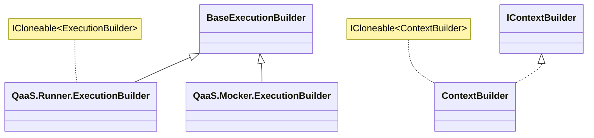
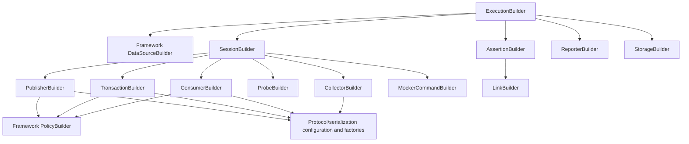

## Q11. Serialization boundaries

QaaS uses serialization in several distinct places. Loading YAML converts a configuration document into a configuration tree. Payload serialization converts an application object to bytes suitable for a chosen boundary. Response deserialization converts bytes into a selected in-memory representation. Persisted session serialization packages captured observations for later retrieval. These operations may all use familiar format names, but they serve different consumers and happen at different times. Treating “the YAML was parsed” as evidence that generated request bodies are JSON bytes confuses configuration with data. Similarly, storing a captured session does not mean the live protocol used that storage representation on the wire.

Framework defines `ISerializer.Serialize(object?) -> byte[]?` and `IDeserializer.Deserialize(byte[]?, Type?) -> object?`. The optional target type belongs to deserialization, not to an ordinary cast. Both factories switch over `SerializationType`: `Binary`, `Json`, `MessagePack`, `Xml`, `Yaml`, `ProtobufMessage`, and `XmlElement`. A null enum produces a null serializer/deserializer; an unsupported nonnull enum value throws. A caller must decide how null affects its pipeline, commonly meaning that no transformation is configured. It is not safe to write `BuildSerializer(null)!.Serialize(...)` and expect a pass-through implementation. [SerializerFactory](https://github.com/TheSmokeTeam/QaaS.Framework/blob/daa83a2b7ddcba5142760fc42833486219efd1ba/QaaS.Framework.Serialization/SerializerFactory.cs#L16) and [DeserializerFactory](https://github.com/TheSmokeTeam/QaaS.Framework/blob/daa83a2b7ddcba5142760fc42833486219efd1ba/QaaS.Framework.Serialization/DeserializerFactory.cs#L17) are the selection points.

`DataSource` demonstrates the distinction clearly. Its serializer and deserializer properties reject simultaneous nonnull values. Its specific deserialization target requires an actual deserializer. `Retrieve` asks the generator for a sequence, rejects a null generated sequence, then optionally transforms each body while preserving metadata. For serialization it chooses `data.MetaData?.Serializer ?? _serializer`; for deserialization it uses the analogous override. These per-item overrides are evaluated inside the configured transformation branch: a metadata serializer is not independently invoked when the entire data source has no serializer branch active. That detail matters when a user attaches an override but sees no transformation. [Retrieve](https://github.com/TheSmokeTeam/QaaS.Framework/blob/daa83a2b7ddcba5142760fc42833486219efd1ba/QaaS.Framework.SDK/DataSourceObjects/DataSource.cs#L98) is the definitive flow.

Deserialization in that method first requires each body to be `byte[]` or null. A string that happens to contain JSON is still a string and fails this check; it must be encoded to bytes or generated in the expected representation. The supplied target type then controls materialization where the selected format supports it. Serializer implementations are not identical: JSON, XML, protobuf, and binary formats have different type requirements and representations. Choosing a format by name alone does not establish that an arbitrary object round-trips. Metadata itself also enforces that serializer and deserializer overrides are mutually exclusive.

The following author-written C# sketch illustrates the format boundary; it has not been compiled as part of this answer:

```csharp
var serializer = SerializerFactory.BuildSerializer(SerializationType.Json)!;
var deserializer = DeserializerFactory.BuildDeserializer(SerializationType.Json)!;
byte[]? bytes = serializer.Serialize(new Message { Value = 7 });
var restored = (Message?)deserializer.Deserialize(bytes, typeof(Message));

public sealed class Message { public int Value { get; set; } }
```

This example illustrates the API and should be tested against the selected package version when used in a real project. By contrast, `CastObjectData<Message>` assumes the in-memory body is already compatible with `Message`; it does not parse `bytes`. If serialized bytes are passed to a JSON serializer a second time, the resulting body represents the byte array according to that serializer rather than the original application object. The appropriate diagnostic is to inspect the body's runtime type and transformation history at each boundary, not to add another serializer until a request succeeds.

Protocols expose serialization expectations through `GetSerializationType`, or separate input/output methods for a transactor. Typed protocol factories choose adapters; Runner actions combine those adapters with their payload and save iterators. A publisher can send a serialized value while logging an original value with a returned timestamp. Persisted `SerializedDetailedData` derives from `DetailedData<byte[]>` and adds optional `SpecificTypeConfig`, while serialized communication/session records preserve the surrounding structure. This is why a stored byte array needs both format/type information and the action/session envelope to be useful later. The exact storage conversion must be traced in Runner's serializer and storage code rather than inferred from `CommunicationData.SerializationType` alone.

The current `Binary` implementation is specifically `BinaryFormatter`, not a generic safe “raw byte” serializer. The project targets .NET 10, enables its compatibility flag, and references `System.Runtime.Serialization.Formatters`. This is a real compatibility and trust-boundary consideration for a QaaS maintainer: Microsoft's ordinary runtime implementation was removed starting with .NET 9, and the compatibility package retains the known risks. A correct curriculum should identify the actual implementation and migration implications rather than recommend it for arbitrary untrusted payloads. See [Binary deserializer](https://github.com/TheSmokeTeam/QaaS.Framework/blob/daa83a2b7ddcba5142760fc42833486219efd1ba/QaaS.Framework.Serialization/Deserializers/Binary.cs#L10), its project file, and [Microsoft's migration guide](https://learn.microsoft.com/en-us/dotnet/standard/serialization/binaryformatter-migration-guide/).

The architecture demonstrates Strategy through interchangeable serializer contracts, Factory through enum selection, and Adapter at protocol boundaries. The inferred benefit is that domain hooks can manipulate objects while communication and persistence choose representations independently. That separation only works when metadata, target types, and ownership of transformations remain explicit. Good verification covers null bodies, null factory selection, wrong target type, non-byte deserialization, double serialization, metadata overrides, and one stored-session round trip. [Microsoft's serialization overview](https://learn.microsoft.com/en-us/dotnet/standard/serialization/) is conceptual background; the source determines QaaS-specific behavior.

Lazy enumeration adds a second axis to these boundaries: when the transformation actually executes. DataSource.Retrieve builds LINQ projections for serialization and deserialization. In lazy mode it returns the sequence, so an invalid body can fail when a consumer advances the enumerator rather than when Retrieve returns. In non-lazy mode ToList materializes and caches the transformed results. A later retrieval can return the cached objects without invoking the generator again. Thus a stack trace appearing inside an action's iteration may originate in a generator or serializer configured much earlier.

A useful investigation writes down four checkpoints for one message: the generator's body type, the value handed to the protocol, the captured assertion-facing body, and the restored body after storage. Record the configured transformation and specific target type beside each checkpoint. If a JSON response becomes a generic JSON representation instead of the expected domain class, inspect the output deserializer's target type before changing the assertion cast. If stored evidence differs from live evidence, inspect session serialization rather than the transport client. This procedure follows the actual separation of responsibilities and avoids treating every format-related failure as the same bug.

## Q12. Extension methods and lookups

An extension function is identified by its declaration, not its folder or class name. The traditional form is a static method with a `this` receiver parameter; this snapshot also uses C# extension blocks for context and logging helpers. Conversely, `GetFilteredConfigurationObjectList` is an ordinary static utility despite living in `EnumerableExtensions`, and `FileSystemExtensions.MakeValidDirectoryName` is not an extension method. A complete source inventory must include private/internal functions and overloads if “all” is taken literally, while distinguishing the public API a hook author can call. The declaration inventory accompanying this answer includes 66 functions/overloads found across the Framework production source, with their visibility and source locations; ordinary static neighbors are discussed separately.

The SDK lookup group supplies completed-session `GetSessionDataByName`, `GetInputByName`, `GetOutputByName`, and the Try variants for input/output; communication `GetCommunicationDataByName`; running-session input/output methods and `GetRunningCommunicationDataByName`; and data-source `GetDataSourceByName`. Most named lookups require exactly one match and throw `ArgumentException` for missing or duplicate matches. The Try variants catch that exception, so false can mean duplicate data as well as missing data. These are stronger semantics than `FirstOrDefault`, which can silently hide a duplicate. `GetDataByIoMatchIndex`, however, intentionally selects the first matching item and only rejects absence. The helper's contract—not a universal convention—determines ambiguity behavior.

The conversion group includes `CastObjectData`, `CastToObjectData`, `CastObjectDetailedData`, `CastToObjectDetailedData`, `CastCommunicationData`, `RetrieveAndCast`, `FilterData`, and `CloneDetailed`. Casts preserve surrounding envelope fields while changing the generic body view; they do not deserialize bytes. `CloneDetailed` adds/preserves a timestamp around an existing data envelope and is not the deep builder cloner. `FilterData` applies body/timestamp/metadata selection for captured observations. `AsSingle` checks a sequence with an enumerator, requiring precisely one element. It should not be replaced with a full `Count()` plus another enumeration when generators may be lazy or have side effects.

Context helpers construct a metadata dictionary path from case/execution identity and retrieve metadata from that path. `LoadConfigurationSectionIntoGlobalDictionary` projects a configuration section into the global dictionary. Logging helpers add hostname/environment enrichers or metadata-bearing logs at Information, Warning, Error, Critical, Debug, and Trace levels. Actual consumers include Runner context initialization calling `GetMetaDataPath`, Framework `DataSourceBuilder` retrieving metadata and debug-logging it, and Runner session completion using metadata information logging. Not every helper has a current production consumer in the inspected repos; the lack of one should be recorded rather than inventing a callsite.

Configuration extensions cover YAML source registration, placeholder-resolver registration, reference expansion, enriched building, shift-left collapse, binding, validation, rendering back to YAML, dictionary conversion, partial merging, and three update overloads. Internal/private extensions implement flattened key/value collection construction, list/dictionary recognition and conversion, instance/default creation, and local validation. These are the mechanics behind Q7/Q8/Q22. Infrastructure contributes the two public timezone conversion methods and one private daylight-saving helper. Protocols adds the S3-storage-class enum conversion. Executions contributes `AddQaaSElasticSink`. Policies and Providers add no extension declarations in this inventory; their ordinary classes and methods still participate in the runtime.

Verified production examples make the inventory useful. `FromSessionDataDataSources.Generate` in Common.Generators uses completed-session and input/output name helpers. `DelayByAverage` in Common.Assertions uses the Try input/output lookups. Common assertions use data-source lookup and `AsSingle` when selecting expected data. `HttpProtocol` converts detailed data to an object envelope; Runner `Collector` filters captured data; `BaseSqlProtocol` uses timestamp conversion and `CloneDetailed`; `S3Protocol` maps the storage enum. ContextBuilder consumes YAML/reference/enriched-building extensions, binding utilities call their internal conversion helpers, and BaseReporter renders configuration as YAML. These are concrete examples with different lifecycles, not interchangeable calls on a generic “test object.”

Named assertion lookup requires special care. Framework `IAssertionResult` is an empty marker interface, so `context.ExecutionData.AssertionResults.Single(x => x.Name == name)` is not a valid expression on that interface. Runner's concrete `AssertionResult` holds an `Assertion` object, and that object has its configured name. At the builder level the public `Assertions` collection contains `AssertionBuilder` instances; Runner's `ConfigurationExtensions` filters names/categories, while `ExecutionBuilder.UpdateAssertion`/`RemoveAssertion` mutate configured entries. There is no verified Framework `GetAssertionByName` extension to invent. An author-written query can be explicit (this C# sketch has not been compiled as part of this answer):

```csharp
var configured = executionBuilder.Assertions!.Single(a => a.Name == "output-valid");
var result = context.ExecutionData.AssertionResults
    .OfType<QaaS.Runner.Assertions.AssertionObjects.AssertionResult>()
    .Single(r => r.Assertion.Name == "output-valid");

var session = sessions.GetSessionDataByName("orders");
var output = session.GetOutputByName("read-orders");
```

These queries deliberately demand uniqueness. `OfType` also makes the Runner dependency explicit; a generic SDK-only hook should not quietly take that dependency merely to inspect a marker. A developer needing cross-executable assertion-result metadata should discuss an appropriate SDK contract instead of assuming it exists. [IAssertionResult](https://github.com/TheSmokeTeam/QaaS.Framework/blob/daa83a2b7ddcba5142760fc42833486219efd1ba/QaaS.Framework.SDK/AssertionObjects/IAssertionResult.cs#L3), [Runner AssertionResult](https://github.com/TheSmokeTeam/QaaS.Runner/blob/0b184ee3c9f6111bc6aca070f0c6f9c9bfd8283f/QaaS.Runner.Assertions/AssertionObjects/AssertionResult.cs#L9), and [Runner selection extensions](https://github.com/TheSmokeTeam/QaaS.Runner/blob/0b184ee3c9f6111bc6aca070f0c6f9c9bfd8283f/QaaS.Runner/Extensions/ConfigurationExtensions.cs#L104) support this distinction.

The pattern connection is Facade-like convenience over data structures, with Iterator semantics important for retrieval and selection. Extension syntax does not grant access to another assembly's private state or change virtual dispatch into a plugin mechanism. The design reasoning is that common lookup, projection, and diagnostic behavior is centralized without enlarging every record with runtime methods. That is an inference from usage, not an assertion that every utility was designed under a named pattern. [Microsoft's extension-members guide](https://learn.microsoft.com/en-us/dotnet/csharp/programming-guide/classes-and-structs/extension-methods) supplies the language rules. The inventory and actual callsites should be refreshed when the pinned source changes.

An effective field guide should also teach the reader to choose the receiver before searching by method name. Completed SessionData and RunningSessionData represent different moments in the lifecycle; their similarly named input/output helpers do not make a completed result into a streaming reader. CommunicationData identifies one action's observations, whereas a single DetailedData item is one observation inside that group. Start with the object actually available in the hook, identify its generic body type, then choose the matching extension. This avoids adding casts solely to make a familiar helper compile. It also exposes when the desired information belongs to Runner's concrete result model rather than the shared SDK contract.

### Q12 declaration inventory and usage map

Scope: production C# in the pinned Framework tree, including public, internal, and private extension declarations. Usage search covers the pinned Framework/Runner/Mocker and current four Common repositories, excluding generated build outputs and tests. A listed source is one representative callsite, not every use. Overloads sharing a name require checking the receiver and signature at that callsite; signatures below disambiguate the declarations. Framework uses both receiver parameters and extension blocks.

| Extension declaration | Definition | Representative production use / status |
|---|---|---|
| `public static IConfiguration CollapseShiftLeftArrowsInConfiguration(this IConfiguration configuration)` | [ConfigurationCollapseParser:16](https://github.com/TheSmokeTeam/QaaS.Framework/blob/daa83a2b7ddcba5142760fc42833486219efd1ba/QaaS.Framework.Configurations/ConfigurationCollapseParser.cs#L16) | [ConfigurationUtils.cs:260](https://github.com/TheSmokeTeam/QaaS.Framework/blob/daa83a2b7ddcba5142760fc42833486219efd1ba/QaaS.Framework.Configurations/ConfigurationUtils.cs#L260) |
| `public static TConfiguration UpdateConfiguration<TConfiguration>( this TConfiguration? currentConfiguration, TConfiguration incomingConfiguration)` | [ConfigurationUpdateExtensions:36](https://github.com/TheSmokeTeam/QaaS.Framework/blob/daa83a2b7ddcba5142760fc42833486219efd1ba/QaaS.Framework.Configurations/ConfigurationUpdateExtensions.cs#L36) | [ConfigurationUpdateExtensions.cs:96](https://github.com/TheSmokeTeam/QaaS.Framework/blob/daa83a2b7ddcba5142760fc42833486219efd1ba/QaaS.Framework.Configurations/ConfigurationUpdateExtensions.cs#L96) |
| `public static TConfiguration UpdateConfiguration<TConfiguration>( this TConfiguration? currentConfiguration, object incomingConfiguration)` | [ConfigurationUpdateExtensions:88](https://github.com/TheSmokeTeam/QaaS.Framework/blob/daa83a2b7ddcba5142760fc42833486219efd1ba/QaaS.Framework.Configurations/ConfigurationUpdateExtensions.cs#L88) | [ConfigurationUpdateExtensions.cs:96](https://github.com/TheSmokeTeam/QaaS.Framework/blob/daa83a2b7ddcba5142760fc42833486219efd1ba/QaaS.Framework.Configurations/ConfigurationUpdateExtensions.cs#L96) |
| `public static IConfiguration UpdateConfiguration( this IConfiguration? currentConfiguration, object incomingConfiguration)` | [ConfigurationUpdateExtensions:144](https://github.com/TheSmokeTeam/QaaS.Framework/blob/daa83a2b7ddcba5142760fc42833486219efd1ba/QaaS.Framework.Configurations/ConfigurationUpdateExtensions.cs#L144) | [ConfigurationUpdateExtensions.cs:96](https://github.com/TheSmokeTeam/QaaS.Framework/blob/daa83a2b7ddcba5142760fc42833486219efd1ba/QaaS.Framework.Configurations/ConfigurationUpdateExtensions.cs#L96) |
| `public static string BuildConfigurationAsYaml(this IConfiguration configuration, List<string>? configurationSectionNames = null)` | [ConfigurationUtils:30](https://github.com/TheSmokeTeam/QaaS.Framework/blob/daa83a2b7ddcba5142760fc42833486219efd1ba/QaaS.Framework.Configurations/ConfigurationUtils.cs#L30) | [BaseReporter.cs:85](https://github.com/TheSmokeTeam/QaaS.Runner/blob/0b184ee3c9f6111bc6aca070f0c6f9c9bfd8283f/QaaS.Runner.Assertions/Reporters/BaseReporter.cs#L85) |
| `internal static Dictionary<string, string?> GetInMemoryCollectionFromObject( this Dictionary<string, string?> inMemoryCollection, object value, string? parentKey = null, BindingFlags bindingAttr = BindingFlags.Instance \| BindingFlags.Public)` | [ConfigurationUtils:69](https://github.com/TheSmokeTeam/QaaS.Framework/blob/daa83a2b7ddcba5142760fc42833486219efd1ba/QaaS.Framework.Configurations/ConfigurationUtils.cs#L69) | [ConfigurationUpdateExtensions.cs:177](https://github.com/TheSmokeTeam/QaaS.Framework/blob/daa83a2b7ddcba5142760fc42833486219efd1ba/QaaS.Framework.Configurations/ConfigurationUpdateExtensions.cs#L177) |
| `public static TConfiguration LoadAndValidateConfiguration<TConfiguration>(this IConfiguration configuration, BinderOptions? binderOptions = null, ILogger? logger = null)` | [ConfigurationUtils:202](https://github.com/TheSmokeTeam/QaaS.Framework/blob/daa83a2b7ddcba5142760fc42833486219efd1ba/QaaS.Framework.Configurations/ConfigurationUtils.cs#L202) | [ExecuteLoader.cs:92](https://github.com/TheSmokeTeam/QaaS.Runner/blob/0b184ee3c9f6111bc6aca070f0c6f9c9bfd8283f/QaaS.Runner/Loaders/ExecuteLoader.cs#L92) |
| `public static IConfiguration EnrichedBuild(this IConfigurationBuilder configurationBuilder, bool addEnvironmentVariables)` | [ConfigurationUtils:243](https://github.com/TheSmokeTeam/QaaS.Framework/blob/daa83a2b7ddcba5142760fc42833486219efd1ba/QaaS.Framework.Configurations/ConfigurationUtils.cs#L243) | [ContextBuilder.cs:268](https://github.com/TheSmokeTeam/QaaS.Framework/blob/daa83a2b7ddcba5142760fc42833486219efd1ba/QaaS.Framework.SDK/ContextObjects/ContextBuilder.cs#L268) |
| `internal static IConfiguration EnrichedBuild(this IConfigurationBuilder configurationBuilder, bool addEnvironmentVariables, bool preserveUnresolvedPlaceholders)` | [ConfigurationUtils:250](https://github.com/TheSmokeTeam/QaaS.Framework/blob/daa83a2b7ddcba5142760fc42833486219efd1ba/QaaS.Framework.Configurations/ConfigurationUtils.cs#L250) | [ContextBuilder.cs:268](https://github.com/TheSmokeTeam/QaaS.Framework/blob/daa83a2b7ddcba5142760fc42833486219efd1ba/QaaS.Framework.SDK/ContextObjects/ContextBuilder.cs#L268) |
| `public static T BindToObject<T>(this IConfiguration source, BinderOptions binderOptions, ILogger? logger = null)` | [ConfigurationUtils:278](https://github.com/TheSmokeTeam/QaaS.Framework/blob/daa83a2b7ddcba5142760fc42833486219efd1ba/QaaS.Framework.Configurations/ConfigurationUtils.cs#L278) | [ConfigurationUpdateExtensions.cs:117](https://github.com/TheSmokeTeam/QaaS.Framework/blob/daa83a2b7ddcba5142760fc42833486219efd1ba/QaaS.Framework.Configurations/ConfigurationUpdateExtensions.cs#L117) |
| `public static object BindToObject(this IConfiguration source, Type objectType, BinderOptions binderOptions, ILogger? logger = null)` | [ConfigurationUtils:287](https://github.com/TheSmokeTeam/QaaS.Framework/blob/daa83a2b7ddcba5142760fc42833486219efd1ba/QaaS.Framework.Configurations/ConfigurationUtils.cs#L287) | [ConfigurationUpdateExtensions.cs:117](https://github.com/TheSmokeTeam/QaaS.Framework/blob/daa83a2b7ddcba5142760fc42833486219efd1ba/QaaS.Framework.Configurations/ConfigurationUpdateExtensions.cs#L117) |
| `private static IDictionary ConvertConfigurationListToDictionaryWithIndexesAsKeys(this IList list, Type dictType, BinderOptions binderOptions, ILogger? logger, string parentPath = "")` | [ConfigurationUtils:563](https://github.com/TheSmokeTeam/QaaS.Framework/blob/daa83a2b7ddcba5142760fc42833486219efd1ba/QaaS.Framework.Configurations/ConfigurationUtils.cs#L563) | [ConfigurationUtils.cs:530](https://github.com/TheSmokeTeam/QaaS.Framework/blob/daa83a2b7ddcba5142760fc42833486219efd1ba/QaaS.Framework.Configurations/ConfigurationUtils.cs#L530) |
| `private static bool TryValidateObject(this object obj, ref List<ValidationResult> results, BindingFlags bindingFlags)` | [ValidationUtils:95](https://github.com/TheSmokeTeam/QaaS.Framework/blob/daa83a2b7ddcba5142760fc42833486219efd1ba/QaaS.Framework.Configurations/ValidationUtils.cs#L95) | [ValidationUtils.cs:34](https://github.com/TheSmokeTeam/QaaS.Framework/blob/daa83a2b7ddcba5142760fc42833486219efd1ba/QaaS.Framework.Configurations/ValidationUtils.cs#L34) |
| `public static LoggerConfiguration AddQaaSElasticSink( this LoggerConfiguration configuration, string? elasticUri = null, string? username = null, string? password = null, Action<string>? warningLogger = null)` | [ExecutionLogging:102](https://github.com/TheSmokeTeam/QaaS.Framework/blob/daa83a2b7ddcba5142760fc42833486219efd1ba/QaaS.Framework.Executions/ExecutionLogging.cs#L102) | [BaseLoader.cs:60](https://github.com/TheSmokeTeam/QaaS.Framework/blob/daa83a2b7ddcba5142760fc42833486219efd1ba/QaaS.Framework.Executions/Loaders/BaseLoader.cs#L60) |
| `public static DateTime ConvertDateTimeToUtcByTimeZoneOffset( this DateTime timeToConvertToUtc, int insertionTimeTimeZoneOffsetSummerTime, bool? isDayLightSavingTime = null, string? timeZoneId = null)` | [DateTimeExtensions:19](https://github.com/TheSmokeTeam/QaaS.Framework/blob/daa83a2b7ddcba5142760fc42833486219efd1ba/QaaS.Framework.Infrastructure/DateTimeExtensions.cs#L19) | [BaseSqlProtocol.cs:78](https://github.com/TheSmokeTeam/QaaS.Framework/blob/daa83a2b7ddcba5142760fc42833486219efd1ba/QaaS.Framework.Protocols/Protocols/BaseSqlProtocol.cs#L78) |
| `public static DateTime ConvertDateTimeFromUtcToTimeZoneByTimeZoneOffset( this DateTime utcTimeToConvert, int timeZoneOffsetSummerTime, bool? isDayLightSavingTime = null, string? timeZoneId = null)` | [DateTimeExtensions:46](https://github.com/TheSmokeTeam/QaaS.Framework/blob/daa83a2b7ddcba5142760fc42833486219efd1ba/QaaS.Framework.Infrastructure/DateTimeExtensions.cs#L46) | [BaseSqlProtocol.cs:98](https://github.com/TheSmokeTeam/QaaS.Framework/blob/daa83a2b7ddcba5142760fc42833486219efd1ba/QaaS.Framework.Protocols/Protocols/BaseSqlProtocol.cs#L98) |
| `private static bool IsDayLightSavingTimeInGivenDateTime(this DateTime dateTime, string? timeZoneId = null)` | [DateTimeExtensions:65](https://github.com/TheSmokeTeam/QaaS.Framework/blob/daa83a2b7ddcba5142760fc42833486219efd1ba/QaaS.Framework.Infrastructure/DateTimeExtensions.cs#L65) | [DateTimeExtensions.cs:25](https://github.com/TheSmokeTeam/QaaS.Framework/blob/daa83a2b7ddcba5142760fc42833486219efd1ba/QaaS.Framework.Infrastructure/DateTimeExtensions.cs#L25) |
| `public static CommunicationData<TData> GetCommunicationDataByName<TData> (this IEnumerable<CommunicationData<TData>>? communicationDataEnumerable, string communicationDataName, string? communicationDataType = null)` | [CommunicationDataExtensions:23](https://github.com/TheSmokeTeam/QaaS.Framework/blob/daa83a2b7ddcba5142760fc42833486219efd1ba/QaaS.Framework.SDK/Extensions/CommunicationDataExtensions.cs#L23) | [SessionDataExtensions.cs:46](https://github.com/TheSmokeTeam/QaaS.Framework/blob/daa83a2b7ddcba5142760fc42833486219efd1ba/QaaS.Framework.SDK/Extensions/SessionDataExtensions.cs#L46) |
| `public static CommunicationData<TCastTo> CastCommunicationData<TCastTo>(this CommunicationData<object> communicationData, string? communicationDataType = null)` | [CommunicationDataExtensions:50](https://github.com/TheSmokeTeam/QaaS.Framework/blob/daa83a2b7ddcba5142760fc42833486219efd1ba/QaaS.Framework.SDK/Extensions/CommunicationDataExtensions.cs#L50) | [ValidateHermeticMetricsByInputOutputPercentage.cs:39](https://github.com/TheSmokeTeam/QaaS.Common.Assertions/blob/9deeec0e049fef1de4e7ae6488f268adda2881fc/QaaS.Common.Assertions/Hermetic/ValidateHermeticMetricsByInputOutputPercentage.cs#L39) |
| `public static DetailedData<TData> GetDataByIoMatchIndex<TData>(this CommunicationData<TData> communicationData, int ioMatchIndex)` | [CommunicationDataExtensions:81](https://github.com/TheSmokeTeam/QaaS.Framework/blob/daa83a2b7ddcba5142760fc42833486219efd1ba/QaaS.Framework.SDK/Extensions/CommunicationDataExtensions.cs#L81) | No production consumer identified in inspected Framework/Runner/Mocker/Common source; public availability is not evidence of current use. |
| `public List<string> GetMetaDataPath()` | [ContextExtensions:9](https://github.com/TheSmokeTeam/QaaS.Framework/blob/daa83a2b7ddcba5142760fc42833486219efd1ba/QaaS.Framework.SDK/Extensions/ContextExtensions.cs#L9) | [ExecutionBuilder.cs:960](https://github.com/TheSmokeTeam/QaaS.Runner/blob/0b184ee3c9f6111bc6aca070f0c6f9c9bfd8283f/QaaS.Runner/ExecutionBuilder.cs#L960) |
| `public MetaDataConfig GetMetaDataFromContext()` | [ContextExtensions:20](https://github.com/TheSmokeTeam/QaaS.Framework/blob/daa83a2b7ddcba5142760fc42833486219efd1ba/QaaS.Framework.SDK/Extensions/ContextExtensions.cs#L20) | [DataSourceBuilder.cs:330](https://github.com/TheSmokeTeam/QaaS.Framework/blob/daa83a2b7ddcba5142760fc42833486219efd1ba/QaaS.Framework.SDK/DataSourceObjects/DataSourceBuilder.cs#L330) |
| `public static void LoadConfigurationSectionIntoGlobalDictionary<TExecutionData>( this BaseContext<TExecutionData> context, string configurationSectionPath, List<string>? destinationPath = null)` | [ContextGlobalDictionaryExtensions:19](https://github.com/TheSmokeTeam/QaaS.Framework/blob/daa83a2b7ddcba5142760fc42833486219efd1ba/QaaS.Framework.SDK/Extensions/ContextGlobalDictionaryExtensions.cs#L19) | No production consumer identified in inspected Framework/Runner/Mocker/Common source; public availability is not evidence of current use. |
| `public static Data<TCasted> CastObjectData<TCasted>(this Data<object> data)` | [DataExtensions:17](https://github.com/TheSmokeTeam/QaaS.Framework/blob/daa83a2b7ddcba5142760fc42833486219efd1ba/QaaS.Framework.SDK/Extensions/DataExtensions.cs#L17) | [DataSourceExtensions.cs:50](https://github.com/TheSmokeTeam/QaaS.Framework/blob/daa83a2b7ddcba5142760fc42833486219efd1ba/QaaS.Framework.SDK/Extensions/DataSourceExtensions.cs#L50) |
| `public static Data<object> CastToObjectData<TData>(this Data<TData> data)` | [DataExtensions:40](https://github.com/TheSmokeTeam/QaaS.Framework/blob/daa83a2b7ddcba5142760fc42833486219efd1ba/QaaS.Framework.SDK/Extensions/DataExtensions.cs#L40) | No production consumer identified in inspected Framework/Runner/Mocker/Common source; public availability is not evidence of current use. |
| `public static DetailedData<TCasted> CastObjectDetailedData<TCasted>(this DetailedData<object> detailedData)` | [DataExtensions:55](https://github.com/TheSmokeTeam/QaaS.Framework/blob/daa83a2b7ddcba5142760fc42833486219efd1ba/QaaS.Framework.SDK/Extensions/DataExtensions.cs#L55) | [CommunicationDataExtensions.cs:62](https://github.com/TheSmokeTeam/QaaS.Framework/blob/daa83a2b7ddcba5142760fc42833486219efd1ba/QaaS.Framework.SDK/Extensions/CommunicationDataExtensions.cs#L62) |
| `public static DetailedData<object> CastToObjectDetailedData<TData>(this DetailedData<TData> detailedData)` | [DataExtensions:80](https://github.com/TheSmokeTeam/QaaS.Framework/blob/daa83a2b7ddcba5142760fc42833486219efd1ba/QaaS.Framework.SDK/Extensions/DataExtensions.cs#L80) | [HttpProtocol.cs:92](https://github.com/TheSmokeTeam/QaaS.Framework/blob/daa83a2b7ddcba5142760fc42833486219efd1ba/QaaS.Framework.Protocols/Protocols/HttpProtocol.cs#L92) |
| `public static DetailedData<TData> FilterData<TData>(this DetailedData<TData> dataItemToFilter, DataFilter dataFilter)` | [DataExtensions:93](https://github.com/TheSmokeTeam/QaaS.Framework/blob/daa83a2b7ddcba5142760fc42833486219efd1ba/QaaS.Framework.SDK/Extensions/DataExtensions.cs#L93) | [Collector.cs:80](https://github.com/TheSmokeTeam/QaaS.Runner/blob/0b184ee3c9f6111bc6aca070f0c6f9c9bfd8283f/QaaS.Runner.Sessions/Actions/Collectors/Collector.cs#L80) |
| `public static DataSource GetDataSourceByName (this IEnumerable<DataSource>? dataSourceEnumerable, string dataSourceName)` | [DataSourceExtensions:20](https://github.com/TheSmokeTeam/QaaS.Framework/blob/daa83a2b7ddcba5142760fc42833486219efd1ba/QaaS.Framework.SDK/Extensions/DataSourceExtensions.cs#L20) | [BaseOutputContentByExpectedResults.cs:155](https://github.com/TheSmokeTeam/QaaS.Common.Assertions/blob/9deeec0e049fef1de4e7ae6488f268adda2881fc/QaaS.Common.Assertions/ContentLogic/BaseOutputContentByExpectedResults.cs#L155) |
| `public static IEnumerable<Data<TCastTo>> RetrieveAndCast<TCastTo> (this DataSource dataSource, IImmutableList<SessionData>? ranSessionsDataList = null)` | [DataSourceExtensions:43](https://github.com/TheSmokeTeam/QaaS.Framework/blob/daa83a2b7ddcba5142760fc42833486219efd1ba/QaaS.Framework.SDK/Extensions/DataSourceExtensions.cs#L43) | No production consumer identified in inspected Framework/Runner/Mocker/Common source; public availability is not evidence of current use. |
| `public static TItem AsSingle<TItem>(this IEnumerable<TItem> enumerable)` | [EnumerableExtensions:17](https://github.com/TheSmokeTeam/QaaS.Framework/blob/daa83a2b7ddcba5142760fc42833486219efd1ba/QaaS.Framework.SDK/Extensions/EnumerableExtensions.cs#L17) | [BaseOutputContentByExpectedResults.cs:41](https://github.com/TheSmokeTeam/QaaS.Common.Assertions/blob/9deeec0e049fef1de4e7ae6488f268adda2881fc/QaaS.Common.Assertions/ContentLogic/BaseOutputContentByExpectedResults.cs#L41) |
| `public static LoggerConfiguration WithHostname(this LoggerEnrichmentConfiguration enrichmentConfiguration)` | [LoggingExetentions:16](https://github.com/TheSmokeTeam/QaaS.Framework/blob/daa83a2b7ddcba5142760fc42833486219efd1ba/QaaS.Framework.SDK/Extensions/LoggingExetentions.cs#L16) | [ExecutionLogging.cs:128](https://github.com/TheSmokeTeam/QaaS.Framework/blob/daa83a2b7ddcba5142760fc42833486219efd1ba/QaaS.Framework.Executions/ExecutionLogging.cs#L128) |
| `public static LoggerConfiguration WithEnvironment(this LoggerEnrichmentConfiguration enrichmentConfiguration)` | [LoggingExetentions:27](https://github.com/TheSmokeTeam/QaaS.Framework/blob/daa83a2b7ddcba5142760fc42833486219efd1ba/QaaS.Framework.SDK/Extensions/LoggingExetentions.cs#L27) | [ExecutionLogging.cs:129](https://github.com/TheSmokeTeam/QaaS.Framework/blob/daa83a2b7ddcba5142760fc42833486219efd1ba/QaaS.Framework.Executions/ExecutionLogging.cs#L129) |
| `public void LogInformationWithMetaData(string message, object metadata, params object?[] propertyValues)` | [LoggingExetentions:44](https://github.com/TheSmokeTeam/QaaS.Framework/blob/daa83a2b7ddcba5142760fc42833486219efd1ba/QaaS.Framework.SDK/Extensions/LoggingExetentions.cs#L44) | [Session.cs:291](https://github.com/TheSmokeTeam/QaaS.Runner/blob/0b184ee3c9f6111bc6aca070f0c6f9c9bfd8283f/QaaS.Runner.Sessions/Session/Session.cs#L291) |
| `public void LogWarningWithMetaData(string message, object metadata, params object?[] propertyValues)` | [LoggingExetentions:58](https://github.com/TheSmokeTeam/QaaS.Framework/blob/daa83a2b7ddcba5142760fc42833486219efd1ba/QaaS.Framework.SDK/Extensions/LoggingExetentions.cs#L58) | No production consumer identified in inspected Framework/Runner/Mocker/Common source; public availability is not evidence of current use. |
| `public void LogErrorWithMetaData(string message, object metadata, params object?[] propertyValues)` | [LoggingExetentions:72](https://github.com/TheSmokeTeam/QaaS.Framework/blob/daa83a2b7ddcba5142760fc42833486219efd1ba/QaaS.Framework.SDK/Extensions/LoggingExetentions.cs#L72) | No production consumer identified in inspected Framework/Runner/Mocker/Common source; public availability is not evidence of current use. |
| `public void LogCriticalWithMetaData(string message, object metadata, params object?[] propertyValues)` | [LoggingExetentions:86](https://github.com/TheSmokeTeam/QaaS.Framework/blob/daa83a2b7ddcba5142760fc42833486219efd1ba/QaaS.Framework.SDK/Extensions/LoggingExetentions.cs#L86) | No production consumer identified in inspected Framework/Runner/Mocker/Common source; public availability is not evidence of current use. |
| `public void LogDebugWithMetaData(string message, object metadata, params object?[] propertyValues)` | [LoggingExetentions:100](https://github.com/TheSmokeTeam/QaaS.Framework/blob/daa83a2b7ddcba5142760fc42833486219efd1ba/QaaS.Framework.SDK/Extensions/LoggingExetentions.cs#L100) | [DataSourceBuilder.cs:328](https://github.com/TheSmokeTeam/QaaS.Framework/blob/daa83a2b7ddcba5142760fc42833486219efd1ba/QaaS.Framework.SDK/DataSourceObjects/DataSourceBuilder.cs#L328) |
| `public void LogTraceWithMetaData(string message, object metadata, params object?[] propertyValues)` | [LoggingExetentions:114](https://github.com/TheSmokeTeam/QaaS.Framework/blob/daa83a2b7ddcba5142760fc42833486219efd1ba/QaaS.Framework.SDK/Extensions/LoggingExetentions.cs#L114) | No production consumer identified in inspected Framework/Runner/Mocker/Common source; public availability is not evidence of current use. |
| `public static RunningCommunicationData<TData> GetRunningCommunicationDataByName<TData> (this IEnumerable<RunningCommunicationData<TData>>? runningCommunicationDataEnumerable, string runningCommunicationDataName, string? runningCommunicationDataType = null)` | [RunningCommunicationDataExtensions:22](https://github.com/TheSmokeTeam/QaaS.Framework/blob/daa83a2b7ddcba5142760fc42833486219efd1ba/QaaS.Framework.SDK/Extensions/RunningCommunicationDataExtensions.cs#L22) | [RunningSessionDataExtensions.cs:19](https://github.com/TheSmokeTeam/QaaS.Framework/blob/daa83a2b7ddcba5142760fc42833486219efd1ba/QaaS.Framework.SDK/Extensions/RunningSessionDataExtensions.cs#L19) |
| `public static RunningCommunicationData<TInput> GetInputByName<TInput, TOutput>( this RunningSessionData<TInput, TOutput>? runningSessionData, string inputName)` | [RunningSessionDataExtensions:17](https://github.com/TheSmokeTeam/QaaS.Framework/blob/daa83a2b7ddcba5142760fc42833486219efd1ba/QaaS.Framework.SDK/Extensions/RunningSessionDataExtensions.cs#L17) | No production consumer identified in inspected Framework/Runner/Mocker/Common source; public availability is not evidence of current use. |
| `public static RunningCommunicationData<TOutput> GetOutputByName<TInput, TOutput>( this RunningSessionData<TInput, TOutput>? runningSessionData, string outputName)` | [RunningSessionDataExtensions:31](https://github.com/TheSmokeTeam/QaaS.Framework/blob/daa83a2b7ddcba5142760fc42833486219efd1ba/QaaS.Framework.SDK/Extensions/RunningSessionDataExtensions.cs#L31) | No production consumer identified in inspected Framework/Runner/Mocker/Common source; public availability is not evidence of current use. |
| `public static GenericSessionData<TInput, TOutput> GetSessionDataByName<TInput, TOutput> (this IEnumerable<GenericSessionData<TInput, TOutput>>? sessionDataEnumerable, string sessionName)` | [SessionDataExtensions:20](https://github.com/TheSmokeTeam/QaaS.Framework/blob/daa83a2b7ddcba5142760fc42833486219efd1ba/QaaS.Framework.SDK/Extensions/SessionDataExtensions.cs#L20) | [FromSessionDataDataSources.cs:33](https://github.com/TheSmokeTeam/QaaS.Common.Generators/blob/d83116a58052000aab9d4503a1f8da9fc7230973/QaaS.Common.Generators/FromDataSourcesGenerators/FromSessionDataDataSources.cs#L33) |
| `public static CommunicationData<TInput> GetInputByName<TInput, TOutput> (this GenericSessionData<TInput, TOutput>? sessionData, string inputName)` | [SessionDataExtensions:43](https://github.com/TheSmokeTeam/QaaS.Framework/blob/daa83a2b7ddcba5142760fc42833486219efd1ba/QaaS.Framework.SDK/Extensions/SessionDataExtensions.cs#L43) | [FromSessionDataDataSources.cs:42](https://github.com/TheSmokeTeam/QaaS.Common.Generators/blob/d83116a58052000aab9d4503a1f8da9fc7230973/QaaS.Common.Generators/FromDataSourcesGenerators/FromSessionDataDataSources.cs#L42) |
| `public static bool TryGetInputByName<TInput, TOutput>(this GenericSessionData<TInput, TOutput>? sessionData, string inputName, out CommunicationData<TInput>? inputValue)` | [SessionDataExtensions:58](https://github.com/TheSmokeTeam/QaaS.Framework/blob/daa83a2b7ddcba5142760fc42833486219efd1ba/QaaS.Framework.SDK/Extensions/SessionDataExtensions.cs#L58) | [DelayByAverage.cs:35](https://github.com/TheSmokeTeam/QaaS.Common.Assertions/blob/9deeec0e049fef1de4e7ae6488f268adda2881fc/QaaS.Common.Assertions/Delay/DelayByAverage.cs#L35) |
| `public static CommunicationData<TOutput> GetOutputByName<TInput, TOutput> (this GenericSessionData<TInput, TOutput>? sessionData, string outputName)` | [SessionDataExtensions:82](https://github.com/TheSmokeTeam/QaaS.Framework/blob/daa83a2b7ddcba5142760fc42833486219efd1ba/QaaS.Framework.SDK/Extensions/SessionDataExtensions.cs#L82) | [BaseOutputContentByExpectedResults.cs:42](https://github.com/TheSmokeTeam/QaaS.Common.Assertions/blob/9deeec0e049fef1de4e7ae6488f268adda2881fc/QaaS.Common.Assertions/ContentLogic/BaseOutputContentByExpectedResults.cs#L42) |
| `public static bool TryGetOutputByName<TInput, TOutput>(this GenericSessionData<TInput, TOutput>? sessionData, string outputName, out CommunicationData<TOutput>? outputValue)` | [SessionDataExtensions:97](https://github.com/TheSmokeTeam/QaaS.Framework/blob/daa83a2b7ddcba5142760fc42833486219efd1ba/QaaS.Framework.SDK/Extensions/SessionDataExtensions.cs#L97) | [DelayByAverage.cs:32](https://github.com/TheSmokeTeam/QaaS.Common.Assertions/blob/9deeec0e049fef1de4e7ae6488f268adda2881fc/QaaS.Common.Assertions/Delay/DelayByAverage.cs#L32) |
| `public static DetailedData<T> CloneDetailed<T>(this Data<T> data, DateTime? datetime = null)` | [DataExtensions:5](https://github.com/TheSmokeTeam/QaaS.Framework/blob/daa83a2b7ddcba5142760fc42833486219efd1ba/QaaS.Framework.SDK/Session/DataObjects/DataExtensions.cs#L5) | [BaseSqlProtocol.cs:91](https://github.com/TheSmokeTeam/QaaS.Framework/blob/daa83a2b7ddcba5142760fc42833486219efd1ba/QaaS.Framework.Protocols/Protocols/BaseSqlProtocol.cs#L91) |
| `public static S3StorageClass GetS3StorageClassFromEnum(this S3StorageClassEnum s3StorageClassEnum)` | [S3StorageClassEnum:71](https://github.com/TheSmokeTeam/QaaS.Framework/blob/daa83a2b7ddcba5142760fc42833486219efd1ba/QaaS.Framework.Protocols/ConfigurationObjects/S3/S3StorageClassEnum.cs#L71) | [S3Protocol.cs:137](https://github.com/TheSmokeTeam/QaaS.Framework/blob/daa83a2b7ddcba5142760fc42833486219efd1ba/QaaS.Framework.Protocols/Protocols/S3Protocol.cs#L137) |
| `internal static IDictionary<string, string?> GetInMemoryCollectionFromDictionary( this IDictionary<string, object?> dict, Dictionary<string, string?> result, string parentKey = "")` | [ConfigurationDictionaryUtils:35](https://github.com/TheSmokeTeam/QaaS.Framework/blob/daa83a2b7ddcba5142760fc42833486219efd1ba/QaaS.Framework.Configurations/ConfigurationBindingUtils/ConfigurationDictionaryUtils.cs#L35) | [ConfigurationUtils.cs:115](https://github.com/TheSmokeTeam/QaaS.Framework/blob/daa83a2b7ddcba5142760fc42833486219efd1ba/QaaS.Framework.Configurations/ConfigurationUtils.cs#L115) |
| `internal static void GetInMemoryCollectionFromList(this IList nestedList, string? parentKey, Dictionary<string, string?> result)` | [ConfigurationDictionaryUtils:77](https://github.com/TheSmokeTeam/QaaS.Framework/blob/daa83a2b7ddcba5142760fc42833486219efd1ba/QaaS.Framework.Configurations/ConfigurationBindingUtils/ConfigurationDictionaryUtils.cs#L77) | [ConfigurationUtils.cs:121](https://github.com/TheSmokeTeam/QaaS.Framework/blob/daa83a2b7ddcba5142760fc42833486219efd1ba/QaaS.Framework.Configurations/ConfigurationUtils.cs#L121) |
| `internal static IConfiguration BindToDictionaryIConfiguration( this IDictionary<string, object?> sourceDictionary)` | [ConfigurationDictionaryUtils:106](https://github.com/TheSmokeTeam/QaaS.Framework/blob/daa83a2b7ddcba5142760fc42833486219efd1ba/QaaS.Framework.Configurations/ConfigurationBindingUtils/ConfigurationDictionaryUtils.cs#L106) | [ConfigurationUtils.cs:301](https://github.com/TheSmokeTeam/QaaS.Framework/blob/daa83a2b7ddcba5142760fc42833486219efd1ba/QaaS.Framework.Configurations/ConfigurationUtils.cs#L301) |
| `internal static bool IsTypeDictionary(this Type type)` | [ConfigurationDictionaryUtils:119](https://github.com/TheSmokeTeam/QaaS.Framework/blob/daa83a2b7ddcba5142760fc42833486219efd1ba/QaaS.Framework.Configurations/ConfigurationBindingUtils/ConfigurationDictionaryUtils.cs#L119) | [ConfigurationUtils.cs:312](https://github.com/TheSmokeTeam/QaaS.Framework/blob/daa83a2b7ddcba5142760fc42833486219efd1ba/QaaS.Framework.Configurations/ConfigurationUtils.cs#L312) |
| `internal static bool IsTypeKeyValuePair(this Type type)` | [ConfigurationDictionaryUtils:126](https://github.com/TheSmokeTeam/QaaS.Framework/blob/daa83a2b7ddcba5142760fc42833486219efd1ba/QaaS.Framework.Configurations/ConfigurationBindingUtils/ConfigurationDictionaryUtils.cs#L126) | [ConfigurationUtils.cs:391](https://github.com/TheSmokeTeam/QaaS.Framework/blob/daa83a2b7ddcba5142760fc42833486219efd1ba/QaaS.Framework.Configurations/ConfigurationUtils.cs#L391) |
| `internal static IList ConvertDictionaryToListAccordingToKeys(this IDictionary<string, object> dictionary)` | [ConfigurationDictionaryUtils:132](https://github.com/TheSmokeTeam/QaaS.Framework/blob/daa83a2b7ddcba5142760fc42833486219efd1ba/QaaS.Framework.Configurations/ConfigurationBindingUtils/ConfigurationDictionaryUtils.cs#L132) | [ConfigurationUtils.cs:494](https://github.com/TheSmokeTeam/QaaS.Framework/blob/daa83a2b7ddcba5142760fc42833486219efd1ba/QaaS.Framework.Configurations/ConfigurationUtils.cs#L494) |
| `internal static bool IsTypeList(this Type type)` | [ConfigurationListUtils:32](https://github.com/TheSmokeTeam/QaaS.Framework/blob/daa83a2b7ddcba5142760fc42833486219efd1ba/QaaS.Framework.Configurations/ConfigurationBindingUtils/ConfigurationListUtils.cs#L32) | [ConfigurationUtils.cs:492](https://github.com/TheSmokeTeam/QaaS.Framework/blob/daa83a2b7ddcba5142760fc42833486219efd1ba/QaaS.Framework.Configurations/ConfigurationUtils.cs#L492) |
| `public static IConfiguration MergeConfigurationObjectIntoIConfiguration(this IConfiguration configuration, object? configurationObject)` | [ConfigurationMergeUtils:29](https://github.com/TheSmokeTeam/QaaS.Framework/blob/daa83a2b7ddcba5142760fc42833486219efd1ba/QaaS.Framework.Configurations/ConfigurationBindingUtils/ConfigurationMergeUtils.cs#L29) | [IConfigurationUtils.cs:17](https://github.com/TheSmokeTeam/QaaS.Framework/blob/daa83a2b7ddcba5142760fc42833486219efd1ba/QaaS.Framework.Configurations/ConfigurationBindingUtils/IConfigurationUtils.cs#L17) |
| `public static TConfiguration? MergeConfiguration<TConfiguration>(this TConfiguration? currentConfiguration, TConfiguration? newConfiguration)` | [ConfigurationMergeUtils:42](https://github.com/TheSmokeTeam/QaaS.Framework/blob/daa83a2b7ddcba5142760fc42833486219efd1ba/QaaS.Framework.Configurations/ConfigurationBindingUtils/ConfigurationMergeUtils.cs#L42) | [ConfigurationUpdateExtensions.cs:51](https://github.com/TheSmokeTeam/QaaS.Framework/blob/daa83a2b7ddcba5142760fc42833486219efd1ba/QaaS.Framework.Configurations/ConfigurationUpdateExtensions.cs#L51) |
| `internal static object? CreateInstance(this Type type)` | [ConfigurationTypeUtils:16](https://github.com/TheSmokeTeam/QaaS.Framework/blob/daa83a2b7ddcba5142760fc42833486219efd1ba/QaaS.Framework.Configurations/ConfigurationBindingUtils/ConfigurationTypeUtils.cs#L16) | [ConfigurationUpdateExtensions.cs:363](https://github.com/TheSmokeTeam/QaaS.Framework/blob/daa83a2b7ddcba5142760fc42833486219efd1ba/QaaS.Framework.Configurations/ConfigurationUpdateExtensions.cs#L363) |
| `internal static object? GetDefaultValue(this Type type)` | [ConfigurationTypeUtils:92](https://github.com/TheSmokeTeam/QaaS.Framework/blob/daa83a2b7ddcba5142760fc42833486219efd1ba/QaaS.Framework.Configurations/ConfigurationBindingUtils/ConfigurationTypeUtils.cs#L92) | [ConfigurationUtils.cs:485](https://github.com/TheSmokeTeam/QaaS.Framework/blob/daa83a2b7ddcba5142760fc42833486219efd1ba/QaaS.Framework.Configurations/ConfigurationUtils.cs#L485) |
| `public static IConfiguration BindConfigurationObjectToIConfiguration(this IConfiguration configuration, object? configurationObject)` | [IConfigurationUtils:16](https://github.com/TheSmokeTeam/QaaS.Framework/blob/daa83a2b7ddcba5142760fc42833486219efd1ba/QaaS.Framework.Configurations/ConfigurationBindingUtils/IConfigurationUtils.cs#L16) | [Bind.cs:19](https://github.com/TheSmokeTeam/QaaS.Framework/blob/daa83a2b7ddcba5142760fc42833486219efd1ba/QaaS.Framework.SDK/ContextObjects/Bind.cs#L19) |
| `public static Dictionary<string, object?> GetDictionaryFromConfiguration(this IConfiguration? configuration)` | [IConfigurationUtils:24](https://github.com/TheSmokeTeam/QaaS.Framework/blob/daa83a2b7ddcba5142760fc42833486219efd1ba/QaaS.Framework.Configurations/ConfigurationBindingUtils/IConfigurationUtils.cs#L24) | [ConfigurationUtils.cs:37](https://github.com/TheSmokeTeam/QaaS.Framework/blob/daa83a2b7ddcba5142760fc42833486219efd1ba/QaaS.Framework.Configurations/ConfigurationUtils.cs#L37) |
| `public static IConfigurationBuilder AddPlaceholderResolver(this IConfigurationBuilder configurationBuilder)` | [PlaceholderConfigurationBuilderExtension:17](https://github.com/TheSmokeTeam/QaaS.Framework/blob/daa83a2b7ddcba5142760fc42833486219efd1ba/QaaS.Framework.Configurations/ConfigurationBuilderExtensions/PlaceholderConfigurationBuilderExtension.cs#L17) | No production consumer identified in inspected Framework/Runner/Mocker/Common source; public availability is not evidence of current use. |
| `public static IConfigurationBuilder AddYamlFromHttpGet(this IConfigurationBuilder builder, string yamlUrl, TimeSpan? timeout = null)` | [YamlConfigurationBuilderExtension:20](https://github.com/TheSmokeTeam/QaaS.Framework/blob/daa83a2b7ddcba5142760fc42833486219efd1ba/QaaS.Framework.Configurations/ConfigurationBuilderExtensions/YamlConfigurationBuilderExtension.cs#L20) | [YamlConfigurationBuilderExtension.cs:38](https://github.com/TheSmokeTeam/QaaS.Framework/blob/daa83a2b7ddcba5142760fc42833486219efd1ba/QaaS.Framework.Configurations/ConfigurationBuilderExtensions/YamlConfigurationBuilderExtension.cs#L38) |
| `public static IConfigurationBuilder AddYaml(this IConfigurationBuilder builder, string yamlPath)` | [YamlConfigurationBuilderExtension:33](https://github.com/TheSmokeTeam/QaaS.Framework/blob/daa83a2b7ddcba5142760fc42833486219efd1ba/QaaS.Framework.Configurations/ConfigurationBuilderExtensions/YamlConfigurationBuilderExtension.cs#L33) | [ContextBuilder.cs:252](https://github.com/TheSmokeTeam/QaaS.Framework/blob/daa83a2b7ddcba5142760fc42833486219efd1ba/QaaS.Framework.SDK/ContextObjects/ContextBuilder.cs#L252) |
| `public static IConfiguration ResolveReferencesInConfiguration(this IConfiguration builtConfiguration, ICollection<ReferenceConfig>? referenceConfigs, IList<string>? referenceResolutionPaths, IList<string>? uniqueIdPathRegexes, bool resolveReferencesWithEnvironmentVariables)` | [ConfigurationReferencesParser:29](https://github.com/TheSmokeTeam/QaaS.Framework/blob/daa83a2b7ddcba5142760fc42833486219efd1ba/QaaS.Framework.Configurations/References/ConfigurationReferencesParser.cs#L29) | [ContextBuilder.cs:267](https://github.com/TheSmokeTeam/QaaS.Framework/blob/daa83a2b7ddcba5142760fc42833486219efd1ba/QaaS.Framework.SDK/ContextObjects/ContextBuilder.cs#L267) |

Ordinary static neighbors deliberately excluded from the extension count include `GetFilteredConfigurationObjectList`, `FileSystemExtensions.MakeValidDirectoryName`, `TimeZoneInfoResolver.ResolveTimeZoneInfo`, `ValidationUtils.TryValidateObjectRecursive`, and the public object-taking `GetInMemoryCollectionFromObject` overload. They remain useful APIs but have no extension receiver.

## Q13. Hook discovery

Discovery begins when `HookProvider<THook>` captures assemblies for a requested hook contract and keeps the execution context and object creator. It adds the entry assembly, assemblies already loaded into the application domain, and DLLs found in the application's base directory. Dynamic assemblies and duplicate identities are excluded. A DLL that cannot be loaded is skipped in the directory scan; failures while inspecting types are debug-logged, and `ReflectionTypeLoadException` can still contribute its successfully loaded types. This means a bad unrelated binary need not make all hook discovery fail. It also means “not found” can be caused by a dependency load failure, so the candidate list and diagnostic logs matter.

Assembly order is deterministic according to the implementation's priority and name sort. The exact priority test is a case-insensitive `Contains("QaaS")`, then `Contains("Common")`, then other names; it is not a strict namespace or filename-prefix rule. Sorting then uses assembly full/name with an ordinal-insensitive comparer. A user assembly containing QaaS in its name can therefore be in the first group. This detail is observable when simple names collide, which is why a developer should not treat the abbreviated documentation wording `QaaS.* → Common.* → user` as a complete algorithm. [Assembly discovery and ordering](https://github.com/TheSmokeTeam/QaaS.Framework/blob/daa83a2b7ddcba5142760fc42833486219efd1ba/QaaS.Framework.Providers/Providers/HookProvider.cs#L34) is the evidence.

Candidate types must be concrete classes assignable to `THook`; merely having a method called Assert or Generate is insufficient. The provider caches supported types per assembly behind a lock. That cache contains `Type[]`, not initialized hook instances. Multiple configured names using the same implementation can therefore receive separate instances and configuration. Thread-safe cache access does not make the discovered hook's mutable state safe for concurrent execution. Those are separate responsibilities, and the lifetime/consumption of each hook belongs to the executable's build and runtime flow.

Resolution first recognizes an exact type-name request using a dotted/comma-containing name and compares full or assembly-qualified names. A single exact match succeeds; multiple exact matches require stronger disambiguation, typically assembly-qualified naming. Simple-name resolution then gathers matching types across the ordered assemblies. More than one same-simple-name candidate within an individual assembly is an error asking for the full name. One candidate in each of several assemblies is resolved using the first assembly in discovery order, with an informational message listing candidates. Thus “two Checks exist” is not enough to predict failure: where they exist and how they are named in configuration determines the outcome.

After resolution, the provider calls `ByNameObjectCreator` with the resolved type's full name and its specific assembly. The creator uses `Activator.CreateInstance` with instance/public/nonpublic binding flags and the supplied constructor arguments. In the ordinary provider path there are no arguments, so a compatible parameterless constructor is needed; a constructor that requires an unprovided service is not automatically satisfied by Autofac just because the larger execution uses DI. If the constructor throws, successful type resolution has not made instantiation successful. [ByNameObjectCreator](https://github.com/TheSmokeTeam/QaaS.Framework/blob/daa83a2b7ddcba5142760fc42833486219efd1ba/QaaS.Framework.Providers/ObjectCreation/ByNameObjectCreator.cs#L17) shows the activation mechanism.

The provider then assigns `hookInstance.Context = _context`. `HooksFromProvidersLoader.LoadAndValidate` obtains each configured hook, calls its configuration-loading method, prefixes returned validation issues with contract/name/type information, aggregates them, and returns pairs of configured name and initialized hook. That configured name is an instance identity, while `hookData.Type` selects the implementation. The loader treats null validation results as an empty sequence and also accepts an actual empty list. The generic hook bases bind before validating and currently return a list. Consequently a type can be discovered and constructed correctly yet fail due to its own configuration schema.

An author-written diagnostic matrix is:

```text
No candidate: assembly absent, dependency unloadable, wrong contract, abstract type,
              or name mismatch.
Ambiguous inside one assembly: use Namespace.Check.
Same full name in different assemblies: use the assembly-qualified name.
Chosen unexpected simple name: inspect priority/order and candidate log.
Activation failure: inspect constructor availability and inner exception.
Validation failure: inspect that named instance's hook configuration and issue path.
```

For a reproducible collision test, compile two tiny assemblies, each with a concrete `Check` for the same interface, and assert both the chosen full name and the emitted diagnostic. Add two same-simple-name classes in different namespaces within one assembly to exercise the different ambiguity branch. Tests should also cover a partially loadable assembly, exact assembly-qualified selection, fresh instance creation, and concurrent cache reads. These cases verify the observed algorithm rather than merely re-stating its conditions.

The Plugin pattern explains how external behavior enters the system; the object creator is a reflective factory; context injection is lifecycle wiring rather than arbitrary constructor injection. The reasoned benefit of caching types while creating instances is to reduce repeated scanning without accidentally sharing hook execution state. The implementation supports that inference, but any broader promise of stateless or thread-safe plugins would be unfounded. See [LoadAndValidate](https://github.com/TheSmokeTeam/QaaS.Framework/blob/daa83a2b7ddcba5142760fc42833486219efd1ba/QaaS.Framework.Providers/HooksFromProvidersLoader.cs#L24) and [Microsoft's reflection documentation](https://learn.microsoft.com/en-us/dotnet/csharp/advanced-topics/reflection-and-attributes/) for the underlying runtime mechanisms.

A practical deployment example is a generator whose assembly is copied into the application directory but whose referenced library is missing. The file's presence satisfies neither successful assembly loading nor assignability to the loaded IGenerator contract. Start by identifying the actual executable base directory and the set of assemblies the provider inspected; then examine loader diagnostics and dependency versions. A second copy of a contract assembly can also complicate type identity. Matching interface names in a text editor is weaker evidence than runtime assignability to the specific contract type used by the provider.

The order of initialization explains another common mistake. The hook's constructor runs before the provider assigns Context, and configuration binding happens after instance creation. Therefore constructor code should not assume that Context or bound configuration already exists on this ordinary activation path. If initialization depends on those values, its placement must agree with the hook lifecycle rather than relying on a property being populated early by the DI container. This follows directly from the creator, assignment, and loader sequence.

Finally, configured names and CLR names solve different problems. Two entries can select the same implementation type while using different configured names and options. Renaming a configured entry can break references from data sources or assertions without changing discovery. Renaming the class can break type selection while leaving those instance references textually intact. Diagnose the first as composition/configuration identity and the second as reflection identity; that distinction makes error messages and migration instructions much more precise.

## Q14. Builder architecture

There are two different relationships to draw. Inheritance defines which API a type extends; composition describes which builders a larger builder owns or invokes. Most QaaS builders are composition peers rather than subclasses of a giant base builder. `BaseExecutionBuilder<TContext,TExecutionData>` is the genuine Framework base for Runner and Mocker execution builders. It constrains the context/execution-data types, stores `DataSources`, holds a protected context, and declares abstract `BuildDataSources` and `Build`. Runner's concrete type is `QaaS.Runner.ExecutionBuilder`, not a type named RunnerExecutionBuilder. [BaseExecutionBuilder](https://github.com/TheSmokeTeam/QaaS.Framework/blob/daa83a2b7ddcba5142760fc42833486219efd1ba/QaaS.Framework.Executions/BaseExecutionBuilder.cs#L12) and [Runner ExecutionBuilder](https://github.com/TheSmokeTeam/QaaS.Runner/blob/0b184ee3c9f6111bc6aca070f0c6f9c9bfd8283f/QaaS.Runner/ExecutionBuilder.cs#L53) establish that hierarchy.



Framework also supplies `DataSourceBuilder` and `PolicyBuilder`, both cloneable, and static command-line `ParserBuilder`/`HelpTextBuilder` utilities. `DataSourceBuilder` additionally implements `IYamlConvertible`; it stores hook selection, generator configuration, dependent data-source names/patterns, lazy behavior, and optional serialization settings. `PolicyBuilder` stores one concrete policy configuration and materializes the corresponding runtime policy. `IDomainBuilder<T>` declares `Register`, but the existence of that interface does not imply every class ending in Builder implements it. In this snapshot `DataSourceBuilder` exposes `Register` without declaring that interface. The examiner should reward the actual declaration over a neat but fictitious inheritance diagram.

Runner composition is:



The six session action families serve different roles: publishers send generated items, transactions pair requests with responses, consumers read live results, probes execute hook behavior, collectors fetch historical/windowed observations, and Mocker commands coordinate a running Mocker. `SessionBuilder` creates staged runtime actions and handles collectors separately. Partial source files for builder properties, logic, and validation compile into one class; they are not extra inheritance layers. Publisher, consumer, and transaction builders implement `IValidatableObject` through their partial declarations. `AssertionBuilder`, `ReporterBuilder`, `LinkBuilder`, and `StorageBuilder` belong to their respective projects and produce assertion/report/storage configurations or runtime products through their build paths.

Fluent methods mutate accumulated builder state and return the builder. They improve readability but do not make the builder immutable or guarantee validation after every call. Public builder setters are often restricted, with fluent APIs as the intended customization surface. `Clone` creates a branch of configuration state for reuse; it is a separate operation from `Build`. `Build` materializes an executable or runtime component from the chosen state and dependencies. `Register` on a data source creates its initial runtime identity so all sources can be known before cross-source dependencies are linked; this supports references to sources declared later in the array. Read [DataSourceBuilder.Register](https://github.com/TheSmokeTeam/QaaS.Framework/blob/daa83a2b7ddcba5142760fc42833486219efd1ba/QaaS.Framework.SDK/DataSourceObjects/DataSourceBuilder.cs#L301) with Runner's `BuildDataSources`, rather than assuming a one-pass construction order.

For a publisher trace, start with the session's `PublisherBuilder` holding its name, input source references, transport configuration, optional serialization, and policy builders. The root execution builder resolves data sources and hook instances; the session builder asks the publisher builder to materialize its runtime action. The publisher's protocol factory chooses an `ISender` or batch alternative from typed configuration, and policy builders create its stop/rate chain. At execution time the publisher iterates source data, serializes the wire-side value if configured, sends through the protocol, and records observations. None of these runtime sends occur merely because the fluent `Named` or configuration method was called.

The important patterns are Builder/Fluent Interface for staged construction, Factory for selecting runtime products, and Prototype for reusable variants. The ownership diagram resembles Composite structurally because it is a tree of composed parts, but it should not be misrepresented as a textbook Composite implementation with one uniform builder interface: these builders do not all share the same child-management or build contract. That qualification demonstrates understanding rather than pattern-name memorization. The reasoned benefits are separation of configuration from live resources, reuse across YAML/code entry points, and localized validation. Those benefits follow from the implementation; they are not evidence of every original design discussion. [Microsoft's interface guide](https://learn.microsoft.com/en-us/dotnet/csharp/fundamentals/types/interfaces) helps distinguish implementation contracts from inheritance and containment.

Reading the builder graph as two diagrams prevents several practical mistakes. An inheritance arrow means that the derived object satisfies an inherited contract and can participate where that contract is expected. A composition arrow means that one object uses or owns another part; it does not imply substitutability. A SessionBuilder cannot be supplied where an ExecutionBuilder is required merely because both are called builders. Their products, dependencies, and lifecycle responsibilities differ. The Framework base establishes common execution scaffolding, whereas action builders encapsulate the details needed to produce a particular kind of action.

Registration illustrates why construction can require multiple passes. Suppose source `orders` depends on source `customers`, which appears later in configuration. Registering all descriptors first makes both names available before the platform resolves generator dependencies. The subsequent build pass attaches the selected generator and dependent data-source collection. The resulting descriptor is mutable during this process: the implementation assigns its `Generator` and `DataSourceList` properties. Although an XML remark calls the registered descriptor immutable, the implementation does not support that claim. Immutable list interfaces used for dependencies should not be confused with an immutable descriptor object.

The split also explains what an incomplete construction state means. After registration there can be an identity that is useful for linking but not yet ready to retrieve meaningful generated data. After building, the data source has the selected behavior and dependencies. These are lifecycle phases of the same construction process, not necessarily different CLR types. A learner should trace which phase a method expects instead of assuming that obtaining any object named DataSource proves all its dependencies are ready.

Cloning raises a separate question: which state is copied and which referenced objects remain shared? The Prototype interpretation is useful because it describes making variants from an existing description, but the word Clone alone is not a guarantee of a deep copy. The relevant implementation must be read before mutating nested configuration in one branch. Similarly, a fluent return value usually allows the next call to operate on the same builder. Neither fluent syntax nor a cloneable interface promises thread safety, persistent immutable data structures, or automatic resource rollback. These qualifications make the pattern vocabulary precise enough to guide engineering decisions rather than merely decorate a class diagram.

**Published documentation:** [Execution infrastructure](https://docs.qaas.online/framework/projects/executions/). Describes the shared execution-builder contract, which must be distinguished from product-specific composition.

## Q15. Execution identity and lifetime

An execution is the runtime object that combines a context with a selected orchestration pipeline. In Runner, it contains references to data-source, session, storage, assertion, report, and template logics. Constructing it does not itself mean that tests have run. `ExecutionBuilder.Build` assembles and validates the runtime graph; `Execution.Start` selects and executes the mode-specific plan. The execution also receives an owned Autofac scope and disposes that scope when its Dispose method is called. This is a unit-of-work boundary, though some host-level services and final reporting responsibilities remain with Runner.

The plan table is concrete and should be reproduced accurately. `run` performs DataSourceLogic, SessionLogic, AssertionLogic, and ReportLogic. `act` performs DataSourceLogic, SessionLogic, and StorageLogic. `assert` performs DataSourceLogic, StorageLogic, AssertionLogic, and ReportLogic. `template` performs TemplateLogic. The ordinary run pipeline does not automatically persist evidence through StorageLogic. Likewise, assertion-only execution still includes data-source preparation because assertion hooks can consume configured data sources as well as retrieved session evidence. Template is a configuration-rendering operation in this runtime, not the `dotnet new` project-template command.

```text
Actual Runner pipeline structure, abbreviated:
run:      sources -> sessions -> assertions -> reports
act:      sources -> sessions -> store
assert:   sources -> retrieve -> assertions -> reports
template: render template
```

`ExecutionId` is an optional string carried by Context. Runner bootstrap accepts an optional execution ID on its internal creation path; RunLoader passes that into `ContextBuilder.SetExecutionId`. The SDK builder transfers the field into the resulting context. For programmatic construction, `ExecutionBuilder.SetExecutionId` stores a configured override, and InitializeContext chooses that override or the loaded context's existing ID. The examined path does not unconditionally call `Guid.NewGuid` when building an execution. Therefore the correct answer is that an execution may have a supplied ID, a reused ID, or null. Uniqueness is an upstream convention or caller responsibility, not an invariant proved by this construction code.

Case identity is separate. RunLoader can load one context or expand configured cases from filesystem or remote case sources into several contexts/builders. Each case can have a different effective configuration and `CaseName`. CaseName also participates in storage retrieval/organization. Treating ExecutionId as a filename or assuming it differentiates every case would conflate separate dimensions. The context metadata path extensions may incorporate execution/case identity, but that does not turn either field into a guaranteed globally unique database key.

Runner first builds its executions and then starts them sequentially in `StartExecutions`, adding individual exit codes. For run/assert, one Execution returns zero only when all recorded assertion statuses are Passed; otherwise it returns one. Act and template return zero on their normal completed paths. Empty assertion results satisfy the `All` predicate, so the plan itself does not enforce “at least one assertion ran.” The host can additionally experience build/runtime/cleanup failures; those are distinct from a failed assertion. It is inaccurate to flatten all process outcomes into “0 pass, 1 assertion failure, 2 any problem” without following bootstrap and lifecycle handling.

Mocker intentionally has different orchestration. `MockerRunner` builds several executions and starts each using Task.Run, waits for all, and sums their returned codes. It does not use the maximum code. Each Mocker Execution starts server logic and optional controller logic as long-running tasks. Normal non-local operation waits for those tasks. Local mode returns after a keypress, or immediately when input is redirected. The code currently has an empty Execution.Dispose, so a claim that it offers the same scope ownership and graceful shutdown guarantees as Runner would be unsupported.

Finally, a Mocker command ID is generated separately inside the Runner MockerCommand runtime with `Guid.NewGuid().ToString()`. It correlates messages and responses for one control operation; server-instance identity selects a Mocker runtime. Neither is the Runner ExecutionId. A useful diagnostic log carries the relevant identities explicitly rather than overloading one value. The inferred rationale is layered correlation: suite/case identity explains why work exists, execution context organizes one runtime pipeline, and command correlation identifies an exchange across process boundaries. Verify these distinctions by creating two builders with the same supplied ID, multiple cases, and separate commands, then observing which values remain shared and which differ.

For example, imagine two cases, small-order and large-order, loaded under one externally supplied build identifier. Both execution contexts can retain that identifier while their case names and effective configurations differ. A log query using only ExecutionId can intentionally group the whole invocation, but a diagnostic that needs one case must also include CaseName. Conversely, constructing a fresh Execution object with the same supplied ID does not prove that it is a retry of the previous object. Retry meaning belongs to the caller's policy; the runtime field is correlation data rather than an enforced uniqueness or replay mechanism.

The object lifetime and the evidence lifetime are also distinct. Disposing Runner's execution scope releases tracked execution services; it does not imply that files already written by act disappear. Stored evidence can outlive the host process and be loaded by an independently constructed assert execution. Live channels, in-memory hook state, and the original service scope do not accompany that serialized evidence. This is why assertion-only workflows need enough saved data and compatible configuration to reconstruct the relevant analysis without relying on a still-running producer.

When diagnosing exit codes, record the individual execution result before interpreting the host's sum. Two failing Runner cases can produce an aggregate that numerically resembles a different status convention, even though each case simply returned one. Likewise, an empty assertion collection passes the All check without proving meaningful coverage. These are observable aggregation and collection semantics, so a surrounding automation should distinguish successful process completion from evidence that the expected cases and assertions actually ran.

**Source evidence:** [Runner execution plans](https://github.com/TheSmokeTeam/QaaS.Runner/blob/0b184ee3c9f6111bc6aca070f0c6f9c9bfd8283f/QaaS.Runner/Execution.cs#L34), [context initialization](https://github.com/TheSmokeTeam/QaaS.Runner/blob/0b184ee3c9f6111bc6aca070f0c6f9c9bfd8283f/QaaS.Runner/ExecutionBuilder.cs#L923), [Mocker runner](https://github.com/TheSmokeTeam/QaaS.Mocker/blob/c3aa787b2db6d4c796b0ec6625af16799150e5ec/QaaS.Mocker/MockerRunner.cs#L86). Background: [Autofac lifetime](https://docs.autofac.org/en/latest/lifetime/).

## Q16. Composing an execution

The actual Runner root class is `QaaS.Runner.ExecutionBuilder`, extending `BaseExecutionBuilder<InternalContext, ExecutionData>` and implementing the cloneable contract. “Composition root” describes its responsibility: it converts selected configuration into cooperating runtime objects and establishes their shared execution context. It is not merely a YAML parser, nor does Build itself execute the session/assertion pipeline. YAML loading, fluent configuration, and discovered configurators can all contribute to the builder before the runtime graph is assembled.

Build begins with InitializeContext. This selects logger, case name, execution ID, root configuration, live-session store, and global values, and installs metadata plus configured variables. It then creates a child Autofac scope through LoadContextScopeDependencies and records that scope for build-time resolution. The scope registers context services, named hook metadata/loading, and orchestration logic types. Registration describes how services will resolve; it should not be confused with eagerly executing every hook at the instant a registration statement is encountered. Resolution/materialization points determine when configured hooks and runtime objects actually exist.

Inside the protected build block, filtering first selects assertion and session configuration according to names/categories and assertion dependencies. The builder then stores the rendered effective configuration template, validates configured sections, and deduplicates validation results. If validation has produced issues, it formats a diagnostic that includes execution identity, case, and configuration paths, logs it, and throws `InvalidConfigurationsException`. Consequently, template capture, validation paths, and selection interact: debugging should inspect the effective selected configuration rather than only the original YAML text. Validation is broader than successful CLR binding because cross-field rules and nested builder state must also be checked.

After validation, the current order materializes data sources, sessions, storages, assertions, and reporters into lists. That sequence matters when describing current code; an old diagram claiming a separate final `BuildLinks()` pass is not a substitute for reading this method. Assertion construction receives configured links, while reporter construction creates the reporting implementations separately. Materialization with ToList avoids repeatedly enumerating deferred builder projections and inadvertently reconstructing hook-backed runtime objects when they are supplied to multiple logic constructors. BuildDataSources creates DataSource runtime objects and resolves configured generator relationships; the later DataSourceLogic/run and retrieval paths govern data use. Building a source is not equivalent to proving every lazy item has already been generated.

```text
Pseudocode summary of Runner Build, omitting diagnostics:
initialize context
scope = register context, hooks, and logic services
try:
    filter selected configuration
    capture rendered configuration
    validate and reject errors
    sources, sessions, stores, assertions, reports = build once
    resolve logics with those concrete collections
    return Execution(context, logics, ownedScope=scope)
catch:
    dispose scope
    rethrow
```

The logic services are resolved using TypedParameter values for the already-built collections, with other constructor dependencies supplied by Autofac. Finally, the builder returns an Execution containing the resolved logics and scope. The failure branch disposes the scope and clears the build-scope reference. Successful ownership passes to Execution.Dispose. This separation allows the host to publish queued ReportPortal information before disposing execution services. It also makes scope lifetime a correctness concern, not just an implementation detail.

Mocker has a related but distinct composition graph. Its ExecutionBuilder creates a child hook scope, recursively validates its configuration and custom cross-object rules, builds sources, builds stubs using resolved `ITransactionProcessor` hooks, resolves the configured Server/Servers shape, builds a server or CompositeServer, and optionally builds a controller over that server's state. It then constructs ServerLogic, TemplateLogic, optional ControllerLogic, and an Execution. Unlike Runner, the shown Mocker Execution does not own and dispose the child scope; its Dispose method is empty. Similar architectural vocabulary does not prove identical resource management.

Builder/Fluent Interface explains accumulating configuration through methods. Factory explains selecting concrete protocol, server, serializer, storage, or stub implementations. Pipeline explains the ordered runtime logics and request transformation steps. Plugin explains runtime discovery of external hooks. Prototype explains Clone, but a clone must be assessed by which references and mutable collections it copies. A clone is not automatically a new identity, fresh external connection, or deep isolation of every object stored in a global dictionary. Likewise, calling Build again can interact with filtering, validation state, retained scopes, and shared inputs; one should not infer safe reuse solely from the method's public visibility.

The inferred design rationale is to concentrate wiring and validation at an explicit boundary so actions and hooks can focus on their narrower responsibilities. The cost is a large, behaviorally important builder that warrants integration-level construction tests. A useful test chooses two differently configured hooks, a selected session and assertion, and one storage, then verifies they share the intended context, are built once, are omitted when filtered, and release owned resources after failure. That tests the composition contract rather than duplicating property setters.

A useful way to read the composition root is to trace one configured generator all the way through it. The hook record identifies its configured name, implementation type, and configuration. Provider-backed resolution creates and configures the hook. Data-source construction then associates a source descriptor with that generator, and the resulting collection is passed into the execution's logic. Later retrieval invokes generation with available evidence. Each transition answers a different question: which implementation, which configured instance, which data-source dependency, and when data is produced. Collapsing these transitions into a single Build call hides the likely cause of a missing or incorrectly configured source.

Filtering is likewise an operation on the composition inputs rather than a late instruction to ignore arbitrary runtime objects. To explain why a session is missing, inspect the selected builder collections before looking at Session.Run. To explain why an assertion has no expected input, compare its links with the retained session configuration and eventual saved results. Successful construction establishes that a graph was assembled under the current checks; it does not prove that an external service will respond correctly or that assertions will pass.

These boundaries suggest focused debugging checkpoints: immediately after context initialization, after selection, after validation, and after runtime collections materialize. At each checkpoint inspect one concrete identity and dependency rather than dumping an entire context indiscriminately. The sequence is directly supported by Build; using it as a debugging workflow is a practical recommendation inferred from that sequence.

**Source evidence:** [Runner Build](https://github.com/TheSmokeTeam/QaaS.Runner/blob/0b184ee3c9f6111bc6aca070f0c6f9c9bfd8283f/QaaS.Runner/ExecutionBuilder.cs#L1108), [Mocker Build](https://github.com/TheSmokeTeam/QaaS.Mocker/blob/c3aa787b2db6d4c796b0ec6625af16799150e5ec/QaaS.Mocker/ExecutionBuilder.cs#L664). Background: [deferred execution](https://learn.microsoft.com/en-us/dotnet/standard/linq/deferred-execution-lazy-evaluation).

## Q17. Session scheduling and completion

A session has a configuration lifecycle followed by a runtime lifecycle. `SessionBuilder` stores the name, session stage, optional `RunUntilStage`, save-data flag, timing settings, action builders, and action-stage settings. Its internal Build method constructs publishers, transactions, consumers, probes, mocker commands, and collectors. Action builders can contribute construction failures to a failure collection and return null; the session builder filters those null runtime objects out. It transfers accumulated failures into a concurrent bag used during execution. The staged action families are then grouped by their action-stage numbers. Collectors are retained separately because they require the completed session's time interval.

`BuildStages` creates a Stage for each action-stage number that actually has an action. An explicit `StageConfig` supplies before/after timing when present; otherwise the Stage constructor defaults apply. An empty timing configuration is not itself proof that a runnable action stage exists. This is composition: the session owns a graph of runtime objects assembled by peer builders. It is not a class-inheritance tree in which every action is derived from a session builder.

At runtime `Session.RunAsync` first applies the before-session delay and records a start timestamp. It registers a `RunningSessionData` object in the context. For every stage it exports actions' live communication data and prepares source-backed actions with available data sources and previously materialized session results. Notice that preparation occurs for all stages before the stage-start loop. This matters for reasoning about what “previous results” means: a later action stage does not automatically trigger a fresh preparation pass after every preceding stage completes.

The critical scheduling detail is the difference between ordered starts and completion barriers. Session loops over action stages ordered by number, awaiting each `Stage.RunAsync`. However, Stage.RunAsync starts the action tasks, creates a `Task.WhenAll` completion task used for a logging continuation, waits any configured after-stage delay, and returns the list of action tasks. It does not await their completion before returning. Thus actions from stage 1 can still run when stage 2 starts. The session collects all returned tasks and only then awaits the combined collection. A learner who draws a mandatory completion barrier between every action stage has described a different implementation.

```text
Illustrative timing, not a guarantee about durations:
session begins
  prepare all action data and live channels
  start action stage 1 ---- action A continues ------------+
  stage delay                                              |
  start action stage 2 ---- action B continues -----+       |
  await all accumulated action tasks <-------------+-------+
  determine session end time
  run collectors using [session start, session end]
  materialize SessionData; clean up; after-session delay
```

Once all staged tasks have completed, the session captures the end timestamp. It gives collectors that interval, launches their tasks using the same action-task wrapper, and awaits them. Collectors' execution time is therefore not simply identical to the interval they collect evidence about. `CreateSessionData` constructs named inputs, outputs, normalized action failures, and session start/end times. For an input, it reuses the internal communication record through a record copy that stamps the action name; outputs are materialized into separate public communication records and null output entries are removed. This preserves direction and serialization information while presenting the assertion-facing data shape.

Cleanup lives in `finally`: task objects and session actions/collectors are disposed through a helper that logs disposal failures, and the running session is removed from the context. The after-session delay happens afterward on the successful control path. `SaveData=false` does not mean “do not run the actions” or “disable live communication.” The runtime still executes and prepares a session result, but returns null instead of exposing that result to later saved-session consumers. Downstream code therefore must distinguish absence of retained evidence from absence of activity.

Above this lies a second scheduling layer, `SessionLogic`. It groups entire sessions by `SessionStage` in numeric order. Sessions without `RunUntilStage` are materialized before progressing beyond their stage. A deferred session starts in its own stage but its result is withheld until its configured target stage, where the logic waits before starting that stage. If that target stage never appears, the final drain still waits and appends the result. This prevents silently dropping deferred evidence, but it does not make a missing target stage a useful explicit synchronization point.

The inferred rationale combines overlap with stable evidence visibility: producers and listeners may need to coexist, while later sessions should see results only at designated boundaries. Verify it with a slow action in stage 1, a fast action in stage 2, a collector recording the chosen interval, and a deferred session whose target is absent. Those observations distinguish the actual scheduling model from diagrammatic assumptions.

Use a concrete listener-and-producer example to reason about action stages. A consumer starts listening in the first action stage, and a publisher starts in a later action stage after a configured delay. Because the earlier stage returns its running tasks, the consumer can still be active when the publisher sends. That overlap may be exactly what the scenario requires. However, the delay is only a timing choice; it does not prove that an external subscription has completed its handshake or that a service is ready. If readiness matters, the scenario needs an observable coordination mechanism appropriate to its actions and infrastructure.

Now consider an assertion that requires completed evidence. Starting the publisher does not make its eventual output immediately available in the completed session list. During activity, running communication channels serve the live view. Completed SessionData is materialized after the required work and collectors finish. This is why session preparation, live observation, and later assertion evaluation cannot be collapsed into one generic “get the results” operation. Each happens at a different boundary and offers different guarantees about completeness.

Failures also have a lifecycle. A build-time action failure can mean no runtime action was created for that configured entry. A runtime failure belongs to work that did start. Cleanup failures are logged during disposal and should not automatically be interpreted as the original business assertion failure. The session carries accumulated action failures into its result so later consumers can inspect them, but the investigator must still distinguish their origins. When a named action appears absent from the evidence, examine construction failures before assuming its protocol silently returned no messages.

The outer session-stage scheduler is useful for a different reason than the inner action-stage scheduler. It determines when a session's completed evidence becomes visible to later work, including deferred sessions controlled by RunUntilStage. Keeping the two numeric stage concepts distinct avoids an ambiguous statement such as “stage two waits for stage one.” The correct answer names the scheduler and the exact awaited tasks. A diagram showing action launches, the aggregate join, collectors, result publication, and cleanup gives enough information to explain an actual race or missing observation. A diagram containing only ordered stage boxes does not.

**Source evidence:** [Session runtime](https://github.com/TheSmokeTeam/QaaS.Runner/blob/0b184ee3c9f6111bc6aca070f0c6f9c9bfd8283f/QaaS.Runner.Sessions/Session/Session.cs#L80), [action Stage](https://github.com/TheSmokeTeam/QaaS.Runner/blob/0b184ee3c9f6111bc6aca070f0c6f9c9bfd8283f/QaaS.Runner.Sessions/Session/Stage.cs#L84), [session orchestration](https://github.com/TheSmokeTeam/QaaS.Runner/blob/0b184ee3c9f6111bc6aca070f0c6f9c9bfd8283f/QaaS.Runner/Logics/SessionLogic.cs#L79). Background: [Task-based programming](https://learn.microsoft.com/en-us/dotnet/standard/parallel-programming/task-based-asynchronous-programming).

**Published documentation:** [SDK session and live-data contracts](https://docs.qaas.online/framework/projects/sdk/). Provides background on the result and running-session objects; the cited Runner methods determine exact scheduling.

## Q18. Capturing and restoring results

Result capture begins inside the action, well before persistence. A transaction creates an `InternalCommunicationData<object>` result containing input/output collections and their serialization interpretation. As each protocol call completes, it retains the original request body with the protocol input timestamp, adds a matching index, optionally deserializes the output, applies configured input/output data filters, and appends the evidence. It locks the respective final-result lists while adding from concurrent workers. In parallel, it adds the same captured data to live communication structures used by other running actions. These are different consumers of evidence: one supports ongoing observation; the other becomes the completed session result.

The live path uses `RunningCommunicationData`, including a blocking collection, a queue, and a cancellation source. Successful completion calls CompleteAdding on the transaction's input/output collections. Failure handling in the action wrapper cancels the relevant live communication tokens. Completion and cancellation are not interchangeable: completion means no further items will arrive; cancellation tells interested consumers to stop waiting because the producing activity failed or was cancelled. The final session data remains a separate materialized view. A consumer that only inspects final SessionData cannot assume it is observing a live stream.

After all staged work and collectors finish, `Session.CreateSessionData` builds the public session result with name, timestamps, normalized failures, inputs, and outputs. Inputs reuse the internal communication record through a record copy with the action name set; output records are materialized separately, preserving output serialization type and excluding null entries. The group name is the action name, while the enclosing SessionData has the session name. A transaction's matching indexes are evidence for pairing requests and responses; simply zipping input and output positions is unsafe if operations finish out of order or responses are absent.

```text
Pseudocode evidence path:
source object -> transport request -> protocol result
            -> filtered detailed input/output + matching metadata
            -> live communication channels
            -> completed SessionData
act         -> BaseStorage serialization -> filesystem/S3 bytes
assert      -> retrieve bytes -> SessionData deserialization
            -> selected assertion inputs
```

Capture is not persistence. The run plan executes sessions, assertions, and reports without StorageLogic. The act plan writes evidence; the assert plan retrieves it. Session `SaveData=false` causes the session to return null even though actions ran and live data existed. BaseStorage filters null session entries before writing. Consequently, an assertion-only run cannot recover evidence that the act execution deliberately did not retain. Data filters can also reduce the body or metadata available later; storage cannot restore fields already removed during capture.

BaseStorage provides a Template Method structure: it implements common selection, name validation, serialization, and deserialization, while concrete storage implementations provide byte write/read operations. Store validates that session names exist, derives normalized JSON filenames, detects case-insensitive filename collisions before writing, and serializes with Framework `SessionDataSerialization`. This common serialization path matters because object-typed bodies need more careful round-tripping than a casual `JsonSerializer.Deserialize<object>` assumption. Transport serialization converts a request or response for a protocol; session-data serialization preserves the structured evidence container for later analysis. They operate at different boundaries and can coexist in the same workflow.

FileSystemStorage resolves the configured directory using case handling, anchors relative paths to the working directory, creates needed directories, and writes serialized files. Retrieval finds configured matching files recursively and reads their bytes; a missing directory yields no session data after logging. S3 implements the same storage abstraction with another backend. Shared act/assert configuration therefore must identify the intended backend, case, and location, and the assertion environment must be able to interpret the preserved evidence. ExecutionId alone does not prove that the correct case data will be selected.

StorageLogic adds another rule when several stores return the same session name: it retains the first session already retrieved and logs a warning for later duplicates. That is a precedence decision, not a merge of communication lists. Different backend enumeration orders or stale data can therefore affect which evidence wins. During act, every configured store receives the retained session list. Storage failures are not automatically equivalent to an assertion false result; they occur in a different execution phase and must be diagnosed accordingly.

A meaningful round-trip test uses a session containing a binary body, a structured body, metadata, timestamps, two out-of-order transaction pairs, and a recorded failure. Store it, retrieve it in a fresh context, then assert the supported body representations, group names, direction-specific serialization types, matching indexes, timestamps, and failures. Add a null session and two names that normalize to the same filename to exercise exclusion and rejection. The inferred design rationale is reproducible separation of costly system interaction from repeatable assertion analysis; reproducibility depends on preserving the evidence semantics, not merely producing parseable JSON.

Consider a transaction that sends requests A and B concurrently, receives B first, and receives no response for A. Completed input evidence can contain both requests while output evidence contains only B. A positional zip would pair the wrong observations or silently lose A. The matching metadata is the intended correlation aid; assertions should also check unmatched inputs according to the domain's expectations. Persisting the two lists faithfully does not correct a later pairing algorithm that ignores that metadata. Capture, persistence, and interpretation each have an independent responsibility.

Similarly, a successful live consumer does not prove that an assert-only invocation can reproduce its view. Live collections expose observations during activity and carry completion/cancellation information. A stored SessionData is a finished snapshot. If an assertion needs a body removed by an action's filter, the snapshot cannot invent it. If a session returns null because SaveData is false, changing storage providers cannot recover that omitted result. Debug the earliest point where required evidence disappears before investigating backend serialization.

A reproducible storage workflow should retain the effective case configuration alongside an understanding of the expected saved session names. When duplicate names appear across stores, the first-wins behavior means that a second backend is not automatically a fallback for individual missing fields inside the first result. It contributes only sessions not already selected by name. This is a concrete consequence of StorageLogic's loop, and it should influence how a team partitions archived evidence and diagnoses stale assertion inputs.

**Source evidence:** [transaction capture](https://github.com/TheSmokeTeam/QaaS.Runner/blob/0b184ee3c9f6111bc6aca070f0c6f9c9bfd8283f/QaaS.Runner.Sessions/Actions/Transactions/Transaction.cs), [storage template](https://github.com/TheSmokeTeam/QaaS.Runner/blob/0b184ee3c9f6111bc6aca070f0c6f9c9bfd8283f/QaaS.Runner.Storage/BaseStorage.cs#L25), [storage orchestration](https://github.com/TheSmokeTeam/QaaS.Runner/blob/0b184ee3c9f6111bc6aca070f0c6f9c9bfd8283f/QaaS.Runner/Logics/StorageLogic.cs#L24). Background: [System.Text.Json](https://learn.microsoft.com/en-us/dotnet/standard/serialization/system-text-json/overview).

## Q19. Assertions, reports, and exit codes

The assertion runtime converts selected evidence and a hook outcome into a reportable result. It is separate from the action runtime that produced the evidence and from the reporter that presents it. `AssertionLogic.Run` first snapshots the execution's session data and data sources into immutable lists, runs configured assertions with Parallel.ForEach, collects their results in a ConcurrentBag, then appends the results to ExecutionData. The immutable lists stabilize collection membership for that phase; they do not prove that every object reachable from each element is deeply immutable. Hook implementations must still avoid unsafe shared mutation.

Inside `Assertion.Execute`, null session entries are excluded and missing data-source input becomes an empty immutable list. The assertion filters sessions and data sources using configured exact names and patterns, combining those selections with Union. These selected collections become the arguments to the hook. This is the second selection boundary after configuration filtering: one controls which sessions execute, and this one controls what evidence one assertion receives. They should be investigated separately when an assertion appears to see the wrong data.

The hook returns a boolean, but the boolean is not always the final status. If the hook explicitly sets `AssertionStatus`, that value overrides the boolean; otherwise true maps to Passed and false maps to Failed. If the hook invocation throws, the runtime records the exception and uses Broken. The catch surrounds the hook invocation, not every possible earlier configuration-selection operation, so it is imprecise to say “every failure anywhere in assertion execution becomes Broken.” A missing/invalid selection can fail before that boundary. A strong answer identifies the actual try/catch region.

```text
Actual status decision, expressed as pseudocode:
try:
    boolean = hook.Assert(selectedSessions, selectedSources)
    status = hook.AssertionStatus ?? (boolean ? Passed : Failed)
catch hookException:
    status = Broken
    record hookException
flaky = any selected session has action failures
```

Flakiness is computed independently from the primary status. If selected sessions contain action failures, the result carries a Flaky object with normalized reasons. A hook may still return true and yield Passed while that result is marked flaky. Conversely, a hook may return false without any session action failure. Therefore “a session action failed” is not automatically the same as “this assertion has Failed status.” This separation allows a hook's business decision and the reliability of the evidence-producing workflow to be represented together. The rationale is inferred from the data model and code rather than a blanket promise that every downstream reporter displays these dimensions identically.

The assertion result also includes duration and links. Duration combines hook stopwatch time with the summed durations of selected sessions; if sessions overlap, that is not necessarily the wall-clock duration of the whole run. Links are produced from selected session time ranges. Configuration controls whether session evidence, logs, attachments, templates, traces, and severity are included or displayed. These are presentation/evidence-retention choices, not definitions of truth. Omitting an attachment cannot turn a failed assertion into a passed one.

`ReportLogic` first matches a result against each reporter's concrete implementation type using the assertion's ReporterTypes. It then checks whether the assertion status belongs to StatusesToReport. Only results satisfying both gates reach `WriteTestResults`. A result excluded from every reporter still exists in ExecutionData and still participates in the execution exit-code decision. This is why inspecting a dashboard alone may not explain a failing process: the relevant result might be filtered out of reporting. The inverse also matters: publishing successfully says nothing about whether the assertion passed.

Allure writes the local report artifacts through its reporter implementation. ReportPortal reporting is passive during ReportLogic: results are queued locally, while Runner owns pre-execution validation and later publication. Runner prepares ReportPortal before the first relevant execution, and cleanup publishes queued results before disposing execution scopes. Reporting has its own potential failure paths; one must read the lifecycle handling before claiming every publication problem is harmless. The repository's prose and the current implementation should be distinguished when they disagree.

At the execution layer, run/assert return zero only if all results are Passed, otherwise one. Explicit non-Passed statuses therefore affect the code even when the hook returned true. An empty list satisfies All and produces zero on this path. Runner sums per-execution codes while starting executions sequentially, so the whole-run result is not just one assertion's status. Build, runtime, and cleanup exceptions belong to additional host lifecycle paths. A useful test matrix covers true/default status, false/default status, true/explicit non-Passed status, thrown hook, Passed-plus-flaky, and reporter-excluded failure. That demonstrates the separation between execution correctness, evidence reliability, report eligibility, and process outcome.

A concrete diagnostic walkthrough makes these distinctions easier to apply. Suppose a transaction times out, its wrapper records an action failure, and an assertion checks that every available response has a valid identifier. If the response collection is empty, a careless implementation using only `All` may return true. The engine does not infer the missing business requirement: it can produce Passed with flakiness attached. A stronger assertion explicitly checks the required population before checking each member. That is a hook-level requirement decision, not a reason to reinterpret the engine's Boolean mapping. It also explains why a passing status should be investigated alongside selected evidence and normalized failures.

Now suppose the assertion explicitly sets a non-Passed status while returning true, and the selected reporter accepts only Passed results. There are three observable facts: the hook returned true, the recorded status was not Passed, and the reporter received no matching result. The process outcome must be explained from the recorded status rather than either of the other observations. To debug it, inspect selection, the hook's status property, the resulting AssertionResult, reporter type matching, then the status filter. This order follows the transformations in the code and avoids changing report settings to conceal a test failure. **Design rationale, inferred:** keeping truth, evidence quality, and presentation in separate fields lets consumers answer different questions without losing the original outcome; it also requires users to inspect more than a single dashboard color.

**Source evidence:** [assertion evaluation](https://github.com/TheSmokeTeam/QaaS.Runner/blob/0b184ee3c9f6111bc6aca070f0c6f9c9bfd8283f/QaaS.Runner.Assertions/AssertionObjects/Assertion.cs#L62), [report routing](https://github.com/TheSmokeTeam/QaaS.Runner/blob/0b184ee3c9f6111bc6aca070f0c6f9c9bfd8283f/QaaS.Runner/Logics/ReportLogic.cs#L30), [Runner publication lifecycle](https://github.com/TheSmokeTeam/QaaS.Runner/blob/0b184ee3c9f6111bc6aca070f0c6f9c9bfd8283f/QaaS.Runner/Runner.cs#L224). Background: [exception handling](https://learn.microsoft.com/en-us/dotnet/csharp/fundamentals/exceptions/exception-handling).

## Q20. The Mocker request lifecycle

Mocker assembles a runtime that receives traffic and delegates response behavior to configured processor hooks. The layers are distinct: a transport server owns listening/routing, a server action associates an endpoint operation with a transaction stub, the stub applies body conversion and invokes a processor, and the processor implements domain behavior. A stub name is therefore not necessarily an HTTP path or a processor type name. Several configured actions can refer to reusable response behavior, while runtime control can change an action's active stub through the server-state abstraction.

Construction starts in Mocker ExecutionBuilder. It registers generator and transaction-processor hook definitions in a child scope, validates the builder, builds data-source objects, and asks StubFactory/StubsLogic to construct stubs with those sources and resolved processor instances. It resolves the configured Server or Servers collection, creates server runtime objects, and optionally creates a controller over the server state. The custom validation requires one of Server or Servers and rejects both together. For multiple servers it also rejects action names duplicated case-insensitively across the collection, which is important because the combined control state addresses actions by name.

The ServerFactory switch is authoritative about transport support in this snapshot: Http, Grpc, and Socket. It constructs one concrete server when there is one configuration or a CompositeServer when there are several. Framework having Kafka/RabbitMQ client protocols does not imply that Mocker's server factory implements those listener types. Security variants belong to the corresponding transport configuration; one should inspect their concrete configuration and host code rather than inventing extra ServerType values from documentation prose.

Once routing selects an action's stub, `TransactionStub.Exercise` receives `Data<object>`. When a request deserializer is configured, the body must be convertible to bytes: the code accepts `byte[]`, `ReadOnlyMemory<byte>`, or a protobuf `IMessage` converted with ToByteArray. Other shapes throw. It then invokes the deserializer with an optional specific target type, retaining request metadata in the replacement Data object. This accommodates HTTP/socket transport bytes and gRPC message instances at a common stub boundary. Without a configured deserializer, the original request data proceeds to the processor.

```csharp
// Excerpt of the actual stub decision, with surrounding code omitted.
var responseData = Processor.Process(DataSourceList, requestData);
if (responseData.Body == null)
    return responseData;
```

For a non-null response body, an optional response serializer converts it to transport bytes while preserving metadata. The final check requires `responseData.Body` to be byte[]. If the processor returns an object and no serializer is configured, that check fails. If the body is null, the early return bypasses that byte-array check. This is concrete payload-shape validation; the method does not perform a generalized final DataAnnotations pass over arbitrary response objects. Transport-specific handling after Exercise must still be inspected for status codes, headers, gRPC details, and errors. It would be inaccurate to promise one uniform typed error response for every server path based only on this method.

Mocker Execution starts server logic on a task created with LongRunning and DenyChildAttach, using the default scheduler. If a controller exists, it starts its logic similarly. Non-local mode waits for all runtime tasks; a controller can remain blocked indefinitely after subscribing its handlers. Local mode waits for a key only if console input is interactive; redirected input causes the method to return immediately. Returning does not establish that every listener has received a cooperative cancellation signal. Execution.Dispose is empty in this snapshot, so graceful shutdown and child-scope cleanup are not guaranteed by that method.

CompositeServer exposes the child servers as one IServer and combines their states. It starts each child using a long-running task and waits for any child to finish. A fault is unwrapped and rethrown preserving its exception dispatch information; a normal child return is also treated as unexpected termination while the other transports should remain active. This is fail-fast detection of a stopped member, not a demonstrated coordinated stop of all siblings. A test should therefore verify both fault and normal-return behavior, and separately inspect whether remaining listeners are cleaned up.

Pipeline explains the conversion/process/conversion sequence; Factory explains concrete server selection; Composite explains presenting many servers through one interface; Plugin explains processor discovery. The inferred rationale is to isolate protocol hosting from domain response logic and expose one control surface for a multi-transport mock. However, nothing in the stub class makes a processor instance inherently stateless or thread-safe. Concurrent requests can encounter mutable processor fields, shared data sources, or external resources. A strong validation scenario sends distinguishable HTTP and gRPC requests concurrently, checks metadata and response-body conversion, injects a processor exception, and observes server behavior without assuming identical error or cleanup semantics across transports.

Consider an HTTP action and a gRPC action that both select one transaction stub. The shared stub can reuse processor behavior, but their incoming body shapes differ before deserialization. A deserializer that expects JSON bytes cannot be assumed to interpret protobuf wire bytes correctly merely because both reach a byte-array boundary. The selected deserialization type and optional specific type must match the encoding produced by the transport. On the response side, the processor can return a domain object only when the configured serializer can convert it into the bytes required by the stub. The common abstraction reduces duplicated orchestration; it does not eliminate representation contracts.

The same reasoning separates routing from runtime control. An endpoint's transport-specific route chooses an action; the action has a configured identity; its active stub chooses processing behavior. When a control command changes the stub, diagnose the action-to-stub association before rewriting the HTTP path or processor type. A useful experiment assigns distinguishable responses to two stubs, invokes the original action, switches its stub through the supported state surface, and invokes that action again. Observe an already-running request separately, because a successful update does not by itself establish a transactional barrier across all in-flight requests. **Design rationale, inferred:** separate action and stub identities permit behavior reuse and dynamic scenarios while keeping transport configuration stable. The cost is an extra mapping to verify whenever the expected processor is not invoked.

**Source evidence:** [stub pipeline](https://github.com/TheSmokeTeam/QaaS.Mocker/blob/c3aa787b2db6d4c796b0ec6625af16799150e5ec/QaaS.Mocker.Stubs/Stubs/TransactionStub.cs#L51), [server factory](https://github.com/TheSmokeTeam/QaaS.Mocker/blob/c3aa787b2db6d4c796b0ec6625af16799150e5ec/QaaS.Mocker.Servers/ServerFactory.cs#L29), [composite lifecycle](https://github.com/TheSmokeTeam/QaaS.Mocker/blob/c3aa787b2db6d4c796b0ec6625af16799150e5ec/QaaS.Mocker.Servers/Servers/CompositeServer.cs#L28), [Execution](https://github.com/TheSmokeTeam/QaaS.Mocker/blob/c3aa787b2db6d4c796b0ec6625af16799150e5ec/QaaS.Mocker/Execution.cs#L70). Background: [ASP.NET Core servers](https://learn.microsoft.com/en-us/aspnet/core/fundamentals/servers/).
